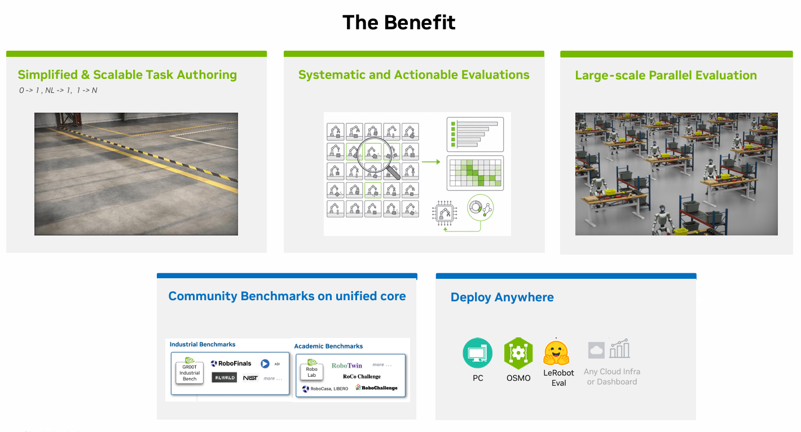

## Introduction

- The previous topic introduced the stack: community benchmarks on top of Isaac Lab-Arena, on top of Isaac Lab. 
- A stack is only useful if it changes what developers can do. 
- This topic answers a simple question: **what do I gain by using it?**

- It maps each gap from "The Gap" topic to a benefit.

| Gap | Benefit that answers it |
|-----|-------------------------|
| Repetitive manual authoring | Simplified and scalable task authoring |
| Results that are only a score | Systematic and actionable evaluations |
| Slow, one-at-a-time execution | Large-scale parallel evaluation |
| Fragmented eval systems | Community benchmarks on a unified core |
| Hard to run in different places | Deploy anywhere |

## Five Benefits

| # | Benefit | Meaning |
|---|---------|------------------|
| 1 | **Simplified and Scalable Task Authoring** | Build tasks from reusable parts, then multiply them |
| 2 | **Systematic and Actionable Evaluations** | Learn why a policy fails, not just how often |
| 3 | **Large-scale Parallel Evaluation** | Run many environments at once on GPUs |
| 4 | **Community Benchmarks on Unified Core** | Benchmarks share one foundation |
| 5 | **Deploy Anywhere** | Run on a PC or in the cloud |

## Benefit 1: Simplified and Scalable Task Authoring

- In above picture first card carries the label **0 -> 1, NL -> 1, 1 -> N**. These are three ways of getting a task.

| Label | Meaning |
|-------|---------|
| **0 -> 1** | Create a first task from nothing, using modular building blocks|
| **NL -> 1** | Create a task from a **natural language** description.|
| **1 -> N** | Turn one task into many by swapping objects, robots or scenes. |

- The first card is shown as: environments are compiled on the fly from independent **Object, Scene, Embodiment and Task** .
- Standard **affordances**, such as an object being openable or pressable, let one task work across many different objects.

## Benefit 2: Systematic and Actionable Evaluations

- The second card in image shows a grid of robot setups with one under a magnifying glass, feeding charts and a loop back to the policy.

| Part of the card | Meaning |
|------------------|---------|
| Grid of setups | Many variations of tasks, scenes and robots |
| Magnifying glass | Looking closely at which cases fail |
| Charts and heat map | Results broken down by factor, not a single number |
| Loop back | Results feed the next policy iteration |

## Benefit 3: Large-scale Parallel Evaluation

- The card shows rows of humanoid robots working at tables in one large simulated scene.

1. Many copies of the environment run **at the same time** on GPUs, instead of one after another.
2. NVIDIA's blog reports that this brings large-scale policy evaluation results in **under one hour**, compared with a full day or more in sequential mode.
3. Exact timing depends on the task, number of environments and GPUs, so treat headline numbers as examples.

> **Why it matters:** Faster evaluation means the "Improve the policy" loop turns more often.

## Benefit 4: Community Benchmarks on Unified Core

- Fourth card in image shows two groups

| Group | Names |
|-------|--------------------------|
| **Industrial benchmarks** | GR00T Industrial Bench, RoboFinals, ADI, RLWRLD, NIST, and more |
| **Academic benchmarks** | RoboLab, RoboTwin, RoCo Challenge, RoboCasa, LIBERO, RoboChallenge, and more |

- Lightwheel's RoboCasa, LIBERO and RoboFinals work, RoboTwin's work on extended benchmarks, and the collaboration with the RoboLab authors. 

> **Why it matters:** "Unified core" means every benchmark uses the same framework underneath, so results and components are easier to compare and reuse.

## Benefit 5: Deploy Anywhere

The fifth card shows four icons.

| Icon | What it means? |
|------|---------------|
| **PC** | Run on a local workstation |
| **OSMO** | NVIDIA's cloud-native orchestration platform, used for scaling jobs and CI/CD style runs |
| **LeRobot Eval** | Integration with the Hugging Face LeRobot Environment Hub, so Arena environments can be used there |
| **Any Cloud Infra or Dashboard** (greyed out) | Other clouds and dashboards, shown as a possibility rather than a named integration |

## Summary

1. The topic turns the earlier gaps into **five benefits**.
2. **Task authoring** works from nothing (0 to 1), from natural language (NL to 1, upcoming) and by multiplying a task (1 to N).
3. **Evaluations** give actionable insight into why a policy fails, not only a score.
4. **Parallel evaluation** runs many environments at once on GPUs, cutting waiting time.
5. **Community benchmarks** share one unified core, and Arena can **deploy** on a PC, OSMO or the LeRobot Environment Hub.
6. The next topics go into each benefit in detail, starting with task authoring.

## References

1. [NVIDIA Technical Blog, "Simplify Generalist Robot Policy Evaluation in Simulation with NVIDIA Isaac Lab-Arena"](https://developer.nvidia.com/blog/simplify-generalist-robot-policy-evaluation-in-simulation-with-nvidia-isaac-lab-arena)
2. [NVIDIA Developer, "NVIDIA Isaac Lab-Arena"](https://developer.nvidia.com/isaac/lab-arena)
3. [Isaac Lab-Arena documentation, "Welcome to Isaac Lab-Arena!"](https://isaac-sim.github.io/IsaacLab-Arena/release/0.3.0/index.html)
4. [NVIDIA Isaac Lab perspectives, "What platform is best for testing whether robot policies train..."](https://perspectives.nvidia.com/isaac-lab/what-platform-is-best-for-testing-whether-robot-policies-train/)
5. [NVIDIA OSMO on GitHub](https://github.com/nvidia/osmo)
6. [Isaac Lab-Arena on GitHub](https://github.com/isaac-sim/IsaacLab-Arena)
