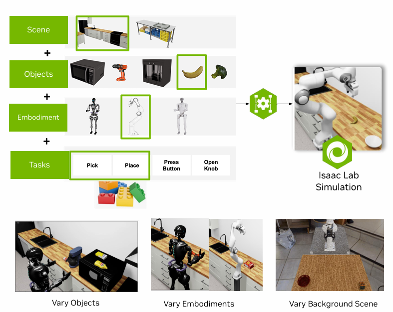

## Introduction

- "The Gap" topic showed that building tasks by hand is repetitive: every new task means a new scene, new rewards and new action and observation setup, and most of it is a near copy of the last one.

| Old way | What goes wrong? |
|---------|-----------------|
| One monolithic task description per task | A small change, such as a different object, means a new file |
| Task logic tied to one specific object | The same idea ("open a door") is rewritten for each object |
| Long tasks written as one big script | Hard to reuse or inspect the individual steps |
| Metrics and recording hard-coded | Hard to add what a new benchmark needs |

This topic shows the five features Isaac Lab-Arena uses to author tasks once and reuse them many times.

## Five Features at a Glance

| # | Feature | Meaning |
|---|----------------------|------------------|
| 1 | **Modular LEGO-like environments composed on-the-fly** | Snap independent blocks together into an environment |
| 2 | **Object Affordances** | Objects advertise what can be done to them |
| 3 | **Long horizon skill chaining** | Join short skills into a long task |
| 4 | **Extensible Metrics and Data Recording** | Add your own measurements and recordings |
| 5 | **Interop Task with Isaac Lab for SDG and RL Training** | Reuse the same task for data generation and training |

## Feature 1: Modular LEGO like Environments

| Block | What it holds? | Examples|
|-------|---------------|-----------------------|
| **Scene** | The background and layout | A kitchen counter, a workbench |
| **Objects** | Things in the scene | Microwave, drill, coffee machine, banana |
| **Embodiment** | The robot | Humanoid, robot arm |
| **Tasks** | What to do | Pick, Place, Press Button, Open Knob |

- The core components are Scene, Embodiment and Task, and the framework keeps them as independent as possible so they can be reused in different environments.
- An environment builder merges them into a single runnable Isaac Lab environment.
- The three photos at the bottom of the diagram show the payoff, changing only one block at a time:

|  | What changed? | What stayed the same? |
|---------------|--------------|----------------------|
| **Vary Objects** | The object on the counter | Scene, robot and task |
| **Vary Embodiments** | The robot | Scene, objects and task |
| **Vary Background Scene** | The background | Robot, objects and task |

> **Why it matters:** This is how Arena goes from **1 task to N tasks**. Swapping one block gives a new evaluation case without rewriting anything else.

## Feature 2: Object Affordances

- Example: a microwave is **"Openable"** and **"Pressable"**.

- An **affordance** is an interaction an object makes available to the robot, such as opening a door, pressing a button or turning a knob.
- NVIDIA's docs state that attaching affordances gives tasks a standard interface to interact with objects, regardless of the specific object.

| Affordance | Typical methods in the docs | Example objects |
|------------|-----------------------------|-----------------------------|
| **Openable** | `is_open()`, `close()` | Microwave, cardboard box |
| **Pressable** | `is_pressed()`, `press()` | Drill, coffee machine |

Two ideas to hold on to:

1. **Tasks are written against the affordance, not the object.** The same task works with any object that has the right affordance. An open-door task works with a microwave, a fridge or a cabinet.
2. **Adding an affordance is lightweight.** An object gains an affordance by inheriting from it and naming the joint it controls.

> **Why it matters:** Affordances are what make a task reusable across objects. Without them, "open the door" would need to be rewritten for every door.

## Feature 3: Long Horizon Skill Chaining

- The example is a **Heat Food Task = Pick + Turn + Open Door + Place + Close Door**.

- A long-horizon task is a task made of several shorter skills. NVIDIA's docs describe two ways to combine subtasks into one longer task:

| Type | Behavior |
|------|----------|
| **Composite task** | Order-independent. The subtasks can succeed in any order |
| **Sequential task** | Ordered. The subtasks must succeed in the listed order |

- The environment builder tracks each subtask, and combines their scene settings, resets and metrics automatically.
- This also means you can see how far a robot got through a long task, because each subtask has its own success tracking.

- The one more example is a sequential task that picks up an object, places it in a refrigerator, and then closes the door.

## Feature 4: Extensible Metrics and Data Recording

| Part | Meaning |
|------|---------|
| **Metrics** | What gets measured, such as success rate or per-subtask success |
| **Data recording** | What gets saved from each run, for later analysis |
| **Extensible** | You can add your own, so a new benchmark does not need a new framework |

- The metrics and recorded data are extensible, giving users fine grained control over simulation and analytics.
- In the docs, tasks are where metrics collection is configured, alongside termination conditions and event handling.

> **Why it matters?:** This connects task authoring to the next benefit, actionable evaluation. Better measurements are what make failure diagnosis possible.

## Feature 5: Interop with Isaac Lab for SDG and RL Training

- **SDG** means synthetic data generation. This feature says a task authored in Arena is not only for testing.

| Use | How it works? |
|-----|--------------|
| **Evaluation** | Run a trained policy in the Arena environment |
| **Data collection and SDG** | Register the Arena environment in Isaac Lab, then use tools such as Isaac Lab-Teleop and Isaac Lab-Mimic |
| **RL training** | Use the same environment for reinforcement learning in Isaac Lab |

> **Why it matters:** One task definition serves the whole loop, so the training task and the evaluation task stay consistent.

## Summary

1. Arena builds environments from **independent blocks**: Scene, Objects, Embodiment and Task.
2. **Affordances** let one task work on any object with the right interaction, such as Openable or Pressable.
3. **Skill chaining** joins short skills into long-horizon tasks, either in any order (composite) or in a fixed order (sequential).
4. **Metrics and data recording** are extensible, so new benchmarks can measure what they need.
5. Tasks **interoperate with Isaac Lab**, so the same environment can support data generation, RL training and evaluation.
6. The next topic shows how to create these tasks from a natural language prompt.

## References

1. [NVIDIA Technical Blog, "Simplify Generalist Robot Policy Evaluation in Simulation with NVIDIA Isaac Lab-Arena"](https://developer.nvidia.com/blog/simplify-generalist-robot-policy-evaluation-in-simulation-with-nvidia-isaac-lab-arena)
2. [Isaac Lab-Arena documentation, "Affordances"](https://isaac-sim.github.io/IsaacLab-Arena/release/0.3.1/pages/concepts/scene/concept_affordances_design.html)
3. [Isaac Lab-Arena documentation, "Composite and Sequential Tasks"](https://isaac-sim.github.io/IsaacLab-Arena/release/0.3.1/pages/concepts/task/concept_composite_tasks_design.html)
4. [Isaac Lab-Arena documentation, "Sequential Tasks"](https://isaac-sim.github.io/IsaacLab-Arena/release/0.2.1/pages/concepts/task/concept_sequential_tasks_design.html)
5. [Isaac Lab-Arena documentation, "Concept Overview"](https://isaac-sim.github.io/IsaacLab-Arena/release/0.1.1/pages/concepts/concept_overview.html)
6. [Isaac Lab-Arena documentation, "Environment Builder"](https://isaac-sim.github.io/IsaacLab-Arena/main/pages/concepts/environment/env_builder.html)
7. [Isaac Lab-Arena documentation, "Release Notes"](https://isaac-sim.github.io/IsaacLab-Arena/release/0.3.0/pages/references/release_notes.html)
8. [Isaac Lab-Arena documentation, "Welcome to Isaac Lab-Arena!"](https://isaac-sim.github.io/IsaacLab-Arena/release/0.3.0/index.html)
9. [NVIDIA Developer, "NVIDIA Isaac Lab-Arena"](https://developer.nvidia.com/isaac/lab-arena)
