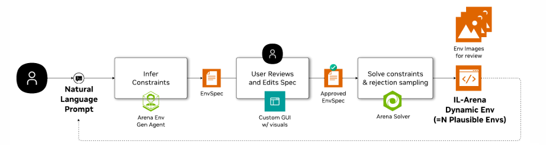
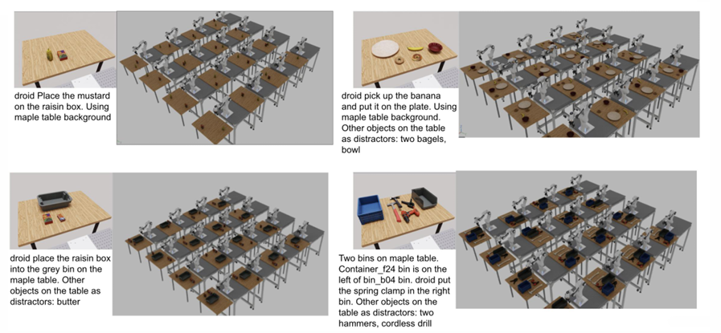

## Introduction

- The previous topic showed that Arena builds tasks from reusable blocks. 
- That already removes a lot of repetition, but a person still has to pick the blocks, place the objects and check that the layout makes sense.

| Step in manual authoring | Why it is slow? |
|--------------------------|----------------|
| Choose a scene, objects, robot and task | Needs knowledge of the asset library and the API |
| Position each object | Poses must avoid collisions and stay reachable by the robot |
| Create many layouts for variety | Each layout is more manual work |

- Evaluation needs **hundreds of tasks and thousands of scenes**. 
- Typing a sentence is much faster than writing code for each one.
- This topic shows the answer: **agentic task generation from a natural language prompt**.

> **Roadmap note:** This feature **Coming Soon v0.3**. NVIDIA's public 0.3.0 and later documentation already describes it, but calls it **experimental** and says prompt formats, the generated spec structure and the GUI may change across releases. Treat it as early-stage.

## Pipeline

| Stage | What happens? | Component |
|-------|--------------|------------------------------|
| 1. Prompt | A person describes the task and scene in plain language | Natural Language Prompt |
| 2. Infer | An agent turns the text into a structured description | **Arena Env Gen Agent** |
| 3. Spec | The structured description is saved as a spec | **EnvSpec** |
| 4. Review | A person checks and edits the spec with visuals | **Custom GUI w/ visuals** |
| 5. Approve | The edited spec becomes the trusted version | **Approved EnvSpec** |
| 6. Solve | A solver finds valid placements that satisfy the constraints | **Arena Solver** |
| 7. Output | Many plausible environments, plus images to review | **Dynamic Env (= N plausible envs)** |

- The dotted arrow from the review images back to the prompt means a person can look at the result and rewrite the prompt.

## What Each Stage Means?

### Stages 1 to 3: From sentence to spec

- An environment generation agent turns a natural language task description and Arena's live registries into a validated **environment graph spec**. 
- The agent builds catalogs of the available assets, tasks and embodiments, then infers the spec in a strict schema. 
- The spec is validated against the schema and the catalogs, with retries driven by critic feedback.

> **Why it matters:** The agent can only use assets, tasks and robots that actually exist in the catalogs. That keeps the output buildable instead of invented.

### Stages 4 and 5: Human in the loop

- This places a person between the agent and the solver. 
- NVIDIA's docs describe a GUI built as a human-in-the-loop review surface: generate a draft from a prompt, inspect the graph, edit the YAML, and preview the result before using it for evaluation. 
- The GUI validates the YAML as you edit, and can run a preview that shows viewport captures.

Two ideas to hold on to:

1. **The agent proposes, the person approves.** The spec is editable text, so the person stays in control.
2. **The approved spec is the contract.** Everything downstream builds from it.

### Stage 6: Solving the layout

- This step **Solve constraints and rejection sampling**. 
- NVIDIA's docs describe a **relation solver** that places objects and the robot from spatial and task constraints (for example "A is on B" or "bin X is to the left of bin Y"). 
- A placement validator then checks things such as robot reachability.

|  | Meaning |
|------|---------------|
| **Constraint** | A rule the layout must satisfy, such as "the mustard sits on the raisin box" |
| **Solver** | The part that finds positions that satisfy those rules |
| **Rejection sampling** | Try a candidate layout, discard it if it breaks a rule, repeat |

### Stage 7: Many environments from one prompt

- The output is a **Dynamic Env** that stands for **N plausible environments**. 
- NVIDIA's docs say the solver produces multiple initial layouts for objects and the robot, and that evaluation samples those layouts across rollouts. 
- One prompt therefore becomes many test cases.

## Four Examples

| Prompt (shortened) | What it exercises? |
|--------------------|-------------------|
| Place the mustard on the raisin box, maple table background | A simple relation: one object on another |
| Pick up the banana and put it on the plate, with two bagels and a bowl as distractors | **Distractor objects** added to the scene |
| Place the raisin box into the grey bin, with butter as a distractor | Placing an object into a container |
| Two bins on a maple table, one bin to the left of the other, put the spring clamp in the right bin, with two hammers and a cordless drill as distractors | Several constraints at once, including left and right order |

- "Droid" in each prompt names the robot used. NVIDIA's docs list a DROID embodiment integration in the release notes.

- NVIDIA's workflow docs also reference a spec file named `mustard_above_raisin.yaml`, which matches the first example.

> **Why it matters?:** The prompts show how one sentence controls the object, the robot, the background, the distractors and the spatial rules, without writing task code.

## What It Does Not Do?

- NVIDIA's docs list limits that are worth knowing.

| Limit | Detail |
|-------|----------------------|
| **Experimental** | Formats and behavior may change across releases |
| **Task coverage** | Only tasks marked as agent-ready in the implementation are supported |
| **Not asset generation** | The agent does not create new 3D assets |
| **Not motion generation** | The agent does not generate robot motion |

## Summary

1. **Agentic task generation** turns a natural language prompt into a runnable Arena environment.
2. An **agent** infers an **EnvSpec**, a person **reviews and edits** it in a GUI, and an **Arena solver** places objects to satisfy the constraints.
3. The output is **many plausible environments** from one prompt, with images for review.
4. The human review step keeps a person in control of what gets tested.
5. The deck marks the feature as **Coming Soon v0.3**, and NVIDIA's docs call it **experimental**, so expect changes.

## References

1. [Isaac Lab-Arena documentation, "Agentic Environment Generation"](https://isaac-sim.github.io/IsaacLab-Arena/main/pages/concepts/agentic_environment_generation/index.html)
2. [Isaac Lab-Arena documentation, "System Overview" (agentic environment generation)](https://isaac-sim.github.io/IsaacLab-Arena/release/0.3.1/pages/concepts/agentic_environment_generation/system_overview.html)
3. [Isaac Lab-Arena documentation, "Agentic Environment Generation GUI"](https://isaac-sim.github.io/IsaacLab-Arena/main/pages/example_workflows/agentic_env_gen/gui_runner.html)
4. [Isaac Lab-Arena documentation, "Agentic Environment Generation and Policy Evaluation"](https://isaac-sim.github.io/IsaacLab-Arena/main/pages/example_workflows/agentic_env_gen/index.html)
5. [Isaac Lab-Arena documentation, "Environment Builder"](https://isaac-sim.github.io/IsaacLab-Arena/main/pages/concepts/environment/env_builder.html)
6. [Isaac Lab-Arena documentation, "Release Notes"](https://isaac-sim.github.io/IsaacLab-Arena/release/0.3.0/pages/references/release_notes.html)
7. [Isaac Lab-Arena documentation, "Welcome to Isaac Lab-Arena!"](https://isaac-sim.github.io/IsaacLab-Arena/release/0.3.0/index.html)
