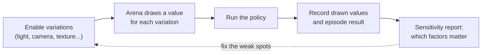
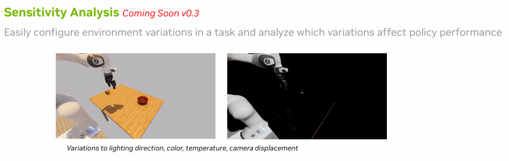
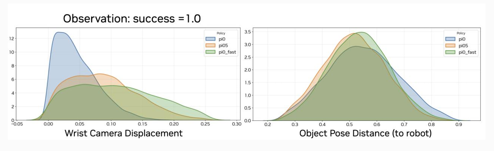
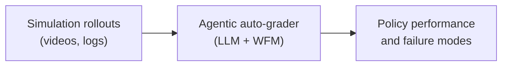

## Introduction

- Running a policy through thousands of environments gives you a number: a success rate. That number is useful, but it leaves the most important question unanswered.

| What a single success rate tells you? | What it does not tell you? |
|--------------------------------------|---------------------------|
| How often the policy completed the task? | **Why** it succeeded or failed |
| | Which conditions made the task harder |
| | Where the policy is most likely to fail next |

- A single success rate does not explain why the policy succeeded or which conditions made the task harder. 
- A team that only sees "51%" does not know what to fix. 
- This topic shows how Arena turns a score into a **diagnosis**, so feedback is **actionable**.

## Two Features

- **Sensitivity Analysis:** Vary the environment on purpose, then find which variations affect success.
- **Agent Augmented Evaluation:** An agentic auto-grader that reviews rollouts and explains failures.

## Feature 1: Sensitivity Analysis

- *Easily configure environment variations in a task and analyze which variations affect policy performance.*
- The workflow into two parts that work together.

| Part | What it does? |
|------|--------------|
| **Variation System** | Creates controlled changes in the environment, such as lighting, background, or a slight shift of the wrist camera |
| **Sensitivity Analysis** | Links the exact conditions of each episode to its result, and shows which conditions are most associated with success or failure |

- The Above photo show the idea: the same scene with changed lighting direction, color and temperature, and a displaced camera, captioned *Variations to lighting direction, color, temperature, camera displacement*.

- Key points from NVIDIA's docs:

1. **Variations are automatic.** They are available in Arena-defined environments without extra code, and the available ones depend on the assets and robot in the environment.
2. **Two timing types.** Some variations are sampled before the environment is built (build-time), and others each time an environment resets (run-time).
3. **The draws are recorded.** Without the recorded values, a success rate shows that the policy struggled, but not which changes were present when it struggled.
4. **Results are analyzed as a combination.** The docs explain that charting a success rate per factor independently is the simplest approach, but Arena's toolbox uses a joint analysis built on neural posterior estimators, so it can capture effects that depend on several factors together.
5. **The analysis is lightweight.** The docs say the estimators run on CPU and do not require Isaac Sim, so a report can be generated anywhere the results file is available.
6. **One slice at a time.** The analysis assumes all results come from a single policy, task and embodiment.

> **Roadmap note:** It label as **Coming Soon v0.3**. NVIDIA's public 0.3.0 and later documentation already includes a Variation System and a Sensitivity Analysis workflow, so check the release you use.

## The Before and After Example

| | Statement |
|---|-----------|
| **BEFORE** | "Pi0.5 success rate on Peg Insert Task is 51%" |
| **AFTER** | The same 51%, plus the findings below |

- The "after" findings:

| Finding | What it tells the team? |
|---------|------------------------|
| Wrist camera displacement has the most impact on pi0 grasp | Check camera calibration or train with camera shifts |
| Lighting intensity explains 15% of grasp failures | Add lighting variety to the training data |
| Lighting x texture (bright scene with a glossy metallic object) caused 3x failure | A **combination** of factors is worse than either alone |
| Friction has negligible impact | No need to spend effort here |

- **Actionable feedback drives the next iteration of policy learning.**

Two ideas to hold on to:

1. **Knowing what does not matter is also useful.** The friction result saves effort.
2. **Combinations matter.** The lighting-and-texture finding is the reason the joint analysis exists, since checking each factor alone would miss it.

> **Note on the numbers:** The percentages (51%, 15%, 3x) are the deck's example.

### Density Chart

- The two density charts compare three policies (labeled pi0, pi05 and pi0_fast) under the heading *Observation: success = 1.0*.

| Chart | What it shows? |
|-------|---------------|
| **Wrist Camera Displacement** | For successful episodes, how the camera offset was spread. Curves bunched near zero mean success happened mostly when the camera stayed close to its expected position |
| **Object Pose Distance (to robot)** | The same view for how far the object was from the robot |

- Each panel is the distribution of one factor **conditioned on success**. 
- A sharp peak means the policy is picky about that factor. 
- A flat spread means it matters less.

## Where RoboLab Fits In?

| Item | What it is? |
|------|------------|
| **RoboLab** | A simulation benchmarking framework from NVIDIA researchers for evaluating task-generalist robot policies, published at Robotics: Science and Systems 2026 |
| **Its claim** | Existing benchmarks often overlap with the training environments, which trivializes success rates and hides robustness problems |
| **Its approach** | Robot- and policy-agnostic tasks, plus granular metrics and analysis tools to see which factors affect policy behavior |
| **Link to Arena** | The Arena docs state that Arena was built in collaboration with the RoboLab authors, and its docs include a RoboLab task catalog |

> **Why it matters:** The sensitivity idea on this topic comes from research on *why* policies fail, not only *how often*.

## Feature 2: Agent Augmented Evaluation

It describes as: *feed simulation rollouts to an agentic auto-grader that uses LLMs and WFMs to analyze policy performance and failure modes.*

| Term | Meaning |
|------|---------|
| **Rollout** | One recorded run of a policy in simulation |
| **Agentic auto-grader** | An AI agent that reviews rollouts and judges them, instead of a person watching each video |
| **LLM** | Large language model |
| **WFM** | World foundation model, such as NVIDIA Cosmos, which understands how the physical world looks and behaves |

- The idea is to go beyond binary success flags and explain, in words, what went wrong, such as a dropped object or a missed grasp.

> **Roadmap note:** The deck labels this **Coming Soon v0.4**. I did not find this feature described in NVIDIA's public Arena documentation, so treat it as a future plan. NVIDIA's earlier blog mentioned exploring agentic and neural approaches, including Cosmos, to scale evaluation further out.

## Summary

1. A single success rate shows **how often** a policy fails, but not **why**.
2. **Sensitivity analysis** applies controlled variations, records them, and finds which factors are linked to success or failure.
3. It can reveal the **most influential factors**, **combined effects** and **factors that do not matter**, which turns a score into a to-do list.
4. **Agent augmented evaluation** (deck label v0.4) would let an LLM and WFM auto-grader explain failures from rollouts, and is not confirmed in public docs.

## References

1. [Isaac Lab-Arena documentation, "Sensitivity Analysis" (workflow)](https://isaac-sim.github.io/IsaacLab-Arena/main/pages/example_workflows/sensitivity_analysis/index.html)
2. [Isaac Lab-Arena documentation, "Variation System"](https://isaac-sim.github.io/IsaacLab-Arena/main/pages/example_workflows/sensitivity_analysis/variation_system.html)
3. [Isaac Lab-Arena documentation, "Sensitivity Analysis" (concepts)](https://isaac-sim.github.io/IsaacLab-Arena/release/0.3.1/pages/concepts/concept_sensitivity_analysis.html)
4. [Isaac Lab-Arena documentation, "Welcome to Isaac Lab-Arena!"](https://isaac-sim.github.io/IsaacLab-Arena/release/0.3.0/index.html)
5. [NVIDIA Technical Blog, "Simplify Generalist Robot Policy Evaluation in Simulation with NVIDIA Isaac Lab-Arena"](https://developer.nvidia.com/blog/simplify-generalist-robot-policy-evaluation-in-simulation-with-nvidia-isaac-lab-arena)
6. [RoboLab: A High-Fidelity Simulation Benchmark for Analysis of Task Generalist Policies (Robotics: Science and Systems 2026)](https://www.roboticsproceedings.org/rss22/p096.html)
7. [RoboLab on arXiv](https://arxiv.org/pdf/2604.09860)
8. [NVIDIA Isaac Lab-Arena product page](https://developer.nvidia.com/isaac/lab-arena)
