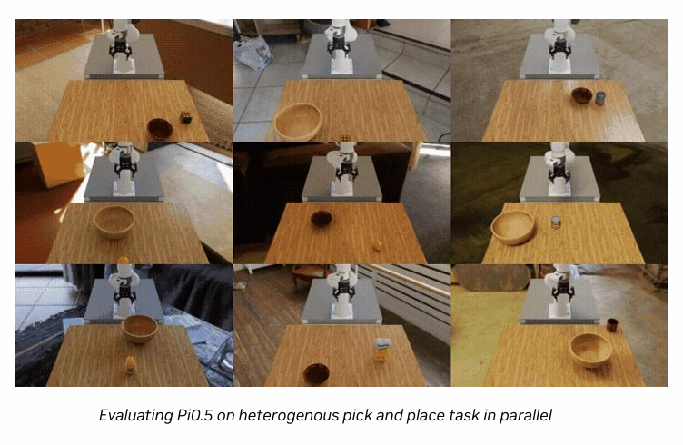
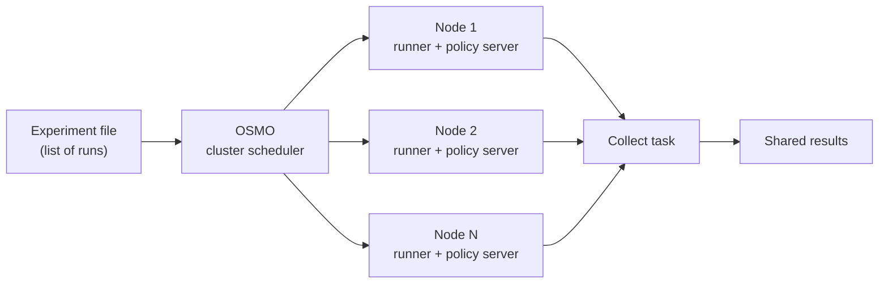
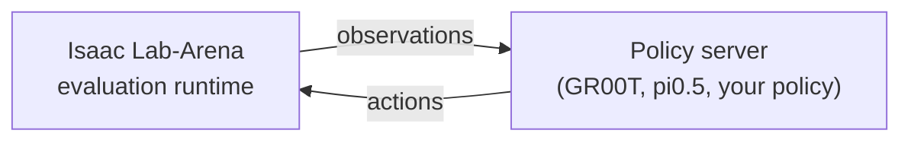

## Introduction

- Earlier topic showed an evaluation space of millions of combinations, and a gap where tools were slow and manual. 
- Even with good tasks and good diagnosis, one more problem remains: **time**.

| Sequential evaluation | What goes wrong? |
|-----------------------|-----------------|
| One environment runs, then the next | A large benchmark takes a very long time |
| One policy wired into one script | Trying a different policy means rewriting the evaluation code |
| One machine | The benchmark is limited by what that machine can handle |

- If one evaluation round takes days, the "Improve the policy" loop turns slowly. 
- This topic covers how Arena runs **many environments at once**, across many GPUs and machines, with any policy.

## Four Features

| # | Feature| Meaning |
|---|----------------------|------------------|
| 1 | **Homogenous Parallel Evaluations** | Run many copies of the same task at once |
| 2 | **Heterogenous (Objects) Parallel Evaluation** | Run many copies, each with a different object |
| 3 | **Improved Heterogeneity and Multi-Node** |  Spread the work across many machines automatically |
| 4 | **Policy Agnostic** | Plug in any policy through a client-server design |

## Feature 1: Homogenous Parallel Evaluation

- **Homogeneous** means the parallel environments are copies of the same task, with parameter variations such as small changes in starting positions.

1. Isaac Lab runs thousands of environments side by side on one GPU, so Arena can evaluate a policy in many at once.
2. NVIDIA's docs describe evaluating a policy in multiple parallel environments with the policy runner, and show examples with several environments per GPU and several GPUs.
3. Because more trials run than in a single-environment run, the success numbers are based on more episodes and are more reliable.
4. Results come as **aggregated metrics** for a quick summary and **per-episode records** for detailed analysis.

> **Why it matters:** More episodes in less time means a more trustworthy success rate and a faster loop.

## Feature 2: Heterogenous (Objects) Parallel Evaluation

- **Heterogeneous** means different environments run different content at the same time.
- Each parallel environment can hold a different object.

| | Homogeneous | Heterogeneous|
|---|-------------|-------------------------|
| What differs between environments? | Small parameter changes | The object itself, such as a different bowl or can |
| What stays the same? | Same task and same objects | Same task |
| Typical use | Fast, high-volume repeats | Testing generalization across objects |

- Below photo is shows **Pi0.5 evaluated on a heterogeneous pick and place task in parallel**.

- Each of the nine tiles shows the same robot and table, but different bowls, items, floor backgrounds and lighting.
- This as run-time swapping of building blocks, such as target objects and backgrounds, which allows parallel evaluation across many variations of a task **without code changes**.
- The main product pages describe evaluating one policy concurrently across thousands of heterogeneous, object-level environments instead of sequential rollouts.

> **Roadmap note:** NVIDIA's early January blog said the first release supported homogeneous parallel environments, with heterogeneous evaluation planned. Later public documentation includes workflows for pick and place with heterogeneous objects, and the deck lists this feature without a "coming soon" label.

## Feature 3: Improved Heterogeneity and Multi-Node (Coming Soon v0.3)

The goal in one sentence:

- *"Given my compute and evaluation list, run evaluations as parallel as possible to get the quickest benchmarking results."*

- This describes a scheduler idea: you provide **what you want evaluated** and **what hardware you have**, and Arena splits the work to finish quickly.

- NVIDIA's docs describe the multi node workflow like this:

1. You write an **experiment file**, the same format used for single-node evaluations, that lists the runs.
2. Arena submits it to a cluster through **OSMO**, NVIDIA's cloud-native orchestration platform, and needs the OSMO command-line client installed and authenticated.
3. Arena schedules each run as its own parallel process.
4. Each run that uses a remote policy starts its own **policy server** and an experiment runner.
5. A final **collect** task gathers the per-environment results into a shared output.

- Sensitivity analysis needs many rollouts for an accurate estimate, so it is a good fit for multi-node runs. 
- They add one current limit: sensitivity analysis on multi-policy runs is not yet supported.

> **Roadmap note:** The deck labels this **Coming Soon v0.3**. NVIDIA's public 0.3.0 and later documentation already includes a multi-node evaluation workflow, so check the release you use. 

## Feature 4: Policy Agnostic (Coming Soon v0.3)

- It describe as **client server arch to plug any policy with ease**.

| Piece | Role |
|-------|------|
| **Arena evaluation runtime (client)** | Runs the simulation and sends **observations** (what the robot sees) |
| **Policy server** | Hosts the policy, which returns **actions** |
| **Shared client contract** | One agreed format for exchanging observations and actions |

- Arena exchanges observations and actions through one client contract across **processes, GPUs or machines**, and the policy server sits behind a network boundary.

Two ideas:

1. **The benchmark never imports the policy.** The docs note there are no policy dependencies in the benchmark, so a policy with different software requirements can run in its own process or environment.
2. **Fair comparison.** Every policy talks to the same environment through the same contract.

> **Roadmap note:** The deck labels this **Coming Soon v0.3**. Public 0.3.0 and later docs already describe the policy client-server setup, and the GR00T closed-loop workflow already uses a policy server, so verify against your release.

## Summary

1. **Parallel evaluation** runs many environments at once, so results arrive faster and from more episodes.
2. **Homogeneous** runs repeat the same task, while **heterogeneous (objects)** runs use a different object in each environment.
3. **Multi-node** evaluation spreads an experiment across a cluster through OSMO and collects the results (deck label v0.3).
4. **Policy agnostic** evaluation uses a client-server design with one shared contract, so any policy can plug in (deck label v0.3).

## References

1. [Isaac Lab-Arena documentation, "Welcome to Isaac Lab-Arena!"](https://isaac-sim.github.io/IsaacLab-Arena/release/0.3.0/)
2. [Isaac Lab-Arena documentation, "Multi-Node Evaluation"](https://isaac-sim.github.io/IsaacLab-Arena/main/pages/example_workflows/multi_node_evaluation/multi_node_evaluation.html)
3. [Isaac Lab-Arena documentation, "Closed-Loop Policy Inference and Evaluation"](https://isaac-sim.github.io/IsaacLab-Arena/release/0.3.0-prerelease/pages/example_workflows/sequential_static_manipulation/step_5_evaluation.html)
4. [Isaac Lab-Arena documentation, gallery (parallel and multi-node evaluation)](https://isaac-sim.github.io/IsaacLab-Arena/release/0.3.0/pages/gallery/index.html)
5. [NVIDIA Technical Blog, "Simplify Generalist Robot Policy Evaluation in Simulation with NVIDIA Isaac Lab-Arena"](https://developer.nvidia.com/blog/simplify-generalist-robot-policy-evaluation-in-simulation-with-nvidia-isaac-lab-arena)
6. [NVIDIA Developer, "NVIDIA Isaac Lab-Arena"](https://developer.nvidia.com/isaac/lab-arena)
7. [NVIDIA OSMO on GitHub](https://github.com/nvidia/osmo)
