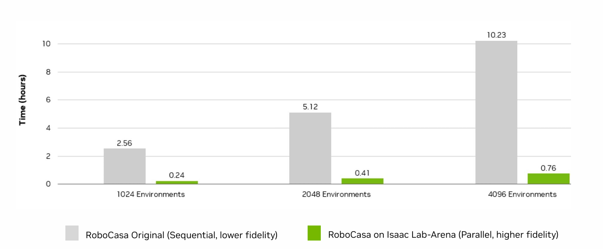

## Introduction

- The previous topic described how Arena runs evaluations in parallel. A reasonable question follows: **how much faster is it, really?**
- "Parallel is faster": Measured time for the same job, with and without parallelism.
- It scales Results at more than one size.
- It is not just fast because it is simpler, A fair description of what was compared.

- This topic answers with a customer case study. It is the evidence for the *Large Scale Parallel Evaluation* benefit.

## Setup

| Statement | Meaning |
|-----------|---------|
| **Lightwheel recreated RoboCasa on Isaac Lab-Arena with richer, higher fidelity environments.** | RoboCasa is an existing kitchen benchmark. Lightwheel rebuilt it on Arena and made the scenes more detailed |
| **Evaluated GR00T N on 10 RoboCasa long-horizon tasks on 8x NVIDIA RTX 6000D GPUs.** | The policy under test was an Isaac GR00T N model, run on 10 long-horizon tasks with eight GPUs |

Terms used:

| Term | Meaning |
|------|---------------|
| **Lightwheel** | NVIDIA's partner, which co-developed the Arena evaluation and task layers and builds task suites on it |
| **RoboCasa** | A kitchen manipulation benchmark that Lightwheel ported to Arena |
| **Long-horizon task** | A task made of several steps, such as opening something, moving an object, then closing it |
| **Environments** | The number of parallel environment variations evaluated per task |

- NVIDIA's technical blog describes the same experiment: the Isaac GR00T N1.5 policy, 10 RoboCasa tasks, 4096 homogeneous environment variations per task, on 8x 6000D GPUs. It says "GR00T N" without a version, so the blog is the source for N1.5.

## Chart

- The chart plots **time in hours** (lower is better) for three sizes.



| Environments | RoboCasa Original (sequential, lower fidelity) | RoboCasa on Isaac Lab-Arena (parallel, higher fidelity) | Speedup|
|--------------|------------------------------------------------|---------------------------------------------------------|------------------------|
| **1024** | 2.56 h | 0.24 h | 10x |
| **2048** | 5.12 h | 0.41 h | 12x |
| **4096** | 10.23 h | 0.76 h | 13x |

Checking the labels against the bars:

| Environments | Original / Arena | Result |
|--------------|------------------|--------|
| 1024 | 2.56 / 0.24 | about 10.7x |
| 2048 | 5.12 / 0.41 | about 12.5x |
| 4096 | 10.23 / 0.76 | about 13.5x |

```
Time (hours)     1024 envs        2048 envs        4096 envs
Original         ##  2.56         #### 5.12        ######## 10.23
Arena (parallel) .   0.24         .    0.41        .        0.76
```

## What the Numbers Show?

Two ideas to hold on to:

1. **The original grows in a straight line.** Doubling the environments roughly doubles the time (2.56, then 5.12, then 10.23 hours). That equals about 400 environments per hour at every size, from my arithmetic.
2. **Arena grows more slowly than the work.** Doubling the environments adds less than double the time (0.24, then 0.41, then 0.76 hours), so the speedup **grows with scale**, from about 10x to about 13x.

| | Original | Arena |
|---|----------|-------|
| Approx. environments per hour (derived) | about 400 at every size | about 4,300 at 1024, about 5,000 at 2048, about 5,400 at 4096 |

- **Why it matters:** Parallel evaluation does not only run faster. It becomes relatively better as the benchmark gets larger, which is exactly the situation the earlier topic described.

## Reading the Comparison Fairly

|  | What it implies? |
|-------|-----------------|
| **Original: Sequential** | One environment at a time |
| **Original: Lower fidelity** | The original RoboCasa scenes are simpler |
| **Arena: Parallel** | Many environments at a time on GPUs |
| **Arena: Higher fidelity** | Richer scenes, which usually cost more to simulate, not less |

- So the Arena run did **more work per environment** and still finished far sooner. 
- NVIDIA's Arena docs summarize the case study as **10x faster despite using higher fidelity assets**.

Points to keep in mind when quoting these numbers:

1. **Two different baselines exist.** The chart compares against the original RoboCasa (about 13x at 4096 environments). NVIDIA's technical blog reports 0.76 hours versus **34.9 hours** for sequential evaluation **on Arena itself**, which is about **40x**. These are different comparisons, so do not mix them.
2. **It is one case study.** It used one policy family, 10 tasks and 8x 6000D GPUs. Results will vary with task, number of environments, scene detail and hardware.
3. **Other NVIDIA measurements exist.** The docs also report a preliminary camera-free scaling benchmark of 2,390 environment-steps per second with 1,024 parallel environments on a single RTX 5880 Ada GPU, which measures something different (raw rollout speed).

## Why Parallel Evaluation Is Faster?

| Reason | Explanation |
|--------|-------------|
| **GPU simulation** | Isaac Lab runs many environments together on the GPU, rather than one by one |
| **Vectorized stepping** | One step advances every parallel environment at once. NVIDIA's docs give the example that one step across 256 environments completes 256 environment-steps |
| **Multiple GPUs** | The test used 8 GPUs, and Arena can also spread work across nodes |

## Summary

1. Lightwheel rebuilt **RoboCasa** on Isaac Lab-Arena with **higher fidelity** scenes and evaluated **GR00T N** on **10 long-horizon tasks** using **8x RTX 6000D GPUs**.
2. At **4096 environments**, Arena took **0.76 hours** versus **10.23 hours** for the original sequential version.
3. The speedup was roughly **10x to 13x** and **grew with scale**, because the original grew linearly while Arena grew more slowly.
4. The comparison is fair in one important way: Arena did the heavier, higher fidelity work and still finished sooner.
5. Do not mix this result with the **40x** figure in NVIDIA's blog, which compares parallel and sequential runs on Arena itself.

## References

1. [NVIDIA Technical Blog, "Simplify Generalist Robot Policy Evaluation in Simulation with NVIDIA Isaac Lab-Arena"](https://developer.nvidia.com/blog/simplify-generalist-robot-policy-evaluation-in-simulation-with-nvidia-isaac-lab-arena)
2. [Isaac Lab-Arena documentation, "Welcome to Isaac Lab-Arena!"](https://isaac-sim.github.io/IsaacLab-Arena/release/0.3.1/index.html)
3. [Isaac Lab-Arena documentation, "Performance and scaling"](https://isaac-sim.github.io/IsaacLab-Arena/main/pages/references/performance.html)
4. [NVIDIA Developer, "NVIDIA Isaac Lab-Arena"](https://developer.nvidia.com/isaac/lab-arena)
5. [NVIDIA Isaac Lab perspectives, "What platform is best for testing whether robot policies train..."](https://perspectives.nvidia.com/isaac-lab/what-platform-is-best-for-testing-whether-robot-policies-train/)
