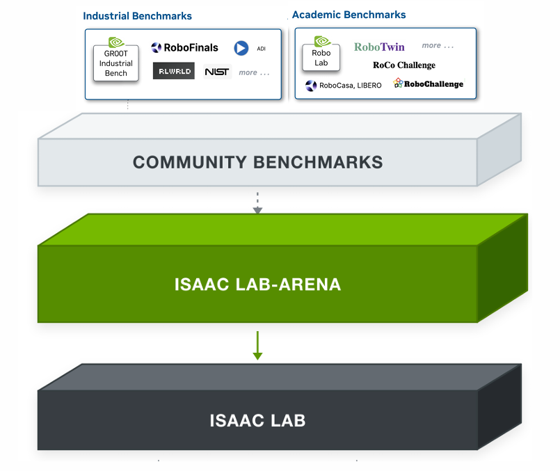
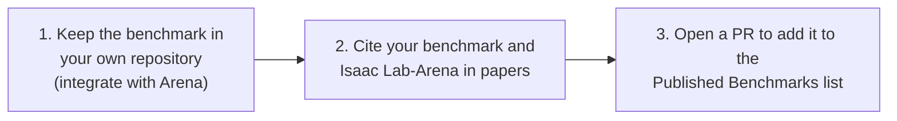

## Introduction

- "The Gap" topic showed three benchmarks, each with its own task definitions, eval scripts, metrics and custom eval system. 
- The results looked like this:

| Fragmented benchmarks | Effect |
|-----------------------|--------|
| Each benchmark has its own tooling | High overhead for every new benchmark author |
| Different scripts and metrics | Results are hard to compare |
| Nothing is shared | A good scene or metric stays locked in one benchmark |

- The fix is a **unified core**: one shared framework that every benchmark builds on. 
- This topic shows what that means for the community.

## Core Idea

- The topic headline statement is: **Community Benchmarks use Isaac Lab-Arena.**
- Benchmarks are not inside Arena, and Arena is not a single benchmark.
- NVIDIA's docs describe Arena as a framework for building and running benchmarks, with ready-made community content on top.



> **Why it matters:** Each benchmark author writes only what is unique to their benchmark. Everything else, such as environment building, parallel execution, metrics and recording, comes from the shared core.

## Four Points

| Point  | What it means? |
|--------------------|---------------|
| **Share and adapt benchmarks in parts or whole** | Reuse a whole benchmark, or just a task, scene, metric or dataset from it |
| **Manipulation, Locomotion, Loco-manipulation** | Benchmarks can cover arms, moving robots, and robots that move and manipulate together |
| **Industrial and Academic** | Both factory-style and research benchmarks are in scope |
| **Complex beyond rigid body PnP** | Not only picking up and placing solid objects |

### Share and adapt in parts or whole

- This as reusing building blocks, such as tasks, scenes, metrics and datasets, for your own evaluations. 
- This works because Arena environments are built from independent blocks (Scene, Embodiment, Task).

### Manipulation, locomotion, loco-manipulation

- Planned coverage spans industrial and research benchmarks across **mobility, manipulation and loco-manipulation**.
- The public release notes mention example workflows for static manipulation and loco-manipulation, including a GR00T fine tuning and evaluation workflow.

| Term | Meaning |
|------|---------|
| **Manipulation** | Using arms and hands on objects |
| **Locomotion** | Moving the robot's body, such as walking |
| **Loco-manipulation** | Doing both together, such as walking while carrying a box |

### Complex beyond rigid body PnP

- **PnP** means pick and place. A rigid body is a solid object that does not change shape. The benchmarks can go beyond that.
- Arena already handles **articulated objects**, such as a microwave with a door, through its Openable and Pressable affordances. 
- NVIDIA's Isaac Lab docs also list experimental guides for deformable objects on the Newton backend.

## Two types of Benchmarks

| Group | Name  | 
|-------|---------------|
| Industrial | **RoboFinals** (Lightwheel) |
| Industrial | **GR00T Industrial Bench** |
| Industrial | **NIST** |
| Industrial | **RLWRLD DexBench** | 
| Industrial | **ADI** | 
| Academic | **RoboTwin** | 
| Academic | **RoboCasa, LIBERO** |
| Academic | **RoboLab** |
| Academic | **RoCo Challenge, RoboChallenge, UC Berkeley AutoLab** |

## How a Community Benchmark Gets Published?

- NVIDIA's docs give a recommended three-step workflow for benchmark authors.



| Step | What it means? |
|------|---------------|
| **1. Own repository** | You keep control of your benchmark and register your own environments, robots and tasks. RoboTwin is named as a reference example |
| **2. Cite both** | Papers cite your benchmark and Arena as the underlying evaluation framework |
| **3. List it** | The Published Benchmarks list is described as the single source of truth for the Arena benchmark ecosystem |

> **Why it matters:** The community discovers and reuses benchmarks from one place, instead of finding scattered scripts.

## Deploy Anywhere

| Platform | Meaning |
|------|---------|
| **PC** | Run on a local workstation |
| **OSMO** | Run on a cloud-native platform for larger and scheduled runs |
| **LeRobot Eval** | Share and run Arena environments through the Hugging Face LeRobot Environment Hub |
| **Any Cloud Infra or Dashboard** | Other clouds and dashboards, shown as a possibility |

- Developers can deploy on local workstations or cloud-native environments such as OSMO for CI/CD, or integrate into leaderboards and distribution platforms such as the LeRobot Environment Hub. 
- The LeRobot Environment Hub as a place to **share and discover Arena environments**.

> **Why it matters:** A benchmark published on the unified core can run the same way on a laptop workstation, a cluster or a public hub.

## Summary

```
 INDUSTRIAL BENCHMARKS      ACADEMIC BENCHMARKS
            \                    /
             COMMUNITY BENCHMARKS         (authored with Arena)
                      |
               ISAAC LAB-ARENA            (shared evaluation core)
                      |
                  ISAAC LAB               (simulation platform)
```

1. **Community benchmarks use Isaac Lab-Arena** as a shared, unified core, instead of each building its own evaluation system.
2. Benchmarks can be **shared and adapted in parts or whole**, across **industrial and academic** settings.
3. Coverage is planned across **manipulation, locomotion and loco-manipulation**, and beyond simple rigid body pick and place.
4. Some benchmarks are available (RoboFinals, RoboTwin, Lightwheel's RoboCasa and LIBERO suites), while others are listed by NVIDIA as **coming soon** or are not yet confirmed publicly.
5. Authors publish by keeping a benchmark in their own repository, citing Arena, and adding it to the **Published Benchmarks** list.
6. **Deploy Anywhere** means the same benchmark can run on a PC, on OSMO, or through the LeRobot Environment Hub.
7. The next topic shows the end-to-end workflow that ties these pieces together.

## References

1. [NVIDIA Technical Blog, "Simplify Generalist Robot Policy Evaluation in Simulation with NVIDIA Isaac Lab-Arena"](https://developer.nvidia.com/blog/simplify-generalist-robot-policy-evaluation-in-simulation-with-nvidia-isaac-lab-arena)
2. [Isaac Lab-Arena documentation, "Release Notes"](https://isaac-sim.github.io/IsaacLab-Arena/release/0.3.0/pages/references/release_notes.html)
3. [Isaac Lab-Arena documentation, "Citing Isaac Lab-Arena" (publishing your own benchmark)](https://isaac-sim.github.io/IsaacLab-Arena/release/0.3.1/pages/references/citing_us.html)
4. [Isaac Lab-Arena documentation, "Affordances"](https://isaac-sim.github.io/IsaacLab-Arena/release/0.3.1/pages/concepts/scene/concept_affordances_design.html)
5. [Isaac Lab documentation, "Physics Backends"](https://isaac-sim.github.io/IsaacLab/release/3.0.0/source/concepts/physics_backends.html)
6. [Isaac Lab-Arena documentation, "Welcome to Isaac Lab-Arena!"](https://isaac-sim.github.io/IsaacLab-Arena/release/0.3.0/)
7. [NVIDIA Developer, "NVIDIA Isaac Lab-Arena"](https://developer.nvidia.com/isaac/lab-arena)
8. [RoboLab: A High-Fidelity Simulation Benchmark for Analysis of Task Generalist Policies (Robotics: Science and Systems 2026)](https://www.roboticsproceedings.org/rss22/p096.html)
9. [Isaac Lab-Arena on GitHub](https://github.com/isaac-sim/IsaacLab-Arena)
