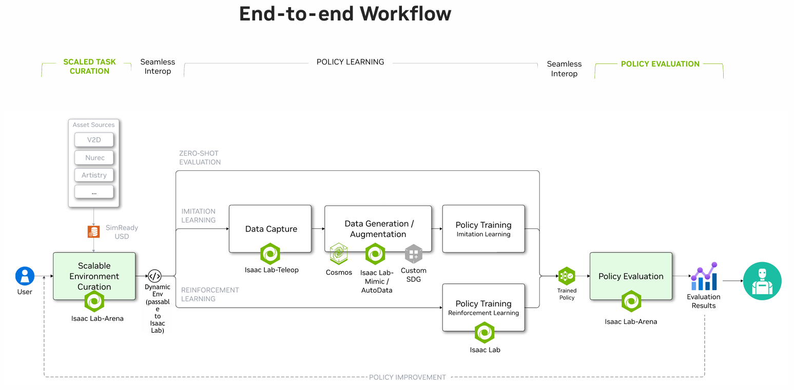

## Introduction

- The earlier topic explained Arena one piece at a time: tasks, evaluation, diagnosis, parallel runs, community benchmarks. 
- we can still ask: **where does this sit in a real project, and how does it connect to the rest of NVIDIA's tools?**

| Question | Why it matters? |
|----------|----------------|
| Where do the environments come from? | Evaluation needs realistic scenes and assets |
| How does the policy get trained? | Evaluation is only useful if it connects to training |
| What happens with the results? | A score that goes nowhere does not improve the policy |

- This topic is the map. It shows the whole journey from a user's idea to a policy running on a robot, with Arena at the start and at the end.

## End-to-End Workflow

The workflow is divided into three phases, joined by two **Seamless Interop** links.

| Phase | Name | Tool | Role |
|-------|----------------|---------------------|------|
| 1 | **Scaled Task Curation** | Isaac Lab-Arena | Build the environments |
| 2 | **Policy Learning** | existing NVIDIA tool | Get a trained policy |
| 3 | **Policy Evaluation** |Isaac Lab-Arena | Test the policy and learn from the results |

> **Why it matters:** The two green boxes are Arena. Everything in the middle is existing NVIDIA tooling that Arena plugs into, so Arena does not replace training. It brackets it.

## Phase 1: Scaled Task Curation

| Part | What it is? |
|------|------------|
| **User** | The person who describes or builds the task |
| **Asset sources** | Where the 3D content comes from (**V2D, Nurec, Artistry, and more**) |
| **SimReady USD** | The common format the assets are converted into so a simulator can use them |
| **Scalable Environment Curation (Isaac Lab-Arena)** | Arena builds many environments from the assets, using the blocks and agentic generation.|
| **Dynamic Env** | The output, an environment that can be passed to Isaac Lab |

- **Omniverse NuRec** turns real camera and lidar data into 3D scenes saved as USD-based files that load into Isaac Sim.
- **SimReady** : NVIDIA's SimReady asset and materials library for simulation, which Arena's agentic environment generation can optionally use to expand assets.

Two ideas to hold on to:

1. **Real-to-sim is an input.** NuRec lets a team scan a real place and use it as the starting point for an environment.
2. **Dynamic Env means flexible, not fixed.** The deck's term stands for an environment that can vary, so one curation step yields many test cases.

### Passing the environment to Isaac Lab

- **Passable to Isaac Lab:** Registering an Arena authored environment in Isaac Lab through an environment registration callback, so the same environment can be used for data collection or policy learning in Isaac Lab.

## Phase 2: Policy Learning (three paths)

- After curation, the workflow splits into three routes.

| Path | Idea | Needs training? |
|------|------|-----------------|
| **Zero-shot evaluation** | Test an existing policy directly | No |
| **Imitation learning** | Learn from demonstrations | Yes |
| **Reinforcement learning** | Learn by trial and reward | Yes |

### Path A: Zero-shot evaluation

- The top line skips the training boxes and goes straight to evaluation. 
- It is for policies that are already trained, for example a published model. 
- NVIDIA's Arena docs include workflows for running real policies such as GR00T and OpenPI against Arena environments.

### Path B: Imitation learning

- Imitation learning has three features in a row.

| Step | Tool  | What it does? |
|------|---------------|--------------|
| **Data Capture** | **Isaac Lab-Teleop** | A person controls the robot to record demonstrations |
| **Data Generation / Augmentation** | **Cosmos**, **Isaac Lab-Mimic / AutoData**, **Custom SDG** | Grow a few demonstrations into a large dataset |
| **Policy Training (Imitation Learning)** | Not labeled | Train the policy on the dataset |

- **Isaac Lab Mimic:** A trajectory data generation tool that augments human demonstrations by creating new synthetic data, so policies become more robust to spatial variation even with few manual demonstrations.
- **Teleoperation:** Isaac Lab supports teleoperation devices for recording demonstrations, and NVIDIA documents an Isaac Teleop framework.
- **Cosmos:** NVIDIA's Isaac Lab docs describe pairing Mimic with Cosmos visual augmentation to generate demonstrations at scale that are robust against visual changes.
- **Custom SDG:** Your own synthetic data generation (SDG) step.

- NVIDIA's blog on synthetic motion generation reports that combining synthetic data with real data improved GR00T N1 performance by 40% compared with real data alone. That is a separate NVIDIA result about data generation, not about Arena.

### Path C: Reinforcement learning

- **Policy Training (Reinforcement Learning)** with **Isaac Lab**. 
- The environment goes straight in, with no demonstrations, and the policy improves by trial and reward. 3
- Isaac Lab is NVIDIA's framework for this, and Arena's release notes list RL workflow support and interoperation with Isaac Lab.

## Phase 3: Policy Evaluation

| Part | What it is? |
|------|------------|
| **Trained Policy** | The policy produced by any of the three paths |
| **Seamless Interop** | The policy plugs into Arena without rebuilding the environment |
| **Policy Evaluation (Isaac Lab-Arena)** | Arena runs the policy at scale, with the features.|
| **Evaluation Results** | Success rates, per-episode records, sensitivity analysis and more |
| **Robot** | Policies that perform well move on toward a real robot |

- Arena's docs describe a closed loop evaluation after training, such as training a policy in Isaac Lab and then evaluating it in Arena.

> **Why it matters?:** The environment used to **train** and the environment used to **evaluate** come from the same Arena definition, so the two stay consistent.

## Policy Improvement Loop

- It runs from **Evaluation Results** back to **Scalable Environment Curation**.

| Step | What happens? |
|------|--------------|
| 1 | Evaluation finds where the policy is weak |
| 2 | The team adds or changes tasks, scenes and variations to cover those weak spots |
| 3 | The policy is retrained or tuned, then evaluated again |

## How This Maps to the Three Computer Strategy?

| Part of this workflow | Computer in NVIDIA's strategy |
|-----------------------|-------------------------------|
| Environment curation, simulation, data generation, evaluation | Computer 2: Omniverse, Isaac Lab, Cosmos |
| Large policy training | Computer 1: DGX |
| Running the final policy on the robot | Computer 3: Jetson AGX Thor |

## Summary

1. The workflow has three phases: **Scaled Task Curation**, **Policy Learning**, **Policy Evaluation**. Arena owns the first and last.
2. Environments come from **asset sources** converted to **SimReady USD**, and real-to-sim tools such as **NuRec** are one of the inputs.
3. A **Dynamic Env** is passed to Isaac Lab, and the same environment serves training and evaluation.
4. Policy Learning has three routes: **zero-shot evaluation**, **imitation learning** (teleop, then Mimic and Cosmos data generation, then training) and **reinforcement learning** in Isaac Lab.
5. Evaluation results feed a **Policy Improvement** loop back to environment curation.

## References

1. [NVIDIA Technical Blog, "Simplify Generalist Robot Policy Evaluation in Simulation with NVIDIA Isaac Lab-Arena"](https://developer.nvidia.com/blog/simplify-generalist-robot-policy-evaluation-in-simulation-with-nvidia-isaac-lab-arena)
2. [Isaac Lab-Arena documentation, "Welcome to Isaac Lab-Arena!"](https://isaac-sim.github.io/IsaacLab-Arena/release/0.3.0/)
3. [Isaac Lab-Arena documentation, "System Overview" (agentic environment generation)](https://isaac-sim.github.io/IsaacLab-Arena/release/0.3.1/pages/concepts/agentic_environment_generation/system_overview.html)
4. [Isaac Lab-Arena documentation, "Release Notes"](https://isaac-sim.github.io/IsaacLab-Arena/release/0.3.0/pages/references/release_notes.html)
5. [Isaac Lab documentation, "Synthetic Data Generation and Imitation Learning with Isaac Lab Mimic"](https://isaac-sim.github.io/IsaacLab/release/3.0.0/source/features/imitation-learning/teleop_imitation.html)
6. [Isaac Lab documentation, "Augmented Imitation Learning" (Cosmos)](https://isaac-sim.github.io/IsaacLab/v2.2.0/source/overview/augmented_imitation.html)
7. [NVIDIA Technical Blog, "Building a Synthetic Motion Generation Pipeline for Humanoid Robot Learning"](https://developer.nvidia.com/blog/building-a-synthetic-motion-generation-pipeline-for-humanoid-robot-learning)
8. [NVIDIA Omniverse NuRec documentation](https://docs.nvidia.com/nurec/index.html)
9. [NVIDIA Technical Blog, "How to Instantly Render Real-World Scenes in Interactive Simulation"](https://developer.nvidia.com/blog/how-to-instantly-render-real-world-scenes-in-interactive-simulation)
10. [NVIDIA Developer, "NVIDIA Isaac Lab-Arena"](https://developer.nvidia.com/isaac/lab-arena)
11. [NVIDIA Blog, "What Is NVIDIA's Three-Computer Solution for Robotics?"](https://blogs.nvidia.com/blog/three-computers-robotics/)
