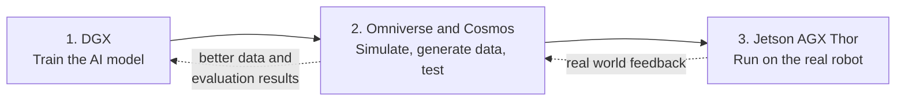
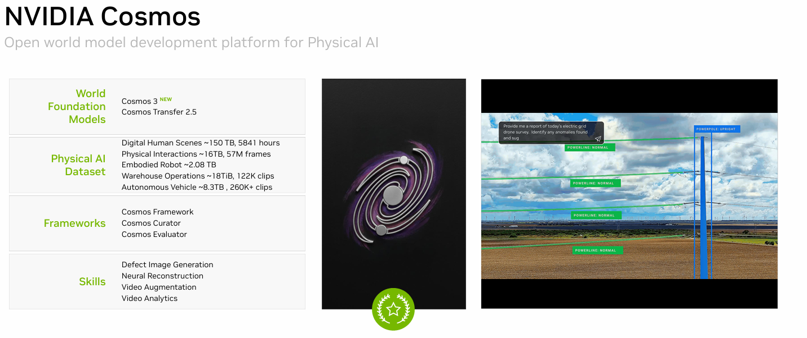
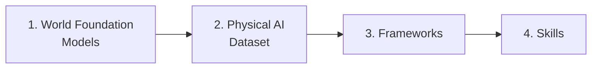

## Introduction

- Physical AI means robots, self-driving cars and other machines that act in the real world.
- Building them is harder than building a chatbot.

| Challenge | Why it hurts? |
|-----------|--------------|
| Real world data is expensive | Collecting data with real robots or cars takes time, money and people |
| Testing in the real world is risky | A mistake can break hardware or hurt someone |
| Rare situations are hard to capture | The unusual cases matter most for safety, but they almost never happen on demand |
| Few teams can train their own foundation model | It needs huge data and compute |

- NVIDIA's answer is Cosmos.
- The **NVIDIA Cosmos** is an **open world model development platform for Physical AI**.

| Phrase | Meaning |
|--------|---------------|
| **NVIDIA Cosmos** | The name of NVIDIA's platform for building AI that understands the physical world |
| **World model** | An AI model that has learned how the physical world looks and behaves, so it can predict what happens next |
| **Development platform** | Not a single model. It is a toolbox of models, tools and data that developers use to build their own physical AI |

- In its launch announcement, NVIDIA described Cosmos as a platform of generative world foundation models, advanced tokenizers, guardrails and an accelerated video processing pipeline, built to advance physical AI systems such as autonomous vehicles and robots.
- The idea is that developers can generate large amounts of photoreal, physics-based synthetic data to train and evaluate their models, or fine-tune Cosmos models into their own custom models.
- NVIDIA now describes Cosmos as an open platform with world foundation models, guardrails and data processing libraries to accelerate physical AI development for autonomous vehicles, robots and video analytics AI agents.

## What "Platform" Means Here?

- Cosmos is a set of building blocks, not one product.
- The original launch described four building blocks:

| Building block | What it is for? |
|----------------|----------------|
| **World foundation models** | Pre-trained models that understand and generate physical world scenes |
| **Tokenizers** | Compress video and images into a form the models can work with efficiently |
| **Guardrails** | Safety checks on what goes into and comes out of the models |
| **Data processing and curation pipeline** | Cleans, filters and labels huge amounts of video for training |

> **Note:** The platform has since grown. It now also includes datasets, an evaluator and ready-made skills. The section **Platform at a Glance** below organizes everything into four layers, and each piece is covered in its own topic later in the deck.

## Where Cosmos Fits in the Three Computer Solution?

- In the earlier note on the three computer solution, Cosmos appeared on the second computer, next to Omniverse.

1. Omniverse and Isaac simulate the world using the laws of physics.
2. Cosmos simulates the world using an AI model that has learned how the world looks and behaves.
3. The two complement each other, and this deck focuses on the Cosmos side.

> **Why it matters?:** Cosmos is the part of the loop that makes data and tests cheaper and safer. It is not a replacement for the robot's own brain.

## Roadmap: What the Rest of the Deck Covers?

The deck moves through these stages.

| Stage | Topics |
|-------|--------|
| **Why Cosmos?** | Physical AI as the next wave, and why scaling data is hard |
| **The platform** | Overview of models, datasets, frameworks and skills |
| **Cosmos 3** | The newest model family, its architecture and benchmark results |
| **What it can do?** | Vision reasoning, image and video generation, data augmentation with Transfer, and generating or inferring robot actions |
| **Customizing it** | Post-training for domain-specific data, open datasets, data curation, guardrails and dataset search |
| **In practice** | Blueprints, healthcare robotics, and examples from companies using Cosmos |
| **Getting started** | Cookbook and learning resources |

The rest of this note covers **The platform** stage: what Cosmos actually contains.

## Platform at a Glance

- This section is a map of the whole platform in four layers, with three headline benchmark claims and a list of places where developers can get it.
- The introduction showed that physical AI is short of data. Fixing that takes more than one model. Developers need models to generate data, data to start from, tools to clean and judge it, and ready-made recipes.
- This is NVIDIA's answer to "what do I get?"

What the image shows shows:

|  | What it shows? |
|-------------------|---------------|
| **Left panel** | The four layers: World Foundation Models, Physical AI Dataset, Frameworks, Skills |
| **Center image** | The Cosmos galaxy-style logo, with a badge for the #1 open vision language model claim |
| **Right image** | A demo of a drone survey of power lines, where the model labels each power line and power pole |

## Four Layers

### 1. World Foundation Models

| Model | What it is? |
|------|------------|
| **Cosmos 3** | NVIDIA's open omnimodel for physical AI. It combines vision reasoning, world generation and action prediction in a single system |
| **Cosmos Transfer 2.5** | A multi-control model for data augmentation. It takes structured video, such as simulation output, and changes things like lighting and environment |

- NVIDIA launched Cosmos 3 on May 31, 2026, saying it can natively understand and generate text, images, video, ambient sound and actions. Developers can use it in three ways:

1. As a **vision language model** that reasons across modalities.
2. As a **world model** that simulates environments and predicts future states.
3. As the backbone for **world action models** that help train robots on specific tasks.

### 2. Physical AI Dataset

The image lists five open dataset groups.

| Dataset  | Size|
|----------------------|----------------------------|
| Digital Human Scenes | ~150 TB, 5841 hours |
| Physical Interactions | ~16 TB, 57M frames |
| Embodied Robot | ~2.08 TB |
| Warehouse Operations | ~18 TiB, 122K clips |
| Autonomous Vehicle | ~8.3 TB, 260K+ clips |

- NVIDIA's Cosmos 3 announcement says the platform now includes new datasets for robotics, physics, human motion, autonomous driving, warehouse safety and spatial reasoning.

### 3. Frameworks

| Framework | Role |
|------|------|
| **Cosmos Framework** | The training and post-training tools for customizing models |
| **Cosmos Curator** | Filters, annotates and deduplicates large video and sensor datasets |
| **Cosmos Evaluator** | Reviews and scores generated video at scale |

### 4. Skills

| Skill | Meaning |
|--------------------|---------------|
| **Defect Image Generation** | Produce images of product defects, which are rare in real factories |
| **Neural Reconstruction** | Rebuild real scenes in 3D from camera data |
| **Video Augmentation** | Create varied versions of existing video |
| **Video Analytics** | Build AI agents that search and summarize video |

- NVIDIA describes the first three as new physical AI agent skills released with Cosmos 3: neural scene reconstruction, defect-image generation and video augmentation.

> **Why it matters?:** the layers fit together. Models create data, datasets give a starting point, frameworks curate and judge it, and skills package common jobs.

## Demo on the Right

- The screenshot shows a drone view of power lines with a text prompt asking for a report of the day's electric grid drone survey and any anomalies found.
- The model overlays labels such as "POWERLINE: NORMAL" and "POWERPOLE: UPRIGHT".
- This is the **vision language model** use of Cosmos: it looks at video, reasons about what it sees, and answers in text.
- It previews the video analytics later in the deck.

## Where to Get It?

| Place | Notes |
|-------|-------|
| **Hugging Face** | Open model downloads |
| **GitHub** | Code, framework and resources |
| **Microsoft Azure, Nebius** | Cloud partners |
| **CoreWeave** | Marked "Coming Soon" |

- NVIDIA's announcement also lists build.nvidia.com for trying the models, and NVIDIA NIM microservices for deployment.

## Summary

1. **NVIDIA Cosmos** is an open world model development platform for Physical AI.
2. A world model is an AI that has learned how the physical world behaves.
3. Cosmos is a platform of models, tokenizers, guardrails and data tools, not a single model.
4. It exists because real world data and testing for physical AI are costly, slow and risky.
5. In the three-computer picture, Cosmos sits on the second computer with Omniverse.
6. The platform map has four layers: **models, datasets, frameworks, skills**.
7. Cosmos 3 and Cosmos Transfer 2.5 are the two model families named.
8. Curator and Evaluator are the tools for cleaning and judging data.
9. NVIDIA claims first place among open models on several world generation, vision language and robot policy benchmarks.
10. The platform is open, available through Hugging Face and GitHub, and offered through several cloud partners.

## References

1. [NVIDIA press release, "NVIDIA Launches Cosmos World Foundation Model Platform to Accelerate Physical AI Development"](https://investor.nvidia.com/news/press-release-details/2025/NVIDIA-Launches-Cosmos-World-Foundation-Model-Platform-to-Accelerate-Physical-AI-Development/default.aspx)
2. [NVIDIA Developer Forum, "Introducing: NVIDIA Cosmos World Foundation Model Development Platform"](https://forums.developer.nvidia.com/t/introducing-nvidia-cosmos-world-foundation-model-development-platform/318970)
3. [NVIDIA Cosmos on GitHub](https://github.com/NVIDIA/Cosmos)
4. [NVIDIA Blog, "What Is NVIDIA's Three-Computer Solution for Robotics?"](https://blogs.nvidia.com/blog/three-computers-robotics/)
5. [NVIDIA Newsroom, "NVIDIA Launches Cosmos 3, the Open Frontier Foundation Model for Physical AI"](https://nvidianews.nvidia.com/news/nvidia-launches-cosmos-3-the-open-frontier-foundation-model-for-physical-ai)
6. [NVIDIA Cosmos, Physical AI](https://www.nvidia.com/en-eu/ai/cosmos)
7. [NVIDIA Cosmos for Developers](https://developer.nvidia.com/cosmos)
8. [NVIDIA on Hugging Face, "Cosmos Predict 2.5 & Transfer 2.5: Evolving the World Foundation Models for Physical AI"](https://huggingface.co/blog/nvidia/cosmos-predict-and-transfer2-5)
9. [NVIDIA Developer Forums, "NVIDIA Cosmos 3 Is Here"](https://forums.developer.nvidia.com/t/nvidia-cosmos-3-is-here-the-open-frontier-foundation-model-for-physical-ai/371824)