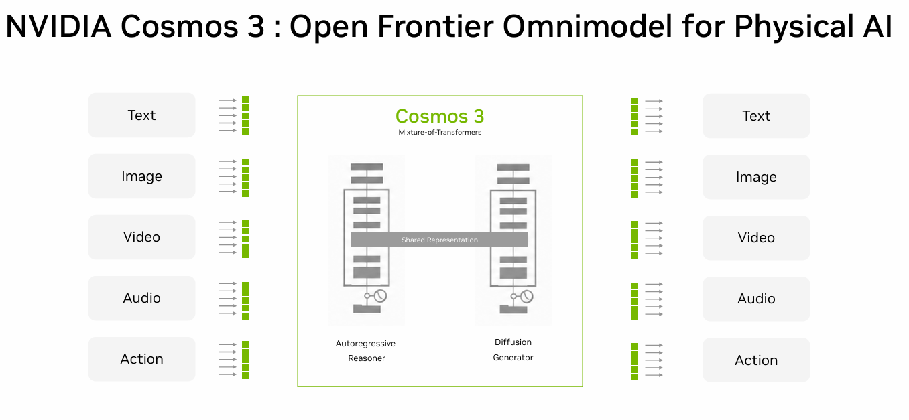

## Introduction

- This topic introduces **Cosmos 3** as one model that can take in and produce many kinds of data it also called Open Frontier Omnimodel for Physical AI.

- Before Cosmos 3, the Cosmos family was a set of separate models, each with its own job, such as Predict for generating video, Transfer for changing it, and Reason for understanding it.
- A developer building a robot or a vehicle system had to connect several models together.

- NVIDIA's Hugging Face documentation describes the biggest change in Cosmos 3 as being an omni-model, one model that reasons and generates across modalities in a single forward pass.

| Before | With Cosmos 3 |
|--------|---------------|
| Separate models for reasoning, world generation and action | One model for all three |
| Action handled outside the model | Action is a first-class input and output |
| Several checkpoints to manage | One checkpoint family |

## Key Terms

| Term | Meaning |
|------|---------------|
| **Omnimodel** | A model that can understand and generate text, images, video, sound and actions |
| **Mixture-of-Transformers (MoT)** | An architecture with more than one transformer inside, each specialized for a kind of work, that still talk to each other |
| **Autoregressive reasoner** | The part that reads input and produces output one piece at a time, like a language model. It handles understanding and reasoning |
| **Diffusion generator** | The part that creates video, audio and actions by starting from noise and refining it step by step |
| **Shared representation** | The layer where the two parts exchange information so the generator can use what the reasoner understood |

## Reading the Diagram

1. Text and vision inputs flow through the reasoner. Vision, audio and action flow through the generator.
2. The two parts meet in a **shared multimodal attention** step.
3. Reasoning outputs come out as text. Generated outputs come out as vision, audio and action.

- Describes the benefit this way: the reasoning transformer helps the model understand object interactions, motion and spatial-temporal relationships before it generates video and action trajectories.

> **Why it matters?:** the model thinks about the scene first and then generates, so the video or action it produces is grounded in physical understanding.

## Action as a Modality

- Cosmos 3 treats action as a core modality, using a dedicated class of action tokens that link the physical world to language based reasoning and video based world representations.

NVIDIA's Hugging Face documentation lists three action modes:

| Mode | Question it answers? |
|------|---------------------|
| **Forward dynamics** | If the agent takes this action, what happens next? |
| **Inverse dynamics** | Given what the agent saw, what action likely caused it? |
| **Policy** | Given the current state, what should the agent do next? |

## Three Model Sizes

There are threemodel type in cosmos3 family **Cosmos 3 Edge, Nano and Super** as 4B, 16B and 64B fully multimodal models.

| Model | Total size | Built from | Intended use |
|-------|-----------|------------|--------------|
| **Edge** | 4B | 2B reasoner + 2B generator | Real-time robot policy and visual reasoning at the edge |
| **Nano** | 16B | 8B reasoner + 8B generator | Efficient inference on workstation-class GPUs |
| **Super** | 64B | 32B reasoner + 32B generator | Large-scale synthetic data generation and research on data center GPUs |

- NVIDIA's Hugging Face model card describes Edge as taking text, image, video and action, while Nano and Super also include audio. So "fully multimodal" it is best read as the family as a whole.

## How to Get It?

|  | What it means? |
|-------------------|---------------|
| **Open Platform** | Models are on Hugging Face and the framework is on GitHub |
| **NIM on NVIDIA NGC** | Packaged as NVIDIA NIM microservices for deployment, available from the NGC catalog |
| **Coming to Microsoft Azure, Nebius, CoreWeave** | Cloud partners|

- NVIDIA's launch announcement described Super and Nano as available at launch, with Edge coming soon. Check the model cards for the current status before you quote availability.

## Summary

1. Cosmos 3 is an **omnimodel**: text, image, video, audio and action in, and the same out.
2. It is built on a **Mixture-of-Transformers** that pairs an autoregressive reasoner with a diffusion generator.
3. A shared representation lets the reasoner's understanding guide the generator.
4. Action is treated as a core modality, with forward dynamics, inverse dynamics and policy modes.
5. It comes in three sizes: Edge (4B), Nano (16B) and Super (64B), counted as total parameters.
6. It is open, with models on Hugging Face, code on GitHub, and NIM microservices on NGC.

## References

1. [NVIDIA Newsroom, "NVIDIA Launches Cosmos 3, the Open Frontier Foundation Model for Physical AI"](https://nvidianews.nvidia.com/news/nvidia-launches-cosmos-3-the-open-frontier-foundation-model-for-physical-ai)
2. [NVIDIA Research, "Cosmos 3: Omnimodal World Models for Physical AI" (technical report)](https://research.nvidia.com/labs/cosmos-lab/cosmos3/technical-report.pdf)
3. [NVIDIA Technical Blog, "Develop Physical AI Reasoning, World, and Action Models with NVIDIA Cosmos 3"](https://developer.nvidia.com/blog/develop-physical-ai-reasoning-world-and-action-models-with-nvidia-cosmos-3/)
4. [Hugging Face Diffusers documentation, "Cosmos 3"](https://huggingface.co/docs/diffusers/main/api/pipelines/cosmos3)
5. [NVIDIA Cosmos on GitHub](https://github.com/NVIDIA/cosmos/blob/main/README.md)
6. [NVIDIA Hugging Face model card, Cosmos3-Edge-Policy-DROID](https://huggingface.co/nvidia/Cosmos3-Edge-Policy-DROID)
