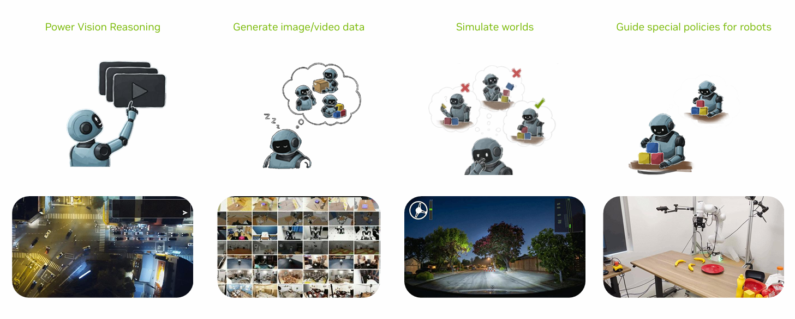
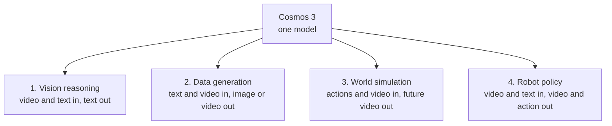

## Introduction

- The previous topic showed that Cosmos 3 can take in and produce text, images, video, audio and action. 
- This topic answers the practical question: **what can you actually do with that?**
- This topic shows four capabilities of the same model.

    - **Power Vision Reasoning**
    - **Generate image/video data**
    - **Simulate worlds**
    - **Guide special policies for robots**

- Without an omnimodel, each of these four jobs would need its own model and its own pipeline. 
- NVIDIA's technical blog says earlier Cosmos releases separated world generation, physical understanding and controlled scene generation into different models and workflows, and that Cosmos 3 unifies them so developers do not have to orchestrate several models.

## Four Capabilities

- NVIDIA's technical blog lists the supported input and output combinations. The four capabilities line up with them like this:

| Capability | Input | Output | NVIDIA's name for the application |
|------------------|-------|--------|-----------------------------------|
| **Power Vision Reasoning** | Text, image and video | Text | VLM for reasoning |
| **Generate image/video data** | Text, or text and video | Image or video | Physically plausible image generation, and a world model for rare edge case video data generation |
| **Simulate worlds** | Action, video and text | Video | Action-conditioned world model |
| **Guide special policies for robots** | Video and text | Video and action | World action model, video action model, vision language action model, policy model for robot learning |

### 1. Power Vision Reasoning

- Cosmos 3 can act as a **vision language model**: you show it video or images, ask a question in text, and it answers in text. 
- The example is Night view of a busy road intersection with a question box.
- This is the reasoner part of the model working on its own. 
- NVIDIA notes that the reasoner can be called independently.

### 2. Generate image/video data

- Cosmos 3 can create images and videos from text prompts, or extend video. 
- The main point for physical AI is **rare edge cases**: situations that are dangerous, costly or unusual to capture with real machines.
- Example shown in image is A grid of many generated scenes of robots in rooms.
- Examples include a generated warehouse safety clip with a small explosion from a box, and a generated driving clip at an intersection.

### 3. Simulate worlds

- Here the model works as a **world model**: given what is happening now, and optionally the actions an agent takes, it predicts what happens next. 
- The image shows a robot imagining three tries at a task, two failing and one succeeding. 
- That is the idea of testing options in a simulated world before acting.
- The driving image shows the same idea for vehicles, where the model can predict a driving scene forward in time.

### 4. Guide special policies for robots

- A **policy** decides what a robot should do next. 
- Cosmos 3 can predict future video and action together from an observation and a text instruction, which makes it a base for robot policy models. 
- The image shows a table-top robot arm with bananas and a plate, a typical "put the bananas on the plate" task.
- NVIDIA describes this as the backbone for world action models that help train robots on specific tasks, and says developers can post train Cosmos 3 on their own action labeled data.

> **Why it matters?:** these are not four products. They are four ways to use one model, so the same understanding of the physical world carries across all of them.

> **Note:** 
    - The reasoning and generation parts of Cosmos 3 can be used separately or together. 
    - NVIDIA says the reasoner can be called alone, while generation always activates both parts so that the output is guided by the reasoner's understanding.

## Summary

1. This turns the omnimodel idea into four practical uses.
2. **Vision reasoning:** watch video and answer questions in text.
3. **Data generation:** create images and videos, including rare edge cases.
4. **World simulation:** predict what happens next, including after an action.
5. **Robot policy:** predict actions as well as video to guide robots on specific tasks.
6. All four come from one model, so developers avoid stitching separate models together.

---

## References

1. [NVIDIA Technical Blog, "Develop Physical AI Reasoning, World, and Action Models with NVIDIA Cosmos 3"](https://developer.nvidia.com/blog/develop-physical-ai-reasoning-world-and-action-models-with-nvidia-cosmos-3/)
2. [NVIDIA Newsroom, "NVIDIA Launches Cosmos 3, the Open Frontier Foundation Model for Physical AI"](https://nvidianews.nvidia.com/news/nvidia-launches-cosmos-3-the-open-frontier-foundation-model-for-physical-ai)
3. [NVIDIA Research, "Cosmos 3: Omnimodal World Models for Physical AI" (technical report)](https://research.nvidia.com/labs/cosmos-lab/cosmos3/technical-report.pdf)
4. [Hugging Face Diffusers documentation, "Cosmos 3"](https://huggingface.co/docs/diffusers/main/api/pipelines/cosmos3)
