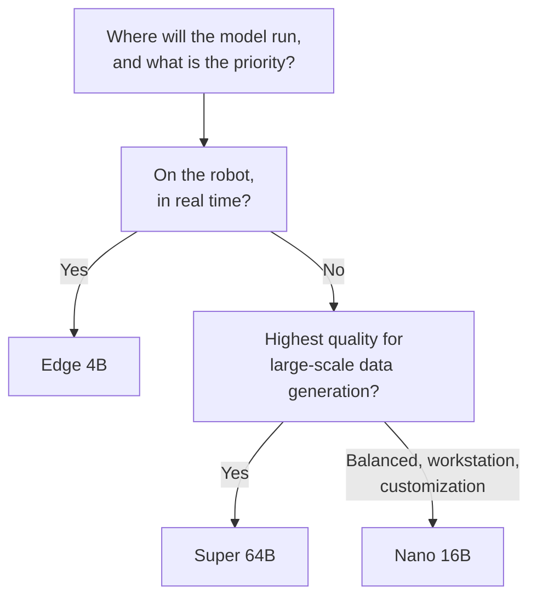

## Introduction

- A bigger model is usually more accurate, but it needs more memory, more power and more time. 
- Physical AI spans very different places to run a model.

| Where it runs? | What it needs? |
|---------------|---------------|
| **Inside a robot** | Small, fast and low power, with no round trip to the cloud |
| **A developer workstation or an enterprise server** | A good balance, easy to customize and deploy |
| **A data center** | The best possible quality, for generating large amounts of training data |

- One size cannot serve all three, so Cosmos 3 offers three **Edge (4B)**, **Nano (16B)** and **Super (64B)**. 
- The message is simple: the same model design comes in different sizes, so you can match the model to the hardware and the job.

| | **Edge** | **Nano** | **Super** |
|---|----------|----------|-----------|
| **Size** | 4B | 16B | 64B |
| **Headline** | Real-time robot action | Balance accuracy and performance | Maximum world-model fidelity |
| **Other Info** | On-device vision analysis. Optimized for Jetson, RTX and DGX. 2B Nemotron-based reasoning tower | Best customization starting point. NIM microservices for enterprise inference | For highest-accuracy use cases. Scales with frontier compute |

> **Link to the three computer idea:** Edge targets the computer *inside the robot* (Jetson Thor), while Nano and Super run on the simulation and training side of the loop.

## Three Models

### Edge, 4B: the on robot model

1. NVIDIA describes Cosmos 3 Edge as a 4B omni-model with a **2B NVIDIA Nemotron-based reasoner**.
2. It is built for **on-device vision reasoning and robot policy**. NVIDIA's announcement says it can run across NVIDIA RTX GPUs, DGX systems and Jetson modules.
3. NVIDIA's tutorial shows Cosmos 3 Edge being post-trained into a manipulation policy that fits in the memory of **Jetson AGX Thor** and runs entirely on the robot, without sending requests to a data-center GPU. In that tutorial, the policy generates action chunks in about 1.53 seconds on a Jetson AGX Thor T5000.
4. NVIDIA also says developers can adapt it to a specific robot, vehicle or sensor quickly, in about a day. That timing depends on your data and setup.

> **Why it matters:** this is the model that answers the "why on the robot and not in the cloud?" question from the three-computer note. A walking or manipulating robot cannot wait for a network round trip.

### Nano, 16B: the balanced model

1. NVIDIA describes Cosmos 3 Nano as the compact version, optimized for efficient inference.
2. It is designed to run on workstation-grade compute such as the **NVIDIA RTX PRO 6000** GPU.
3. **NIM microservices for enterprise inference**. NIM packages a model with an optimized runtime so it is easier to deploy.
4. "Best customization starting point". NVIDIA provides open post-training recipes for Cosmos 3, and Nano's smaller size makes experiments cheaper.

### Super, 64B: the highest fidelity model

1. NVIDIA describes Cosmos 3 Super as the model for maximum quality and capability, with the highest benchmark scores.
2. It targets data center deployment on NVIDIA Hopper and Blackwell GPUs.
3. Typical jobs are **large-scale synthetic data generation**, advanced physical reasoning, and post-training models that need the highest physics accuracy.

## How to Choose?

| If you need | Start with |
|----------------|------------|
| A policy or vision model on a Jetson inside the robot | **Edge** |
| A model you can fine-tune and serve on a workstation or enterprise server | **Nano** |
| The best generated video for synthetic data and simulation | **Super** |

## Notes

- **Total versus half.** The 4B, 16B and 64B sizes count the whole model (reasoner plus generator). Some NVIDIA material describes Nano and Super as "8B-class" and "32B-class", which refers to one half.
- **Edge has now been released.** NVIDIA's launch announcement for Cosmos 3 listed Edge as coming soon.
- **One checkpoint, parts used separately.** A smaller device may only need the reasoner part for video understanding. For example, NVIDIA's blog notes the reasoner can be called on its own.

## Summary

1. Cosmos 3 comes in three sizes: **Edge 4B, Nano 16B, Super 64B**.
2. **Edge** is for real-time, on-device use, built with a 2B Nemotron-based reasoner and able to run on Jetson Thor.
3. **Nano** balances accuracy and speed, runs on workstation GPUs and is the usual starting point for customization.
4. **Super** gives the highest fidelity for data center scale data generation.
5. Pick the size by where the model runs and what matters most: latency, balance or quality.

## References

1. [NVIDIA Technical Blog, "Post-Train NVIDIA Cosmos 3 Edge for On-Device Robot Control"](https://developer.nvidia.com/blog/post-train-nvidia-cosmos-3-edge-for-on-device-robot-control/)
2. [NVIDIA press release, "Japan's Robotics and Manufacturing Leaders Build on NVIDIA Cosmos to Advance Physical AI Frontier"](https://investor.nvidia.com/news/press-release-details/2026/Japans-Robotics-and-Manufacturing-Leaders-Build-on-NVIDIA-Cosmos-to-Advance-Physical-AI-Frontier/default.aspx)
3. [NVIDIA Technical Blog, "Develop Physical AI Reasoning, World, and Action Models with NVIDIA Cosmos 3"](https://developer.nvidia.com/blog/develop-physical-ai-reasoning-world-and-action-models-with-nvidia-cosmos-3/)
4. [NVIDIA Newsroom, "NVIDIA Launches Cosmos 3, the Open Frontier Foundation Model for Physical AI"](https://nvidianews.nvidia.com/news/nvidia-launches-cosmos-3-the-open-frontier-foundation-model-for-physical-ai)
5. [NVIDIA Research, "Cosmos 3: Omnimodal World Models for Physical AI" (technical report)](https://research.nvidia.com/labs/cosmos-lab/cosmos3/technical-report.pdf)
6. [NVIDIA Cosmos on GitHub](https://github.com/NVIDIA/cosmos/blob/main/README.md)
