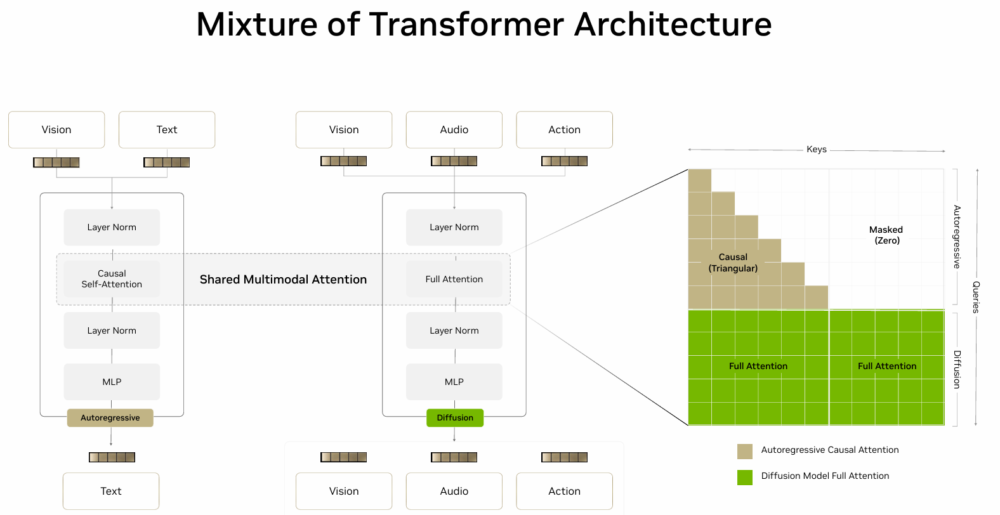

## Introduction

- Understanding and generating are different jobs that normally call for different kinds of model.

| Job | Usual model type | How it works? |
|-----|------------------|--------------|
| Understand and reason, with text out | **Autoregressive** (like a language model) | Produces one token at a time, each depending only on what came before |
| Create video, audio and actions | **Diffusion** | Starts from noise and refines all the pieces together, step by step |

- NVIDIA's technical report argues that treating these separately is limiting. 
- Understanding needs to reason about how the world will change, and generation needs a compact, structured picture of the world.
- Its example is a home robot told to clear a dining table: with separate models you would stitch together one model to find the dishes and plan, another to produce actions, and another to simulate what happens next. 
- The report calls that fragmented and computationally wasteful.
- Cosmos 3's answer is to put both kinds of model **inside one network**.

- **Reasoner:**  Vision and Text go in, passing through Layer Norm, Causal Self-Attention, Layer Norm and MLP. Text comes out. It is labeled **Autoregressive**
- **Generator:** Vision, Audio and Action go in, passing through Layer Norm, Full Attention, Layer Norm and MLP. Vision, Audio and Action come out. It is labeled **Diffusion**

## Key Idea: Two model, One Network



- In a **Mixture-of-Transformers (MoT)**, each layer of the model carries two sets of parameters:

| | Reasoner | Generator|
|---|----------------|-----------------|
| **Handles** | The autoregressive tokens: language, plus images and video encoded for understanding | The diffusion tokens: images and video encoded for generation, plus audio and action |
| **Attention style** | Causal | Full |
| **Output** | Text, one token at a time | Denoised vision, audio and action |

- Both has its own layer norms, attention projections and feed forward network.
- NVIDIA's report says both are initialized from the weights of a pre trained vision language model, so Cosmos 3 starts with strong language and visual reasoning and then learns to generate.

> **Note:** vision appears in **both** towers, but not as the same data. NVIDIA's report uses one encoder for understanding (a ViT, feeding the reasoner) and a different video VAE encoder for generation (feeding the generator).

## Attention Mask

- Attention decides which tokens can "look at" which other tokens. 
- The grid on the diagram shows the rule, with **queries** down the side (who is looking) and **keys** across the top (what can be looked at).

```
                     Keys (what can be looked at)
                  AR tokens          Diffusion tokens
Queries
 AR token 1       ■ . . .            . . .
 AR token 2       ■ ■ . .            . . .
 AR token 3       ■ ■ ■ .            . . .
 AR token 4       ■ ■ ■ ■            . . .
 Diffusion 1      ■ ■ ■ ■            ■ ■ ■
 Diffusion 2      ■ ■ ■ ■            ■ ■ ■
 Diffusion 3      ■ ■ ■ ■            ■ ■ ■
```

- Grid on image show three regions:
    1. **Causal (Triangular):** Each reasoning token sees only itself and earlier reasoning tokens.
    2. **Masked (Zero):** Reasoning tokens never look at generation tokens. 
    3. **Full Attention:** Each generation token sees every reasoning token and every other generation token.

- Diffusion is conditioned on the autoregressive context, while the autoregressive side stays self contained. AR tokens are never updated based on diffusion tokens.

> **Why it matters?:** the information flows one way. The reasoner first works out what is going on, and the generator uses that understanding to produce video, audio and actions. The reasoner stays unchanged by the generator, so its text and reasoning ability is preserved.

## How the Tokens Are Arranged?

- It describes a single sequence made of two parts:

1. The **autoregressive part comes first**: language tokens, plus image and video tokens for understanding, ending with special end-of-sentence and begin-of-generation tokens.
2. The **diffusion part follows**: vision, audio and action tokens. During generation these start as noise and are denoised step by step.

- Language comes out through next token prediction, while the other modalities come out through iterative denoising.

## Which Parts Run for Each Task?

- Because the architecture are separate, the model can switch parts on and off. 

| Task | Reasoner | Generator |
|------|----------|-----------|
| Answer a question about a video (acts like a normal vision language model) | On | Not activated |
| Text to image or text to video | Provides the prompt understanding | On |
| Image to video, future prediction | Provides the prompt understanding | On, with clean frames as conditioning |
| Forward dynamics, inverse dynamics, policy | Provides the prompt understanding | On, with action tokens |

- The reasoner can be called on its own, while the generator always activates both towers.

## Summary

1. Cosmos 3 puts a **reasoner** and a **generator** side by side inside every layer of one network.
2. The reasoner is **autoregressive** with causal attention and produces text.
3. The generator is **diffusion based** with full attention and produces vision, audio and action.
4. The two towers share a single **multimodal attention** step, where generation tokens can look at everything but reasoning tokens never look at generation tokens.
5. This one way flow lets the model understand first and then generate, without losing its language ability.
6. The same design is used at all three model sizes.

## References

1. [NVIDIA Research, "Cosmos 3: Omnimodal World Models for Physical AI" (technical report)](https://research.nvidia.com/labs/cosmos-lab/cosmos3/technical-report.pdf)
2. [NVIDIA Technical Blog, "Develop Physical AI Reasoning, World, and Action Models with NVIDIA Cosmos 3"](https://developer.nvidia.com/blog/develop-physical-ai-reasoning-world-and-action-models-with-nvidia-cosmos-3/)
3. [NVIDIA Newsroom, "NVIDIA Launches Cosmos 3, the Open Frontier Foundation Model for Physical AI"](https://nvidianews.nvidia.com/news/nvidia-launches-cosmos-3-the-open-frontier-foundation-model-for-physical-ai)
4. [Hugging Face Diffusers documentation, "Cosmos 3"](https://huggingface.co/docs/diffusers/main/api/pipelines/cosmos3)
