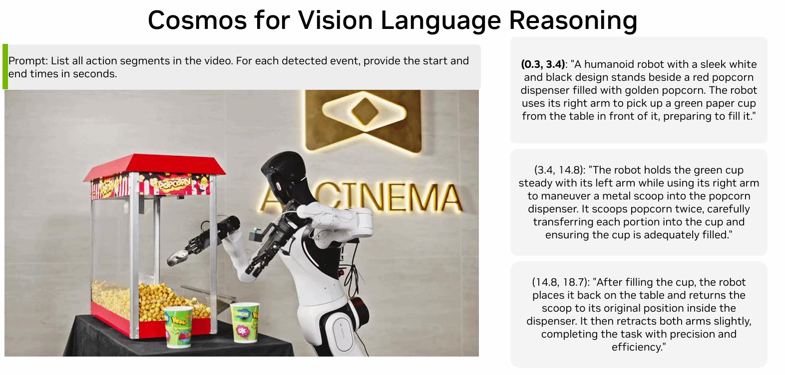

## Introduction

- Physical AI produces huge amounts of video: robot demonstrations, factory cameras, driving logs. 
- Someone has to understand that video before it can be used.

| Need | Why it is hard by hand? |
|------|------------------------|
| Label what happens in a demonstration | Every clip needs a person to watch and write it down |
| Find the exact moment an event starts and ends | Requires scrubbing through footage |
| Describe actions in enough detail to train on | Short labels like "pick up cup" lose the useful detail |

- A vision language model (VLM) that can reason about video and time can do this at scale.
- In this topic shows the first of Cosmos 3's practical uses in action: **watching a video and explaining it in words, with timestamps.**
- The point is that the model does more than label the video. 
- It breaks it into steps, says **when** each step happens, and describes **what the robot is doing and with which arm**.

## Reading the Example

| Parts | What it shows? |
|-------------------|---------------|
| **Prompt** | "List all action segments in the video. For each detected event, provide the start and end times in seconds." |
| **Video frame** | A humanoid robot standing beside a red popcorn dispenser, holding a scoop, with two green paper cups on a table |
| **Three answer boxes** | Three events, each with a start and end time in seconds and a description |

The answer breaks the 18-second clip into three consecutive segments.

| Segment (seconds) | What the model says is happening? |
|-------------------|----------------------------------|
| **0.3 to 3.4** | The robot stands beside the popcorn dispenser and uses its right arm to pick up a green paper cup, getting ready to fill it |
| **3.4 to 14.8** | The robot holds the cup steady with its left arm while its right arm uses a metal scoop to take popcorn from the dispenser twice, filling the cup |
| **14.8 to 18.7** | The robot puts the cup back on the table, returns the scoop to its place in the dispenser, and pulls both arms back slightly |

What makes this a good demo:

1. **Time grounding.** Each event has a start and end time, and the segments follow one another without gaps.
2. **Fine detail.** It tells left arm from right arm, names objects (green paper cup, metal scoop) and counts repeated actions (two scoops).
3. **Task structure.** It splits one task into stages: prepare, fill, finish. That is the kind of structure robot learning needs.

> **Why it matters?:** the same ability can turn raw robot videos into labeled training data, which links straight back to the data problem.

## What Is Happening Inside?

- This is the **reasoner tower** from the previous topic working on its own, with the generator switched off.
- NVIDIA's documentation describes it as acting like a standard vision language model when only language output is needed.
- NVIDIA's Cosmos 3 repository lists these understanding tasks for the reasoner:

| Task | Input | Output |
|------|-------|--------|
| **Caption** | Video | Detailed text description |
| **Temporal localization** | Video and a query | Text or JSON: event detection, timestamp queries, interval questions |
| **Embodied reasoning** | Video and a question | Next-action prediction for robotics and assisted tasks |
| **2D grounding** | Image and a prompt | Bounding boxes |
| **Describe anything** | Image with marked subjects | Attribute descriptions |
| **Situation understanding** | Video and a question | Situation understanding and likely next action |

- The example is **temporal localization combined with captioning**.

## How It Learned This?

NVIDIA's technical report describes how the reasoner was trained for time aware video understanding:

1. Video frames are given **text timestamps** interleaved with them, so the model can tell where in time each frame sits.
2. Human annotators wrote dense captions with start and end times for everyday indoor tasks filmed from a first-person view.
3. A broader set of 55K videos (about 2.6K hours) provided 743K event entries of the form start time, end time and caption, used to teach the model to list events and to find events from a query.
4. The report also includes robotics data such as action reasoning for manipulation.

## Where This Shows Up Later in the Deck?

| Use | Later |
|-----|-------------|
| Labeling and filtering video for training | Cosmos Curator Data Processing and Curation Pipeline (the annotation step uses Cosmos Reason) |
| Answering questions about camera feeds | NVIDIA Blueprint for Video Search and Summarization |
| Industrial and traffic video analysis | Cosmos 3 as Vision Language Model, and the adopters |
| Robot planning and reasoning | Unlock real-time reasoning for physical and vision AI |

## Summary

1. Cosmos 3 working as a **vision language model**: video and a text prompt in, a timed description of events out.
2. The prompt asks for **action segments with start and end times**, and the model returns three consecutive steps of a robot filling a popcorn cup.
3. The answer includes fine detail such as which arm does what and how many scoops.
4. It uses the reasoner tower only, trained with timestamped video and dense event captions.
5. The main payoff is automatic labeling and analysis of video for training and monitoring.

## References

1. [NVIDIA Cosmos on GitHub (README)](https://github.com/nvidia/cosmos)
2. [NVIDIA Research, "Cosmos 3: Omnimodal World Models for Physical AI" (technical report)](https://research.nvidia.com/labs/cosmos-lab/cosmos3/technical-report.pdf)
3. [NVIDIA Technical Blog, "Develop Physical AI Reasoning, World, and Action Models with NVIDIA Cosmos 3"](https://developer.nvidia.com/blog/develop-physical-ai-reasoning-world-and-action-models-with-nvidia-cosmos-3/)
4. [NVIDIA Cosmos Reason 2 model card (build.nvidia.com)](https://build.nvidia.com/nvidia/cosmos-reason2-8b/modelcard)
5. [NVIDIA Cosmos Reason 1 model card (build.nvidia.com)](https://build.nvidia.com/nvidia/cosmos-reason1-7b/modelcard)
