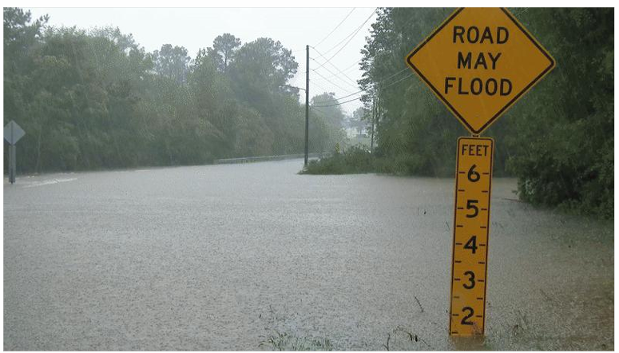

## Introduction

- Cameras are everywhere: warehouses, factories, roads, power lines. 
- People cannot watch all of that footage, and simple detectors only flag fixed things like "person" or "car". 
- The real questions are more open ended.

| Question someone might ask | Why it needs a VLM? |
|----------------------------|--------------------|
| "Is the road flooded, and how deep is the water?" | Needs reading a sign and a gauge and understanding the scene |
| "Did a forklift get too close to a worker?" | Needs understanding objects, motion and distance over time |
| "Describe everything that happened in this clip." | Needs dense, detailed captioning |
| "Is anything unusual here?" | Needs reasoning about what is normal |

- The previous topic showed one example of Cosmos 3 describing a video. 
- This topic steps back and states the **claim and the selling points** of Cosmos 3 when it is used as a **vision language model (VLM)**.
- A **vision language model** is an AI that takes images or video plus a text question, and answers in text.

## Capabilities

- Open, customizable, commercial ready VLM for physical reasoning.
- Excels at navigating diverse real world scenarios and synthetic data validation.
- Enhanced spatial temporal understanding and visual perception.
- Flexible deployment with Super, Nano and Edge versions.
- Performance optimized with efficient token sampling, NVFP4, speculated decoding.

## Open, customizable, commercial ready VLM for physical reasoning

- **Open.** NVIDIA releases the Cosmos 3 models and code openly.
- **Customizable.** NVIDIA provides open post-training recipes so you can adapt the model to your own domain.
- **Commercial ready** . Read the license text on the model card for the exact commercial terms.

## Excels at navigating diverse real world scenarios and synthetic data validation

- **Real-world scenarios.** 
    - The reasoner was fine tuned on physical AI data covering robotics, autonomous driving and smart infrastructure such as warehouses and traffic cameras.

- **Synthetic data validation.** 
    - The same model can act as a judge of generated video. 
    - Training it to judge physical plausibility using human graded questions about generated videos, covering things like geometry, motion plausibility and physical commonsense. 
    - That helps filter out bad synthetic data before it is used for training.

## Enhanced spatial temporal understanding and visual perception

- "Spatial" means where things are, and "temporal" means when things happen. T
- It describes training for 2D and 3D grounding (locating objects), temporal event understanding, and timestamped video.

## Flexible deployment with Super, Nano and Edge versions

- The same capability is offered at three sizes, so you can run it in a data center, on a workstation, or on a device. 
- See the model family note for how to choose.

## Performance optimized with efficient token sampling, NVFP4, speculated decoding

- These are three speed ups for running the model.

| Technique | Meaning | What NVIDIA says? |
|-----------|---------------|------------------|
| **Efficient token sampling** | Feed the model fewer video tokens, keeping the most distinctive parts of each frame and dropping the rest | NVIDIA calls it Efficient Video Sampling (EVS). It speeds up the Cosmos Reason NIM, and smaller GPUs tend to benefit more |
| **NVFP4** | Store the model's numbers in 4 bit floating point instead of 16 bit | NVIDIA says NVFP4 gives up to 2x inference speedup compared with BF16. FP8 and BF16 are also offered |
| **Speculative decoding** | A small helper guesses the next few words and the big model checks them in one go | See the note below |

> **Check on speculative decoding.** NVIDIA's NIM documentation for vision language models describes built-in EAGLE speculative decoding for **Cosmos Reason 2**. The Cosmos 3 launch blog lists NVFP4, vLLM and EVS as the optimizations.

## Example: Flood Image

- The photo is a good example of **anomaly and hazard reasoning**.
- A useful answer needs the model to read the warning sign, notice the water over the road, and interpret the depth gauge.

## Summary

1. Cosmos 3 as an **open vision language model** for physical reasoning.
2. Its strengths are real-world scenes, checking synthetic data, and understanding both space and time.
3. It comes in Super, Nano and Edge sizes.
4. Speed comes from fewer video tokens (EVS), 4-bit NVFP4 weights, speculative decoding.
5. The "#1 open" claim rests on VANTAGE-Bench, a benchmark for fixed-camera industrial and traffic footage.
6. Confirm the speculative decoding and license wording before presenting them as firm facts.

## References

1. [NVIDIA Technical Blog, "Develop Physical AI Reasoning, World, and Action Models with NVIDIA Cosmos 3"](https://developer.nvidia.com/blog/develop-physical-ai-reasoning-world-and-action-models-with-nvidia-cosmos-3/)
2. [NVIDIA Research, "Cosmos 3: Omnimodal World Models for Physical AI" (technical report)](https://research.nvidia.com/labs/cosmos-lab/cosmos3/technical-report.pdf)
3. [NVIDIA Newsroom, "NVIDIA Launches Cosmos 3, the Open Frontier Foundation Model for Physical AI"](https://nvidianews.nvidia.com/news/nvidia-launches-cosmos-3-the-open-frontier-foundation-model-for-physical-ai)
4. [NVIDIA NIM for Vision Language Models, Release Notes](https://docs.nvidia.com/nim/vision-language-models/1.7.0/release-notes.html)
5. [NVIDIA NIM for Vision Language Models, "Query the Cosmos 3 Reasoner API"](https://docs.nvidia.com/nim/vision-language-models/1.7.0/examples/cosmos-reason3/api.html)
