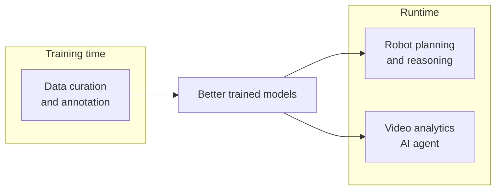
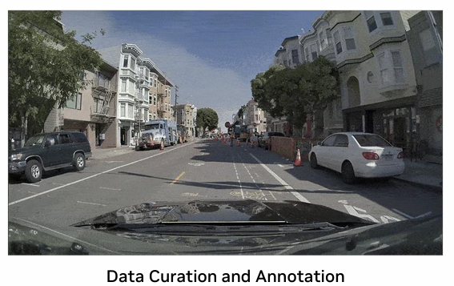
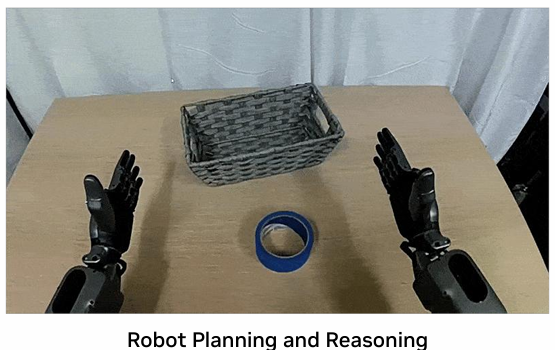
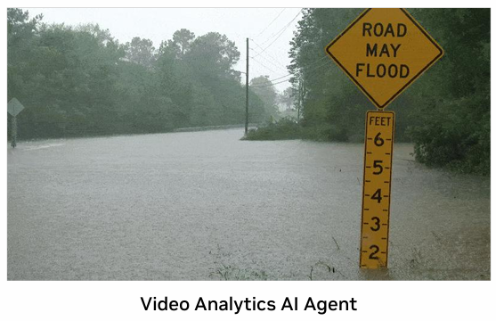

## Introduction

- Earlier topic showed that physical AI is limited by data and by understanding. 
- Reasoning helps at both ends.

| Stage | Problem | How a reasoning VLM helps? |
|-------|---------|---------------------------|
| **Before running** | Millions of clips need to be filtered, labeled and described, and doing it by hand does not scale | The model watches and writes the labels and captions |
| **While running** | A robot given a vague command must work out the steps | The model breaks the command into tasks |
| **While running** | Camera feeds need someone to watch them | The model watches and reports in plain language |

- After learning on Cosmos 3 as a vision language model. This topic answers **"where is that used?"**
- **"Analyze data during training and runtime."** That means the reasoning model helps at two moments in a physical AI project.
- It shows three use cases, each with an example image.

| When | Use case | Example image |
|------|-----------------------|---------------|
| **Training time** (before the system runs) | **Data Curation and Annotation** | A dashcam view down a city street |
| **Runtime** (while the system is working) | **Robot Planning and Reasoning** | Two robot hands over a table with a basket and a roll of blue tape |
| **Runtime** | **Video Analytics AI Agent** | The flooded road with the "ROAD MAY FLOOD" sign |

## Three Use Cases

### 1. Data Curation and Annotation

- NVIDIA describes this as letting developers automate high-quality curation and annotation of massive, diverse training datasets. 
- The model reads video and produces captions, labels and quality judgments that would otherwise take people a very long time.

Examples from NVIDIA's announcements:

1. **Uber** is using Cosmos Reason to annotate and caption autonomous vehicle training data, and has been post-training it to summarize visual data and analyze scenarios such as pedestrians walking across highways.
2. **Linker Vision and Milestone Systems** use it to curate large amounts of video to train vision language models for visual agents.
3. NVIDIA's own robotics and DRIVE teams use it for data curation and filtering, annotation and VLA post-training.

- This connects directly to the **Cosmos Curator** later in the deck, where an annotation step in the pipeline uses Cosmos Reason.

### 2. Robot Planning and Reasoning

- NVIDIA describes the model here as the brain for deliberate, methodical decision making in a robot vision language action (VLA) model. 
- Given a complex command, the robot can break it into tasks and carry them out using common sense, even in unfamiliar settings.
- The image, two robot hands over a table with a basket and a roll of tape, fits a command such as "put the tape in the basket". 
- The model decides the order of steps, and a lower-level controller carries them out.

### 3. Video Analytics AI Agent

- Here the model is the reasoning engine inside an **AI agent that watches video** and answers questions or writes reports. 
- Here reuses the flood image from the previous topic.
- NVIDIA's blueprint for this is **Video Search and Summarization (VSS)**.
- NVIDIA's announcements describe VAST Data, Milestone Systems and Linker Vision adopting Cosmos Reason to automate traffic monitoring, improve safety and enhance visual inspection in cities and industrial settings.

> **Why it matters:** the same model serves the data team (labeling), the robot (planning) and the operations team (monitoring), so one investment covers several jobs.

## The Adopters

| Company | What companies are doing? |
|---------|---------------------|
| **Uber** | Annotating and captioning AV training data, and post-training for scenario analysis (NVIDIA) |
| **Linker Vision** | Curating video to train VLMs for visual agents, and traffic monitoring (NVIDIA) |
| **Milestone Systems** | Built a VLM for intelligent transportation using NeMo Curator for use in the VSS blueprint, and adopting Cosmos Reason for traffic and safety use (NVIDIA) |
| **Telit Cinterion** | Listed by NVIDIA among partners advancing physical AI. NVIDIA's blog describes its AI visual inspection platform using NVIDIA TAO and vision foundation models for defect detection |
| **Nexar** | NVIDIA's earlier announcement says Nexar uses Cosmos Predict for autonomous driving |
| **Voxel51** | NVIDIA says its FiftyOne data engine supports NuRec for reconstruction data preparation |
| **Tulip** | Listed among Cosmos adopters on NVIDIA's Cosmos page.|
| **Intenseye** | Company's own blog says it integrated Cosmos Reason 2 into its safety control room ([Intenseye blog](https://www.intenseye.com/blog/from-detection-to-prediction-intenseye-integrates-nvidia-cosmos-reason-2)).|
| **Levatas** | Company's own LinkedIn post says its platform uses Cosmos Reason VLM with DeepStream and VSS for utility inspections ([Levatas on LinkedIn](https://linkedin.com/company/levatas)).|

> Caution:
    - Much of NVIDIA's adopter material refers to **earlier Cosmos Reason versions** (Reason 1 and Reason 2), so describe these as companies building on Cosmos Reason, not necessarily on Cosmos 3.

## About the Words "Real-Time"

- The title says "real-time reasoning", but the topic gives no latency numbers. 
- In this deck, real time reasoning mostly comes from the smaller Edge and Nano sizes and the speed ups (fewer video tokens and 4-bit NVFP4). 
- If someone asks "how fast is it?", the answer depends on the model size, the GPU and the video length.

## Summary

1. Where Cosmos reasoning is used: **training time** (data curation and annotation) and **runtime** (robot planning, video analytics agents).
2. Data curation uses the model to caption, label and filter huge video collections.
3. Robot planning uses it to turn a command into a sequence of tasks.
4. Video analytics agents use it to watch camera feeds and report in plain language.
5. Several companies are listed as adopters, though NVIDIA's own material mostly refers to earlier Cosmos Reason versions.

## References

1. [NVIDIA Newsroom, "NVIDIA Opens Portals to World of Robotics With New Omniverse Libraries, Cosmos Physical AI Models and AI Computing Infrastructure"](https://nvidianews.nvidia.com/news/nvidia-opens-portals-to-world-of-robotics-with-new-omniverse-libraries-cosmos-physical-ai-models-and-ai-computing-infrastructure)
2. [NVIDIA Newsroom, "NVIDIA Announces Major Release of Cosmos World Foundation Models and Physical AI Data Tools"](https://nvidianews.nvidia.com/news/nvidia-announces-major-release-of-cosmos-world-foundation-models-and-physical-ai-data-tools)
3. [NVIDIA Blog, "CrowdStrike, Uber, Zoom Among Industry Pioneers Building Smarter Agents With NVIDIA Nemotron and Cosmos Reasoning Models"](https://blogs.nvidia.com/blog/nemotron-cosmos-reasoning-enterprise-physical-ai/)
4. [NVIDIA Blog, "Making Safer Spaces: NVIDIA and Partners Bring Physical AI to Cities and Industrial Infrastructure"](https://blogs.nvidia.com/blog/physical-ai-partners-metropolis-updates-siggraph/)
5. [NVIDIA Cosmos, Physical AI information page (adopters list)](https://www.nvidia.com/en-us/ai/cosmos/llm-info/)
6. [NVIDIA Newsroom, "NVIDIA Launches Cosmos 3, the Open Frontier Foundation Model for Physical AI"](https://nvidianews.nvidia.com/news/nvidia-launches-cosmos-3-the-open-frontier-foundation-model-for-physical-ai)
