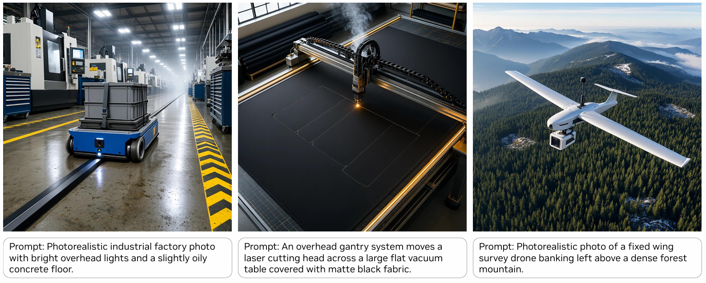

## Introduction

- We know that physical AI is short of data. Images are a good example of the gap:

| Need | Why real photos fall short? |
|------|----------------------------|
| Pictures of unusual or risky situations (a slippery floor, smoke at a cutting head) | Rare, and sometimes dangerous or costly to capture |
| Many variations of the same scene (lighting, surfaces, camera angle) | Each variation needs a new shoot |
| Images of equipment or sites that you cannot access | No camera on location |
| Training data for inspection and detection models | Needs wide variety to work outside the lab |

- Text-to-image lets a developer **describe the scene they need** and get as many examples as they want.

## Example

- This topic shows Cosmos 3 **creating still images from a text description**. 
- It has three examples, each with its prompt underneath.



| Example | Prompt | What the image shows? |
|---------|---------------------|----------------------|
| **1. Factory floor** | "Photorealistic industrial factory photo with bright overhead lights and a slightly oily concrete floor." | A long factory aisle with machines on both sides and a small cart carrying grey crates, with reflections on a wet-looking floor and yellow safety lines |
| **2. Laser cutting** | "An overhead gantry system moves a laser cutting head across a large flat vacuum table covered with matte black fabric." | A gantry rail with a cutting head over a black table, with a small glow and a wisp of smoke at the cutting point |
| **3. Survey drone** | "Photorealistic photo of a fixed wing survey drone banking left above a dense forest mountain." | A white fixed-wing drone with a camera, tilted in a turn above a forested mountain ridge |

- All three are industrial or field scenes, not everyday photos. That is deliberate and links to physical AI data needs.

## What Is Happening Inside?

- Image generation in Cosmos 3 is the **generator tower** at work, with the reasoner tower providing understanding of the prompt.

1. NVIDIA's technical blog lists text in and image out as a supported combination, described as physically plausible image generation.
2. NVIDIA's documentation treats an image as a **single-frame video**. The same pipeline that makes video makes images when you ask for one frame.
3. The model is available as Nano and Super, and NVIDIA also publishes few-step distilled versions for faster image generation, such as a 4-step Super text-to-image checkpoint.
4. The Super text-to-image model is the one that placed first among open models on the Artificial Analysis leaderboard

A short example from NVIDIA's documentation of how a developer calls it:

```python
result = pipe(prompt=json.dumps(json_prompt), num_frames=1, height=720, width=1280)
result.video[0].save("cosmos3_t2i.jpg", format="JPEG", quality=85)
```

- `num_frames=1` is what turns the video pipeline into an image generator.

---

## Why the Prompts Look Like This?

- Cosmos 3 was trained on **long, highly descriptive captions**. 
- For the best quality, a short prompt should be **upsampled** into a structured JSON description before it goes to the model. 
- NVIDIA provides an open upsampling script for this, which is what the later "prompt upsampling".

- Reading the three prompts, each one packs in the kinds of details that matter for realism.

| Detail type | Example |
|-------------|------------------------|
| **Lighting** | "bright overhead lights" |
| **Surface condition** | "slightly oily concrete floor", "matte black fabric" |
| **Equipment and motion** | "overhead gantry system moves a laser cutting head" |
| **Viewpoint and pose** | "banking left above a dense forest mountain" |
| **Style** | "photorealistic photo" |

> **Why it matters:** the more physical detail in the prompt, the more useful the image is as training data. A prompt about an oily floor yields reflections that a vision model should learn to handle.

## Safety Built In

NVIDIA's documentation says Cosmos 3 runs a **safety checker** by default, using the Cosmos guardrail models:

1. A text guardrail rejects unsafe prompts before generation.
2. A video guardrail checks the generated frames and either blurs detected faces or rejects the output.


## Where Generated Images Fit?

| Use | Link to the rest of the deck |
|-----|------------------------------|
| Training and testing visual inspection and detection models | Defect Image Generation|
| Filling gaps in a dataset | Physical AI Data Factory Blueprint |
| Starting point for video | Cosmos for World Generation  |
| Checking realism before training | Cosmos Evaluator and Cosmos Curator |

## Summary

1. Cosmos 3 can **generate photoreal images from text**.
2. An image is produced as a single-frame video through the same pipeline used for video.
3. Prompts that include lighting, surfaces, motion and viewpoint give more useful training images.
4. Short prompts work best after being upsampled into a longer structured description.
5. A default safety checker screens prompts and outputs.
6. The main value for physical AI is cheap, varied images of rare or hard-to-capture scenes.

## References

1. [NVIDIA Technical Blog, "Develop Physical AI Reasoning, World, and Action Models with NVIDIA Cosmos 3"](https://developer.nvidia.com/blog/develop-physical-ai-reasoning-world-and-action-models-with-nvidia-cosmos-3/)
2. [Hugging Face Diffusers documentation, "Cosmos 3"](https://huggingface.co/docs/diffusers/main/api/pipelines/cosmos3)
3. [NVIDIA Newsroom, "NVIDIA Launches Cosmos 3, the Open Frontier Foundation Model for Physical AI"](https://nvidianews.nvidia.com/news/nvidia-launches-cosmos-3-the-open-frontier-foundation-model-for-physical-ai)
4. [NVIDIA Research, "Cosmos 3: Omnimodal World Models for Physical AI" (technical report)](https://research.nvidia.com/labs/cosmos-lab/cosmos3/technical-report.pdf)
