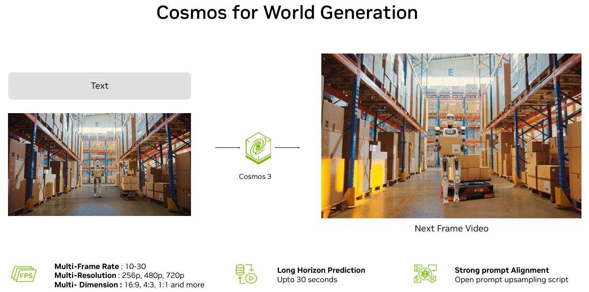
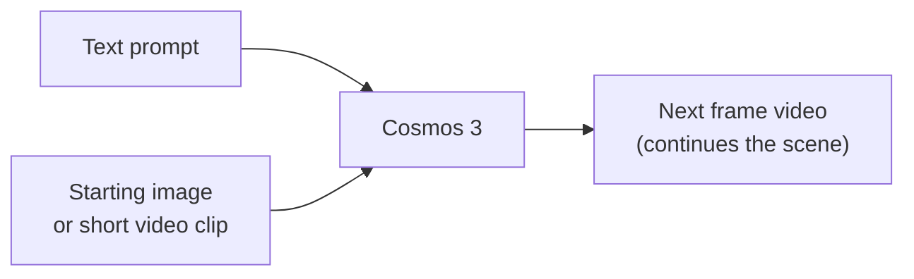

## Introduction

- The previous topic was about still images. This one is about **video: generating what happens next in a scene.**
- Robots and vehicles need to understand how scenes unfold over time, and developers need video of situations they cannot easily film.

| Need | Why a world generator helps? |
|------|-----------------------------|
| Training video for rare or risky events | Generate them instead of waiting for them to happen |
| Many versions of one scene | Change the prompt, keep the starting frame |
| Predicting consequences | See likely futures before a robot acts |
| Varied formats for different models | Pick the frame rate, size and shape that the training pipeline needs |

- A model that can predict the next frames is acting as a **world model**: it has learned how the physical world tends to move and change.
- In short: **give Cosmos 3 a starting image or clip plus a text instruction, and it predicts how the scene continues.**

## Three Features

### 1. Multi-frame rate, multi-resolution, multi-dimension

NVIDIA's Cosmos repository lists the supported generation settings:

| Setting | Supported values |
|---------|------------------|
| **Frame rates** | 10, 16, 24 and 30 FPS (default 24) |
| **Resolution tiers** | 256p, 480p and 720p (default 480p) |
| **Aspect ratios** | 16:9, 4:3, 1:1, 3:4 and 9:16 (default 16:9) |
| **Frame count** | 5 to 300 frames (default 189) |

- It says "10-30" for frame rate and "16:9, 4:3, 1:1 and more" for shape. 
- Both match, with the note that the frame rates are four fixed choices rather than any value in between.

### 2. Long horizon prediction, up to 30 seconds

- The 30 second figure follows from the settings above, but only at the lowest frame rate. 
- The maximum is 300 frames, so how long the clip runs depends on the frame rate you choose.

| Frame rate | Longest clip at 300 frames |
|------------|----------------------------|
| 10 FPS | 30 seconds |
| 16 FPS | about 18.8 seconds |
| 24 FPS | 12.5 seconds |
| 30 FPS | 10 seconds |

- The default of 189 frames at 24 FPS gives about 7.9 seconds, which is what NVIDIA's documentation uses in its examples.

### 3. Strong prompt alignment, with an open prompt upsampling script

- Cosmos 3 was trained on long, descriptive captions, so short prompts work best after being **upsampled** into a denser structured description.
- NVIDIA's documentation says the upsampling expands short scene descriptions into dense structured prompts and recommends keeping world generation prompts under 300 words. 
- The upsampling script is open and lives in NVIDIA's Cosmos Framework on GitHub. It works with an LLM endpoint that you choose.

## Reading the Diagram

NVIDIA's documentation describes the relevant modes:

| Mode | Input | Result |
|------|-------|--------|
| **Text to video** | Text only | A new video from a description |
| **Image to video** | Text and an image | The image becomes the first frame and the model generates the rest |
| **Video to video** | Text and a short clip | The clip's opening frames are kept, and the model continues from them |

- Input detail from NVIDIA: video conditioning uses 5 frames at the matching resolution, and the sizes are 1280 by 720 for 720p, 832 by 480 for 480p and 320 by 192 for 256p.

## Edge Is More Limited

- NVIDIA lists tighter limits for the small on robot model, Cosmos 3 Edge: only 256p and 480p, 12 to 30 FPS, and 50 to 150 frames. 
- It also does not currently support video-to-video transfer. For long, high-quality clips, Nano or Super is the better fit.

## Limits to Mention

- NVIDIA's own documentation says Cosmos 3 can produce artifacts in long, high-resolution or physically complex outputs. 
- The failure modes it lists include:

    1. Temporal inconsistency (things changing from frame to frame)
2. Unstable camera or object motion
3. Object morphing
4. Inaccurate 3D structure
5. Implausible physical dynamics

- NVIDIA adds that applications needing physically grounded simulation or safety-critical control need extra validation before deployment.

> **Why it matters:** a generated video is a prediction, not a recording. It is useful for training and testing, but it should be checked, especially over long horizons.

## Summary

1. Cosmos 3 **predicting the next frames of a scene** from a text prompt plus a starting image or clip.
2. It supports four frame rates (10 to 30 FPS), three resolution tiers (256p to 720p) and several aspect ratios.
3. "Up to 30 seconds" is the maximum, reached at 10 FPS with 300 frames. The default is about 7.9 seconds.
4. Short prompts should be upsampled into longer structured ones, using NVIDIA's open script.
5. The small Edge model has tighter limits than Nano and Super.
6. Long or complex clips can show artifacts, so generated video needs checking before use.

## References

1. [NVIDIA Cosmos on GitHub (README: supported generation settings, input and output, limitations)](https://github.com/nvidia/cosmos)
2. [Hugging Face Diffusers documentation, "Cosmos 3"](https://huggingface.co/docs/diffusers/main/api/pipelines/cosmos3)
3. [NVIDIA Technical Blog, "Develop Physical AI Reasoning, World, and Action Models with NVIDIA Cosmos 3"](https://developer.nvidia.com/blog/develop-physical-ai-reasoning-world-and-action-models-with-nvidia-cosmos-3/)
4. [NVIDIA Newsroom, "NVIDIA Launches Cosmos 3, the Open Frontier Foundation Model for Physical AI"](https://nvidianews.nvidia.com/news/nvidia-launches-cosmos-3-the-open-frontier-foundation-model-for-physical-ai)
