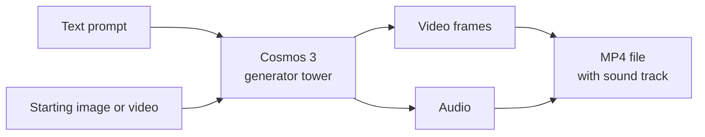

## Introduction

- The real world is not silent, and sound carries information that pictures do not.

| Real world sound | What it tells you |
|------------------|-------------------|
| An engine rising and falling | Speed and acceleration |
| A crash, a thud or a clank | That contact just happened |
| A warning beep or alarm | A hazard or a machine state |
| Echo and background noise | What kind of place it is |

- A world model that makes only silent video leaves out part of what a machine would sense. Silent clips also give less to train audio-aware systems on.
- The last topic generated silent video. This one adds **sound**: Cosmos 3 can create the audio track together with the video.

- Generate Worlds With Sound On: Pair motion with audio that follows visible events, source movement, and scene context.

| Phrase | Meaning |
|--------|---------------|
| **Follows visible events** | If something happens on screen, such as a skid or an impact, the sound should happen at that moment |
| **Source movement** | As the thing making the noise moves, the sound should change to match, such as a car passing by |
| **Scene context** | The overall sound should fit the place, such as a race track compared with a quiet room |

- NVIDIA's documentation lists inaccurate sound and video alignment among the known failure modes, so the match is good but not perfect. See the limits below.

## How It Works?

- Sound is one more modality in the **generator** from the architecture topic.

1. NVIDIA's Cosmos repository says that, in generator mode, noisy image, video, audio and action tokens are denoised through full attention, so the model can generate coherent multimodal outputs together.
2. Audio and video are produced in the same pass and can "see" each other, which is how the sound can be lined up with the picture. This explanation of why it works is my reading of the architecture.
3. The sound is not generated on its own. NVIDIA's model table notes that the models generate sound **along with the video, not standalone**.

## What You Can Do and What You Get?

NVIDIA's documentation lists these sound-capable modes:

| Mode | Input | Output |
|------|-------|--------|
| **Text to video with sound** | Text | Video and sound |
| **Image to video with sound** | Text and an image | Video and sound |
| **Video to video with sound** | Text, a video and its sound | Video and sound |

- Output format from NVIDIA's model card: a **stereo AAC audio stream at 48 kHz, muxed into the MP4 file**. 
- If you give the model a video that already has sound, that audio should also be stereo at 48 kHz.

- For developers using the Hugging Face Diffusers pipeline, sound is switched on with `enable_sound=True`, and it needs a checkpoint that includes the sound tokenizer.

## Which Models Support It?

| Model | Sound output |
|-------|--------------|
| **Cosmos 3 Super (64B)** | Yes |
| **Cosmos 3 Nano (16B)** | Yes |
| **Cosmos 3 Edge (4B)** | No |

## Limits and Safety

1. **Alignment errors.** NVIDIA lists inaccurate sound-video alignment among the failure modes of Cosmos 3, along with temporal inconsistency and implausible physics. Check the audio, especially in long or complex scenes.
2. **Audio is not guardrailed.** NVIDIA's Diffusers documentation says the safety checker covers prompts and video frames, and that audio output is not guardrailed.
3. **Synthetic audio.** As with generated video, it is useful for training and testing but should be validated before it is treated as real.

## Summary

1. Cosmos 3 can generate **video and audio together**, as shown by an image-to-video example of a racing car.
2. The goal is audio that follows visible events, source movement and scene context.
3. Sound comes out of the generator tower in the same pass as the video, and it is never generated alone.
4. The output is a stereo, 48 kHz AAC audio track inside the MP4.
5. Nano and Super support sound. Edge does not.
6. NVIDIA lists sound-video misalignment as a known limitation, and audio is not covered by the guardrails.

## References

1. [NVIDIA Cosmos on GitHub (README: model family, generator mode, limitations)](https://github.com/nvidia/cosmos)
2. [NVIDIA Hugging Face model card, Cosmos3-Nano](https://huggingface.co/nvidia/Cosmos3-Nano)
3. [NVIDIA Hugging Face model card, Cosmos3-Super](https://huggingface.co/nvidia/Cosmos3-Super)
4. [Hugging Face Diffusers documentation, "Cosmos 3"](https://huggingface.co/docs/diffusers/main/api/pipelines/cosmos3)
5. [NVIDIA Newsroom, "NVIDIA Launches Cosmos 3, the Open Frontier Foundation Model for Physical AI"](https://nvidianews.nvidia.com/news/nvidia-launches-cosmos-3-the-open-frontier-foundation-model-for-physical-ai)
