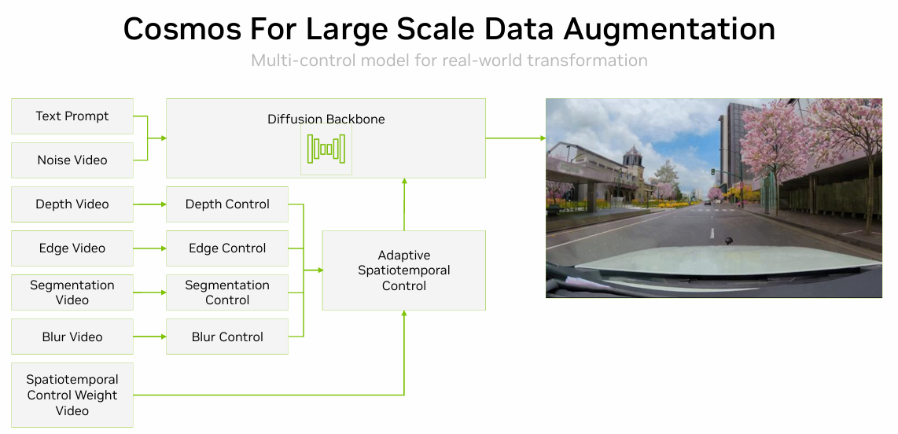

## Introduction

- We know that physical AI is short of varied data. 
- A model trained on sunny, clear footage will struggle at night, in rain or in a different city. 
- Filming every condition is slow and costly.

| Need | How transformation helps? |
|------|--------------------------|
| Same scene in many conditions (day, night, rain, snow, seasons) | Change the look, keep the layout |
| Turn simulator output into realistic video | Simulated video is clean but looks artificial, so it can be transformed to look real |
| Cover rare edge cases | Alter existing clips instead of waiting for the real event |
| Train on more variety without a bigger camera budget | One clip becomes many |

- This is the "Sim2Real" idea: start with a simulator's perfectly controlled scene and make it look like the real world.
- Earlier topic generated new scenes from text. This topic is about **transforming a scene you already have**: keep its structure and motion, but change how it looks.

## How the Diagram Works?

What Are the Four Controls?

- Each control is a video that records one kind of structure from the source clip.

| Control | What it captures? | What it keeps fixed? |
|---------|------------------|---------------------|
| **Depth** | How far each part of the scene is from the camera | The 3D layout |
| **Edge** | Outlines of objects | Shapes and boundaries |
| **Segmentation** | Which pixels belong to which kind of object (road, car, tree, sky) | What is where |
| **Blur** | A blurred version of the original video | Overall color and rough appearance |

- NVIDIA's model card says you can supply a text prompt plus up to four control videos, and the model predicts a photorealistic output video guided by them. 
- Automatic extraction is available for edge and blur when you give it only a regular video.

1. **Each control has its own branch.** NVIDIA describes the Transfer 2.5 control branch as a copy of a few transformer blocks of the base model. It reads the control video and injects what it finds into the matching blocks of the main model. Each control video gets a dedicated branch.
2. **The mixer weights them.** NVIDIA's earlier Cosmos Transfer paper describes a **spatiotemporal control map** that weights each control across space and time, so the model can lean on the most relevant hint in each region. An example would be trusting segmentation for the road surface and edges for the buildings.
3. **The text prompt sets the look.** The backbone denoises the video from noise, guided by the prompt and by the controls.

- NVIDIA's quickstart also shows that binary masks can limit a control to specific regions of the video.

> **Why it matters:** the controls keep the scene's geometry and motion, while the prompt changes the appearance. This is what makes the output useful as a variation of the original and not just a different video.

| Part of the diagram | Role |
|---------------------|------|
| **Text Prompt** | Describes the look you want, such as the season or weather |
| **Noise Video** | The starting noise that the diffusion model refines into the output video |
| **Depth, Edge, Segmentation, Blur Video** | Four structural "hints" taken from a source video, each with its own control block |
| **Adaptive Spatiotemporal Control** | Mixes the four hints, deciding how strongly each one counts in each place and moment |
| **Spatiotemporal Control Weight Video** | The map that tells the mixer where to weight which hint |
| **Diffusion Backbone** | The main video generator, steered by the controls |
| **Box at the bottom** | "Pair with leading simulation platforms: NVIDIA Omniverse, NuRec" |

## Which Model Is This?

- On the platform overview, **Cosmos Transfer 2.5** is the transfer model listed, and the control design above matches NVIDIA's descriptions of it.

| Fact | Source |
|------|--------|
| Cosmos Transfer 2.5 is a multi-control model for data augmentation from structured video inputs | NVIDIA blog on Hugging Face |
| It is a 2B model, described as **3.5x smaller** than the previous Transfer 1 (7B) while faster and better in quality | NVIDIA blog on Hugging Face |
| It builds on Cosmos Predict 2.5 | NVIDIA model card |
| Inputs may come from a physics simulator such as Isaac Sim or from real-world video | NVIDIA research page |
| A distilled Transfer 2.5 Edge model offers lower latency inference | NVIDIA GitHub for Transfer 2.5 |

- Cosmos 3 also covers transfer. NVIDIA's Cosmos 3 repository lists video transfer examples with edge, blur, depth, segmentation and world-scenario controls. 
- The Edge size of Cosmos 3 does not currently support video-to-video transfer.

## Benefits

From NVIDIA's blog on Cosmos Transfer 2.5:

1. **Better robot generalization.** Robot policy models trained with Transfer 2.5 augmentation generalize significantly better to new environments than the others compared.
2. **Better control adherence for driving.** On generated multi-view videos, 3D lane and cuboid detection improved by up to **60%** over the previous AV model.
3. **Less error build-up.** Across all four control types, Transfer 2.5 shows less error accumulation than Transfer 1 over long videos.

## Pairing With Simulation: Omniverse and NuRec

| Platform | Role |
|----------|------|
| **NVIDIA Omniverse** | Builds physically accurate virtual worlds. Its output (with depth and segmentation available directly from the simulator) can feed the controls |
| **NuRec** | NVIDIA's neural reconstruction, which rebuilds real scenes in 3D from camera data, so a captured real scene can be replayed and then transformed |

- This links back to the three-computer note: simulation gives structure, and Cosmos adds realism and variety.

## Summary

1. Cosmos Transfer keeps a scene's structure and changes its look, driven by a text prompt and up to four control videos.
2. The four controls are **depth, edge, segmentation and blur**, each with its own control branch.
3. An adaptive mixer weights the controls across space and time, using a control weight map.
4. It turns one clip or one simulator scene into many realistic variations, which is the core of data augmentation and Sim2Real.
5. Transfer 2.5 is a smaller 2B model than its predecessor, with reported gains for robot policies and driving.
6. It pairs with Omniverse for simulation and NuRec for reconstructed real scenes.

## References

1. [NVIDIA on Hugging Face, "Cosmos Predict 2.5 & Transfer 2.5: Evolving the World Foundation Models for Physical AI"](https://huggingface.co/blog/nvidia/cosmos-predict-and-transfer2-5)
2. [NVIDIA Cosmos Transfer 2.5 model card (build.nvidia.com)](https://build.nvidia.com/nvidia/cosmos-transfer2_5-2b/modelcard)
3. [NVIDIA Research, Cosmos-Transfer2.5](https://research.nvidia.com/labs/cosmos-lab/cosmos-transfer2.5)
4. [NVIDIA Cosmos-Transfer2.5 on GitHub](https://github.com/nvidia-cosmos/cosmos-transfer2.5)
5. [NVIDIA Cosmos documentation, Transfer 2.5 Quickstart Guide](https://docs.nvidia.com/cosmos/latest/transfer2.5/quickstart_guide.html)
6. [NVIDIA Research, "Cosmos-Transfer1: Conditional World Generation with Adaptive Multimodal Control" (arXiv)](https://web3.arxiv.org/pdf/2503.14492v2)
7. [NVIDIA Cosmos on GitHub (README: Cosmos 3 transfer examples)](https://github.com/nvidia/cosmos)
