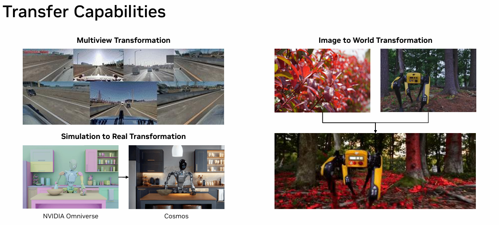
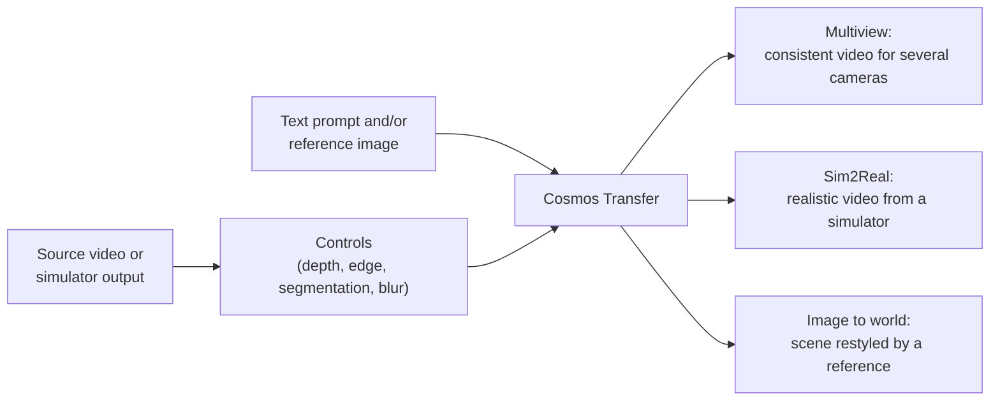

## Introduction

- The previous topic explained how Cosmos Transfer works.
- This topic shows **three things it can do**, each with a before-and-after example, and then lists companies using it.

| Capability | What it shows? |
|------------|----------------------|
| **Multiview Transformation** | A set of camera views of a highway, as seen from different cameras on one vehicle |
| **Simulation to Real Transformation** | Left: a cartoon-colored kitchen from **NVIDIA Omniverse** with a robot. Right: the same scene from **Cosmos**, now realistic |
| **Image to World Transformation** | Two small inputs (a close-up of red leaves, and a robot dog in a forest) combine into one output: the robot dog in a forest covered in red leaves |

| Problem | Which capability helps? |
|---------|------------------------|
| Vehicles carry several cameras, and training data must be consistent across all of them | Multiview |
| Simulators are controllable and cheap but look artificial, which hurts models trained on them | Simulation to real |
| Real robots must work in places that look very different from where they were trained | Image to world |

## Three Capabilities

### 1. Multiview Transformation

Autonomous vehicles and some robots use **several cameras at once**. If you change the look of one camera's video (say, to rain), the other cameras must agree, or the training data contradicts itself.

1. NVIDIA's technical blog describes a multiview model that extends single-view videos into multi-view consistent sequences.
2. NVIDIA says Cosmos Transfer 2.5 improves multi-camera consistency by spreading its control blocks more evenly through the network.
3. NVIDIA's model card lists an autonomous vehicle multiview version of Transfer 2.5 that works with a set of seven cameras, and a robot multiview version also exists.
4. NVIDIA's Transfer 2.5 blog reports up to a **60% improvement** over the previous model in how well generated multi-view driving videos preserve 3D lanes and cuboids. This is NVIDIA's reported result on specific tests.

### 2. Simulation to Real Transformation (Sim2Real)

This is the most widely used workflow. NVIDIA's documentation calls it **Simulations to Photorealism**, and says it minimizes the need for high fidelity in 3D simulation.

1. A simulator such as **Omniverse** makes a scene where everything is known exactly: where the robot is, what each object is, how far away things are.
2. Cosmos Transfer uses that structure as the controls and a text prompt for the look, and produces realistic video.
3. NVIDIA's Cookbook gives an example for mobile robots that applies multi-control settings (edge weight 0.3 and segmentation weight 1.0) to vary lighting, materials and textures while **preserving geometry, motion and annotations**.

> **Why it matters:** the simulator already knows the labels. If the realistic version keeps the geometry and motion, those labels can still apply, so you get realistic-looking training data without labeling it by hand. Check a sample before you rely on it.

### 3. Image to World Transformation

The diagram shows a reference image of red leaves and a clip of a robot in a forest, producing a clip of that robot in a forest transformed by the red-leaf look.

1. NVIDIA's model card says Transfer 2.5 generates images and videos from text, image or control video inputs.
2. The closest NVIDIA-documented workflow is **Scale World State Diversity**, which creates variations of a scene's conditions from a base clip. That workflow is described in NVIDIA's Transfer 2.5 documentation.

## How They Relate to the Previous topic?

All three capabilities use the same model. They differ in what you feed it.

- NVIDIA's Cosmos repository also says Cosmos 3 provides stronger transfer capabilities than Transfer 2.5. 
- Cosmos 3 lists transfer with the same four control types plus world-scenario controls.

## The Adopters

- Roles below are what NVIDIA's own pages say.

| Company | What NVIDIA says? |
|---------|------------------|
| **CARLA** | The open-source driving simulator integrated Cosmos Transfer to augment its simulation outputs, so its community can generate video variations with simple prompts. NVIDIA cites a community of 150,000 developers |
| **Foretellix** | Uses Cosmos Transfer to add weather and lighting to sensor simulation scenarios, giving more situation diversity |
| **Oxa** | Integrated Cosmos Transfer into its own toolchain, Oxa Foundry |
| **Skild AI** | Uses Cosmos Transfer to augment synthetic datasets for its robots |
| **Voxel51** | Provides a toolkit for managing, visualizing and refining data generated by Cosmos Transfer |
| **PlusAI** | NVIDIA says Plus is embedding Cosmos models into its SuperDrive technology for self-driving trucks, and post-trained Cosmos Predict 1 on real truck driving data to create multiview videos matching real truck cameras |
| **Li Auto** | Named in NVIDIA's Cosmos 3 launch as a developer building on Cosmos for autonomous vehicles |
| **Milestone** | Named in NVIDIA's material for vision AI agents and video search. |
| **Gatik** | NVIDIA's automotive ecosystem post mentions Gatik's use of DRIVE AGX for trucks.  |

Two cautions:

1. Some NVIDIA adopter stories are from 2025 and refer to earlier Cosmos Transfer versions. Describe these as companies using Cosmos Transfer, not necessarily Cosmos 3.
2. For Gatik and X-Humanoid, avoid stating what they do with Transfer unless you can confirm it.

## Summary

1. Three uses of Cosmos Transfer: **multiview, simulation to real, and image to world**.
2. Multiview keeps several camera views consistent, which matters for vehicles and robots with multiple cameras.
3. Sim2Real turns simulator output into realistic video while preserving geometry, motion and annotations.
4. Image to world restyles a scene using a reference image. NVIDIA's pages do not name this feature.
5. Named adopters use Transfer for driving simulation, robot data and data management, though NVIDIA's roles vary by company.
6. Cosmos 3 offers stronger transfer than Transfer 2.5, according to NVIDIA's repository.

## References

1. [NVIDIA Technical Blog, "Simplify End-to-End Autonomous Vehicle Development with New NVIDIA Cosmos World Foundation Models"](https://developer.nvidia.com/blog/simplify-end-to-end-autonomous-vehicle-development-with-new-nvidia-cosmos-world-foundation-models/)
2. [NVIDIA on Hugging Face, "Cosmos Predict 2.5 & Transfer 2.5: Evolving the World Foundation Models for Physical AI"](https://huggingface.co/blog/nvidia/cosmos-predict-and-transfer2-5)
3. [NVIDIA Cosmos Transfer 2.5 model card (build.nvidia.com)](https://build.nvidia.com/nvidia/cosmos-transfer2_5-2b/modelcard)
4. [NVIDIA Cosmos documentation, Cosmos-Transfer2.5](https://docs.nvidia.com/cosmos/latest/transfer2.5/index.html)
5. [NVIDIA Technical Blog, "How to Scale Data Generation for Physical AI with the NVIDIA Cosmos Cookbook"](https://developer.nvidia.com/blog/?p=109119)
6. [NVIDIA Blog, "Driving Impact: NVIDIA Expands Automotive Ecosystem to Bring Physical AI to the Streets"](https://blogs.nvidia.com/blog/auto-ecosystem-physical-ai/)
7. [NVIDIA Newsroom, "NVIDIA Announces Major Release of Cosmos World Foundation Models and Physical AI Data Tools"](https://nvidianews.nvidia.com/news/nvidia-announces-major-release-of-cosmos-world-foundation-models-and-physical-ai-data-tools)
8. [NVIDIA Newsroom, "NVIDIA Launches Cosmos 3, the Open Frontier Foundation Model for Physical AI"](https://nvidianews.nvidia.com/news/nvidia-launches-cosmos-3-the-open-frontier-foundation-model-for-physical-ai)
9. [NVIDIA Cosmos-Transfer2.5 on GitHub](https://github.com/nvidia-cosmos/cosmos-transfer2.5)
