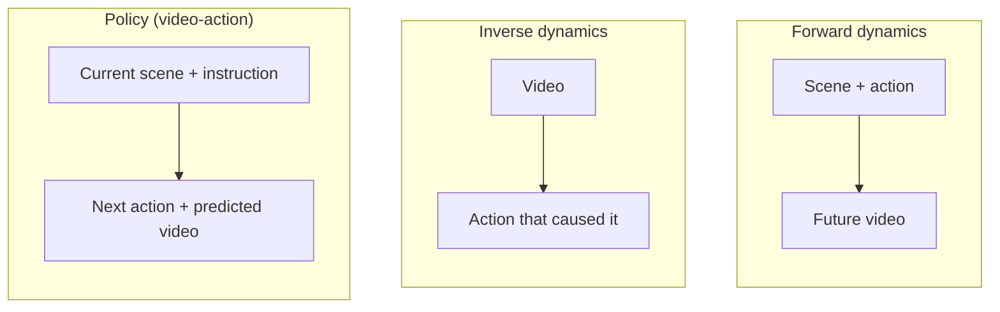
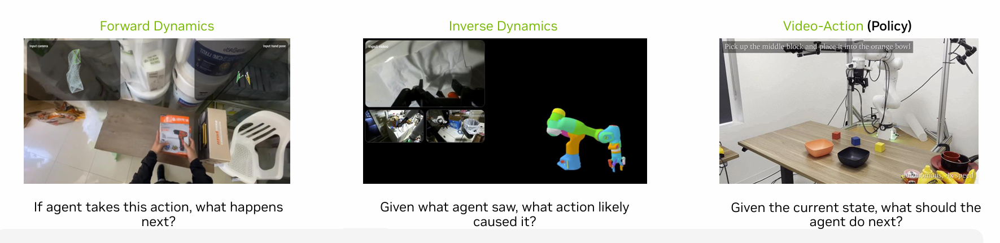
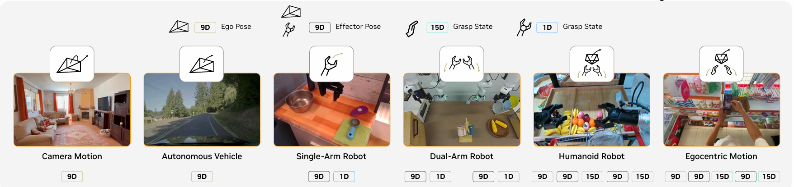

## Introduction

- A robot arm, a self-driving car and a camera on a person's head move in completely different ways.
- Normally each needs its own model and its own data format, so what one learns cannot help the others.

| Problem | What Cosmos 3 does? |
|---------|--------------------|
| Different machines, different control formats | Describes all of them with the same small building blocks |
| Most video has no action labels | Infers the likely actions from the video |
| Testing a plan on a real robot is risky | Predicts what would happen first |
| A robot needs to choose its next move | Generates the action from the current scene |

- Earlier topics used Cosmos 3 for words, pictures, video and sound. 
- This topic covers its newest modality: **action**, meaning the movements that a robot, vehicle or camera makes.
- In this topic we will learn:
- **Three configurations:** Forward Dynamics, Inverse Dynamics and Video-Action (Policy), each with a question and an example image.
- **One shared format:** Six types of "body" (embodiments), each described with the same small building blocks, shown as colored labels such as 9D, 1D and 15D.

## Three Configurations

| Configuration | Question | Meaning | Typical use |
|---------------|-----------------------|----------------|-------------|
| **Forward dynamics** | "If agent takes this action, what happens next?" | You give a starting scene and an action. The model shows the result | Simulate and test before acting |
| **Inverse dynamics** | "Given what agent saw, what action likely caused it?" | You give a video. The model works out the movements that produced it | Turn unlabeled video into training data with actions |
| **Video-Action (Policy)** | "Given the current state, what should the agent do next?" | You give the current scene and a task. The model proposes the next actions | Control a robot or vehicle |

Notes on each:

1. **Forward dynamics** needs a starting frame and an action sequence, and gives back video. NVIDIA's Cosmos repository lists examples for driving, robot arms and human hand pose.
2. **Inverse dynamics** needs a video as input. NVIDIA's examples include predicting ego-motion trajectories from driving video.
3. **Policy** predicts future video and actions together from the first frame, a text instruction and the type of body. NVIDIA's documentation shows an example task "put the pot to the left of the purple item" for a robot arm, with actions produced in chunks of 16 steps.

- This three example images match these ideas: 
    - A first-person view of someone handling a box for forward dynamics.
    - A video with a colored robot arm overlay showing the recovered motion for inverse dynamics.
    - A table-top robot with the task "Pick up the middle block and place it into the orange bowl" for policy.

> **Why it matters:** the same model that can imagine the future (forward), explain the past (inverse) and act in the present (policy) can be used as a simulator, a labeling tool and a robot controller.

## Shared Action Format

NVIDIA's technical report explains the idea in its section on a unified action representation.

1. Each action token stands for the **change** between one moment and the next.
2. Motion is described using shared geometry: **3D translation plus 6D rotation, which makes a 9D pose**. The report uses 6 numbers for rotation, which is an over parameterized form of 3D rotation that is easier for models to learn.
3. Grasp is described by what is actually happening in the hand or gripper: **fingertip positions for hands**, or **gripper open and close values for robots**.
4. A domain-specific output layer turns the shared tokens back into the control format of each real machine.

**Belowe are some examples**

- **9D Ego Pose:** Motion of the viewpoint (a vehicle, a camera or a head).
- **9D Effector Pose:** Motion of a hand or tool at the end of a robot arm.
- **15D Grasp State:** A hand's finger positions. The report says fingertip positions, and 15 matches five fingertips in 3D (my arithmetic).
- **1D Grasp State:** A gripper's open or close value.

### Six bodies

| Embodiment | Blocks shown | Total |
|-------------------------|--------------|-------|
| **Camera Motion** | 9D ego pose | 9D |
| **Autonomous Vehicle** | 9D ego pose | 9D |
| **Single-Arm Robot** | 9D effector pose + 1D gripper | 10D |
| **Dual-Arm Robot** | Two of (9D effector pose + 1D gripper) | 20D |
| **Humanoid Robot** | 9D ego pose, 9D + 15D for one hand, 9D + 15D for the other | 57D |
| **Egocentric Motion** | 9D head pose, 9D + 15D for the left hand, 9D + 15D for the right hand | 57D |

- For egocentric data, the report uses head camera pose changes as the ego pose, wrist pose changes as effector poses, and fingertip positions in each wrist frame as the grasp state.

## Which Models Support It?

1. NVIDIA lists action input and output for Cosmos 3 Nano and Super, and the Edge model has action support too.
2. NVIDIA names specialized policy checkpoints for the DROID robot dataset: **Cosmos3-Nano-Policy-DROID** and **Cosmos3-Edge-Policy-DROID**.
3. NVIDIA's model cards say action sequences run from 16 to 400 steps or frames, and that action is only supported for the listed compatible embodiments.

## Limits

- NVIDIA's Cosmos repository lists imperfect action state consistency among the known failure modes, and says safety-critical control needs extra validation. 
- Treat generated actions and rollouts as predictions to be tested, not as commands to run.

## Summary

1. Cosmos 3 treats **action** as a modality, with three configurations: forward dynamics, inverse dynamics and policy.
2. Forward dynamics predicts what happens after an action. Inverse dynamics infers the action from video. Policy chooses the next action.
3. All bodies are described with the same building blocks: a 9D pose (3 translation and 6 rotation) plus a grasp state.
4. There are six embodiments, from a camera (9D) to a two-handed humanoid or egocentric view (57D).
5. Humanoid total of 57D differs from NVIDIA's AgiBot humanoid at 29D, so avoid quoting one number for all humanoids.
6. Generated actions are predictions, so validate them before use.

## References

1. [NVIDIA Research, "Cosmos 3: Omnimodal World Models for Physical AI" (arXiv version of the technical report)](https://arxiv.org/pdf/2606.02800)
2. [NVIDIA Research, "Cosmos 3: Omnimodal World Models for Physical AI" (technical report PDF)](https://research.nvidia.com/labs/cosmos-lab/cosmos3/technical-report.pdf)
3. [NVIDIA Cosmos on GitHub (README: action conditioning and use cases)](https://github.com/nvidia/cosmos)
4. [Hugging Face Diffusers documentation, "Cosmos 3" (action modes)](https://huggingface.co/docs/diffusers/main/api/pipelines/cosmos3)
5. [NVIDIA Hugging Face model card, Cosmos3-Edge](https://huggingface.co/nvidia/cosmos3-edge)
6. [NVIDIA Technical Blog, "Develop Physical AI Reasoning, World, and Action Models with NVIDIA Cosmos 3"](https://developer.nvidia.com/blog/develop-physical-ai-reasoning-world-and-action-models-with-nvidia-cosmos-3/)
