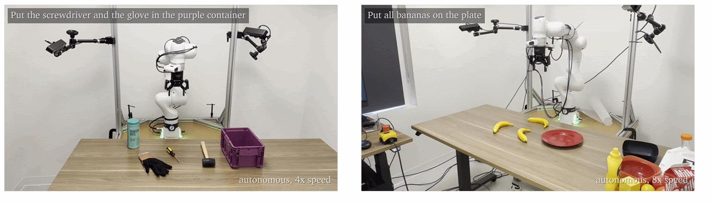
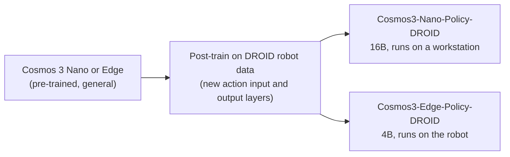

## Introduction

- A general purpose Cosmos 3 model understands the world but does not know how to drive a particular robot. 
- Every robot has its own arms, cameras and control signals. Turning a general model into a working robot controller is called **post-training**.

| Challenge | How post-training addresses it? |
|-----------|--------------------------------|
| Each robot moves differently | Train on data from that robot |
| Training a robot brain from scratch needs huge data | Start from a model that already knows how the physical world works |
| Policies often fail when objects, positions or lighting change | A model that has learned physics may generalize better. This is NVIDIA's argument, covered below |

- The previous topic explained **policy** as one of three action modes. This topic shows it working on a real robot arm.

## Examples

1. The task "Put the screwdriver and the glove in the purple container". A robot arm picks items from a table. The label says "autonomous, 4x speed".
2. The task "Put all bananas on the plate". The label says "autonomous, 8x speed" |

Two small details on the labels matter:

1. **"Autonomous"** means the robot is acting on its own, with no person controlling it.
2. **"4x" and "8x speed"** mean the clips are sped up for the presentation. The robot does not move that fast in real life.

## What "Post trained" Means?

1. **Start from a pre trained Cosmos 3 checkpoint.** The policy is resumed from the mid-trained Cosmos 3 Nano, with a freshly initialized action encoder, action-decoding layer and action embedding tokens.
2. **Train on DROID data.** NVIDIA describes the DROID platform as a Franka Panda arm with a Robotiq gripper. The dataset has 76,000 trajectories, 350 hours of interaction, 86 tasks and 564 scenes. The robot with two side cameras on the example image fits this setup.
3. **Get a policy.** Given a language instruction and camera views, it outputs robot action trajectories.

- The Nano policy predicts **32 future joint-position actions** at **15 Hz**, along with future video frames, and uses only **4 diffusion steps** at inference time.

> **Why it matters:** "DROID" in the model names tells you which robot setup it was trained for. For a different robot, you need to post-train again.?

## Two Models

| | **Cosmos3-Nano-Policy-DROID** | **Cosmos3-Edge-Policy-DROID** |
|---|-------------------------------|-------------------------------|
| **Size** | 16B | 4B |
| **Where it runs** | On a workstation beside the robot, such as one NVIDIA RTX PRO 6000. The robot streams camera views over the network and receives action chunks back | On the robot itself, on a Jetson Thor |
| **Control rate** | 15 Hz action generation | Real-time control at 15 Hz, with 32 actions per inference |
| **RoboLab result** | 36.8% success | 22.9% success |

Notes:

1. The 36.8% matches the RoboLab result for Nano on the benchmark. The 22.9% for Edge comes from NVIDIA's tutorial, where closed-loop RoboLab evaluation covers 120 language conditioned manipulation tasks.
2. The post-trained Edge policy generates action chunks in about **1.53 seconds** on a Jetson AGX Thor T5000, which supports continuous real-time control.
3. This is the trade off from the model family: the smaller on-robot model gives up some accuracy in return for running with no network round trip.

## Why a World Model Makes a Good Policy?

NVIDIA's blog on this topic compares two designs:

| | **VLA** (vision language action) | **WAM** (world action model) |
|---|----------------------------------|------------------------------|
| **Built on** | A vision language model, which learns to describe the world | A video world model, which learns how the world changes |
| **Weakness or strength** | Strong at understanding instructions, weaker at predicting physical outcomes | Starts with a physics prior, so it can predict how a scene will evolve |

The Cosmos 3 policy models are WAMs. NVIDIA lists three properties that follow:

1. **It imagines while it acts.** As it outputs actions, it can also output the video the robot's cameras would see if those actions were carried out.
2. **It keeps the full omni architecture.** Post-training removes nothing, so the checkpoint can still reason and generate video.
3. **The benefit is measurable.** In the technical report, two DROID policies with the same recipe, data and compute differ only in starting point. The one that began from an omni checkpoint trained on multi-domain action data raised RoboLab success from **28.1% to 36.8%**.

- WAMs can learn from varied interaction data and adapt to new robots with fewer demonstrations than VLAs.

## "State-of-the-art": What It Means and Does Not Mean?

1. NVIDIA's technical report says Cosmos3-Nano-Policy-DROID **ranked first on RoboLab, RoboArena and MolmoSpaces at the time of its leaderboard submissions**.
2. Leaderboards change, so "state-of-the-art" is a snapshot.
3. **First place is not the same as solved.** A RoboLab success rate of 36.8% means most of the 120 tasks still fail. The benchmark is hard.
4. The results come from a simulation benchmark for the RoboLab figure.

## Practical Points

1. Both policy models, their post training recipe and the DROID dataset (Cosmos3-DROID) are published openly. NVIDIA says the base model, datasets, recipe, weights, evaluation tools and serving stack are released under a license that permits commercial use.
2. Each new robot type, such as a dual arm setup, a UR arm or a WidowX, needs its own post-training run, though all start from the same foundation.
3. The full post training is large-scale foundation model post training, not a single GPU fine tune.

## Summary

1. The example image shows robot arms completing tasks autonomously, with two models named: **Cosmos 3-Edge-Policy-DROID** and **Cosmos 3-Nano-Policy-DROID**.
2. They are Cosmos 3 models **post trained on the DROID robot data** to output actions from instructions and camera views.
3. Nano (16B) runs on a workstation beside the robot, and Edge (4B) runs on the robot's Jetson Thor.
4. They are world action models, so they can predict video of the outcome as they act.
5. NVIDIA reports first place on RoboLab, RoboArena and MolmoSpaces at submission time, with 36.8% success for Nano on RoboLab.
6. "State-of-the-art" does not mean solved, and the clips are sped up.

## References

1. [NVIDIA Technical Blog, "Beyond VLAs: How World Action Models Reshape Robot Manipulation"](https://developer.nvidia.com/blog/beyond-vlas-how-world-action-models-reshape-robot-manipulation/)
2. [NVIDIA Technical Blog, "Post-Train NVIDIA Cosmos 3 Edge for On-Device Robot Control"](https://developer.nvidia.com/blog/post-train-nvidia-cosmos-3-edge-for-on-device-robot-control/)
3. [NVIDIA Research, "Cosmos 3: Omnimodal World Models for Physical AI" (arXiv version of the technical report)](https://arxiv.org/pdf/2606.02800)
4. [NVIDIA Research, "RoboLab: A High-Fidelity Simulation Benchmark for Analysis of Task Generalist Policies"](https://research.nvidia.com/labs/srl/projects/robolab)
