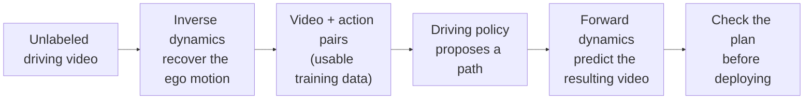

## Introduction

- Self driving development has a data problem that is different from the robot arm problem.

| Problem | Why it hurts? |
|---------|--------------|
| Fleets record huge amounts of video, but most of it has **no action labels** | Training a driving policy needs pairs of "what the car saw" and "what the car did" |
| Real driving tests are costly and risky | A bad plan cannot just be tried on a public road |
| Rare situations are rare | The cases that matter most for safety almost never appear on demand |

- The last two topic covered action and robot policy for arms. This topic applies the same three ideas to **cars** thst is policy for self driving vehicles

## How to define policy for self driving vehicles?

### Learns from real driving signals

- Says Cosmos 3 was mid trained on action data from four areas: egocentric motion, robotics, **autonomous vehicles** and camera motion. 
- For vehicles, the "action" is the **ego motion** of the car: how its position and heading change from one moment to the next.

- As the earlier action topic explained, this is written as a **9D pose** (3 numbers for translation and 6 for rotation), the same building block used for camera motion. 
- Cosmos 3's supported action list names autonomous vehicle at 9D.

### Inverse dynamics: unlabeled video to usable data

- Inverse dynamics asks, "given what the camera saw, what motion caused it?" Applied to driving, the model watches a clip and recovers how the vehicle moved.

1. This is useful because most driving video has no motion labels. The model supplies them.
2. NVIDIA's report tests this on an in house driving dataset of **6-second clips with accurate ego-vehicle trajectories at 10 frames per second**. The model predicts the ego trajectory directly from video.
3. The report measures accuracy with three standard errors:

| Metric | What it measures? |
|--------|------------------|
| **RRE** (relative rotation error) | How accurately each frame-to-frame turn is estimated? |
| **RTE** (relative translation error) | How accurately each frame-to-frame movement is estimated? |
| **ATE** (absolute trajectory error) | How consistent the whole trajectory is overall? |

- NVIDIA's conclusion is that one foundation model can be adapted to autonomous vehicle inverse dynamics while remaining competitive with or stronger than specialized baselines.

### Forward dynamics: simulate before you deploy

- Forward dynamics asks, "if the car follows this path, what will happen next?" The model takes a starting scene and a proposed motion and generates the video of the result.

1. A candidate driving plan can be tested in a generated world before it is tried for real.
2. It can also generate rare driving scenes to fill data gaps.
3. NVIDIA's report treats forward dynamics, inverse dynamics and policy as conditioning patterns of one model. Forward dynamics keeps the actions clean and generates the video, while inverse dynamics keeps the video clean and generates the actions.

> **Why it matters?:** the two directions work together. Inverse dynamics turns unlabeled video into training data, and forward dynamics checks what a trained policy would do. Both come from the same model.

## What "Policy" Means for a Car?

- A policy chooses what to do next. For a vehicle, that is a **trajectory**: where the car should go over the next moments, given what the camera sees. 

## Notes

1. **No published AV policy benchmark found.** NVIDIA's technical report gives numbers for autonomous vehicle **inverse dynamics**, and for robot policy on the DROID arm.
2. **Not a certified driving system.** NVIDIA's own repository says safety critical control needs extra validation. Treat the topic as a research and development capability.
3. **Separate NVIDIA driving models exist.** NVIDIA has other driving focused model families, such as Alpamayo.

## Summary

1. The topic applies Cosmos 3's action modes to **self-driving vehicles**.
2. For a car, the action is **ego motion**, written as a 9D pose.
3. **Inverse dynamics** recovers motion from unlabeled driving video, which creates usable training data.
4. **Forward dynamics** predicts the video that would follow a proposed path, so plans can be tested before deployment.
5. NVIDIA reports results for AV inverse dynamics, but I found no published benchmark for a Cosmos 3 driving policy.
6. Treat it as a development tool, not a certified driving system.

## References

1. [NVIDIA Research, "Cosmos 3: Omnimodal World Models for Physical AI" (arXiv version of the technical report)](https://arxiv.org/pdf/2606.02800)
2. [NVIDIA Research, "Cosmos 3: Omnimodal World Models for Physical AI" (technical report PDF)](https://research.nvidia.com/labs/cosmos-lab/cosmos3/technical-report.pdf)
3. [NVIDIA Research, Cosmos 3 project page](https://research.nvidia.com/labs/cosmos-lab/cosmos3/)
4. [NVIDIA Cosmos on GitHub (README: action conditioning and limitations)](https://github.com/nvidia/cosmos)
