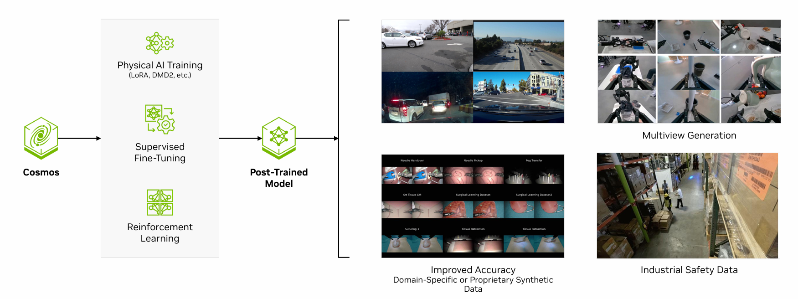
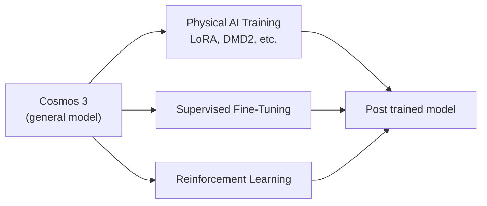

## Introduction

- NVIDIA's Cosmos Cookbook says that zero shot models give strong baselines, but many applications need better accuracy, physical realism or domain alignment, which targeted fine-tuning provides.

| Situation | Why a general model falls short? |
|-----------|---------------------------------|
| A truck with its own camera layout | The model has never seen those viewpoints |
| A surgical robot | Operating-room video looks nothing like everyday video |
| A warehouse safety system | Needs to recognize your site's rules, equipment and hazards |
| Your own private data | You cannot assume the public training data covered it |

- Post training adapts the model without redesigning it. 
- NVIDIA's technical report says Cosmos 3 can be post trained on target data for distinct applications without architectural modifications.
- A general Cosmos model knows a lot about the physical world, but not about **your** cameras, **your** robot or **your** factory. 
- This topic shows how to close that gap by **post training**: continuing to train the model on your own data.

## Workflow for COSMOS Post training

**What above workflow shows?**

- **Three methods:** **Physical AI Training** (LoRA, DMD2, etc.), **Supervised Fine Tuning**, **Reinforcement Learning**
- **Four example outputs**

## Three Methods

| Method | Meaning | When it helps? |
|--------|---------------|---------------|
| **Supervised Fine-Tuning (SFT)** | Train on labeled examples of the exact task you want | When you have good examples. The Cookbook's "full post training" updates all parameters and suits large datasets or big changes in behavior |
| **Physical AI Training: LoRA** (Low Rank Adaptation) | Train a small set of added weights and leave the main model alone | Faster and cheaper, good for quick iteration |
| **Physical AI Training: DMD2** | A distillation method, which NVIDIA's Cosmos pages describe as model compression. It trains a faster version of a model | When you need quicker inference. Cosmos 3's few-step image checkpoints are an example of this idea |
| **Reinforcement Learning (RL)** | Improve the model using a reward signal for good outcomes | When data is scarce but high quality, especially for reasoning behavior |

Points to keep in mind:

1. The topic groups LoRA and DMD2 together under "Physical AI Training". In practice LoRA is a way to adapt a model, while DMD2 is a way to speed it up. They answer different needs.
2. NVIDIA's Cosmos Cookbook describes reinforcement learning as applying to **Cosmos Reason only**.
3. Post training often follows two stages: broad exposure first, then focused fine tuning on a high quality subset.

## Concrete Example With Numbers

- NVIDIA's developer blog shows Cosmos 3 Nano post trained for traffic video question answering using LoRA, with an AI coding agent driving NVIDIA TAO training:

| Item | Result |
|------|--------|
| Dataset | Woven Traffic Safety, a four-way multiple-choice video question set with more than 8,000 training and validation samples |
| Accuracy before | 54.41% (zero-shot baseline) |
| Accuracy after one automated LoRA run | 87.14% |
| Cost | LoRA needed about 7 times fewer GPU hours than full-parameter fine-tuning in that example. One LoRA epoch took about 30 minutes on a node of A100 80 GB GPUs |

- These figures are from one NVIDIA example on one dataset. They show how much a small, targeted post training run can help, but they will not transfer exactly to your data.

## Four Example Outputs

| Example | What it shows? |
|---------------|---------------|
| **Multi-camera driving scene** | Generating video from several cameras at once, so a vehicle's camera views stay consistent.|
| **Multiview Generation** | The same idea for a robot with several camera views |
| **Improved Accuracy, domain-specific or proprietary synthetic data** | Surgical task clips such as needle handover, peg transfer and suturing. This is the healthcare version of Cosmos, covered later |
| **Industrial Safety Data** | A warehouse scene with workers and equipment, for safety-related training data |

## Adopters

| Company | What NVIDIA says? |
|---------|------------------|
| **Johnson & Johnson MedTech** | Using Isaac Sim and Cosmos-based post-training workflows to train and validate systems for its Monarch Platform for Urology |
| **FieldAI** | Building generalized robot brains with Cosmos world models for data generation, and Isaac to validate policies in simulation |
| **mimic** | Named among companies using Cosmos to accelerate physical AI training and video analytics |
| **Toyota Research Institute** | Named in the same group. A later topic in the deck covers its work |
| **AgiBot** | Listed among robotics leaders building humanoids with Cosmos world models, Isaac Sim and Isaac Lab |
| **Nexar** | NVIDIA's earlier announcement says Nexar uses Cosmos Predict to advance its autonomous driving systems |
| **PlusAI** | NVIDIA says Plus post-trained Cosmos Predict on real truck driving data to create multiview videos matching its truck cameras |
| **NVIDIA** | An adopter itself, for example in its own robotics and driving work |

- Some of this material is from earlier Cosmos versions, so describe these as companies building on Cosmos, not necessarily Cosmos 3.

## Practical Points

1. NVIDIA's Cosmos 3 post training framework is open, with recipes, dataset formats and configuration files exposed. Check the current repository for what has been released, because earlier pages listed some Cosmos 3 recipes as coming soon.
2. For a new robot type, you need a new post training run, as the robot policy topic showed.
3. Check your results on held out data, since a post trained model can drift or overfit.

## Summary

1. Post-training adapts Cosmos to **your own data**, so it fits your cameras, robots and sites.
2. The topic lists three approaches: **physical AI training (LoRA, DMD2), supervised fine-tuning and reinforcement learning**.
3. LoRA is a cheap way to adapt, DMD2 makes models faster, SFT learns from labeled examples, and RL learns from rewards.
4. In NVIDIA's example, LoRA took a traffic video question task from 54.41% to 87.14% accuracy.
5. Example results include multiview generation, surgical training data and warehouse safety data.
6. Adopters apply it in driving, robotics and healthcare.

## References

1. [NVIDIA Cosmos Cookbook, "Post-Training" overview](https://nvidia-cosmos.github.io/cosmos-cookbook/core_concepts/post_training/overview.html)
2. [NVIDIA Technical Blog, "Post-Train NVIDIA Cosmos 3 in One Day Using Agent Skills"](https://developer.nvidia.com/blog/post-train-nvidia-cosmos-3-in-one-day-using-agent-skills/)
3. [NVIDIA Technical Blog, "Maximize Robotics Performance by Post-Training NVIDIA Cosmos Reason"](https://developer.nvidia.com/blog/maximize-robotics-performance-by-post-training-nvidia-cosmos-reason)
4. [NVIDIA Cosmos-Predict2.5 on GitHub (LoRA and DMD2 distillation updates)](https://github.com/nvidia-cosmos/cosmos-predict2.5)
5. [NVIDIA Research, "Cosmos 3: Omnimodal World Models for Physical AI" (technical report)](https://research.nvidia.com/labs/cosmos-lab/cosmos3/technical-report.pdf)
6. [NVIDIA press release, "NVIDIA and Global Robotics Leaders Take Physical AI to the Real World"](https://investor.nvidia.com/news/press-release-details/2026/NVIDIA-and-Global-Robotics-Leaders-Take-Physical-AI-to-the-Real-World/default.aspx)
7. [NVIDIA press release, "NVIDIA Expands Open Model Families to Power the Next Wave of Agentic, Physical and Healthcare AI"](https://investor.nvidia.com/news/press-release-details/2026/NVIDIA-Expands-Open-Model-Families-to-Power-the-Next-Wave-of-Agentic-Physical-and-Healthcare-AI/default.aspx)
8. [NVIDIA Newsroom, "NVIDIA Announces Major Release of Cosmos World Foundation Models and Physical AI Data Tools"](https://nvidianews.nvidia.com/news/nvidia-announces-major-release-of-cosmos-world-foundation-models-and-physical-ai-data-tools)
