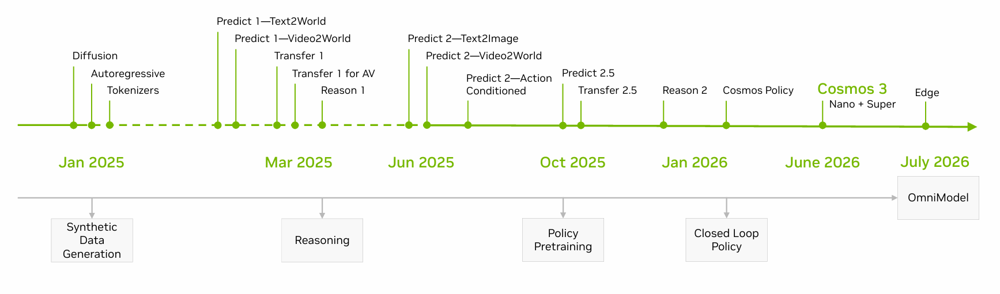
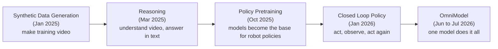

## Introduction

- With so many names (Predict, Transfer, Reason, versions 1, 2 and 2.5), it is easy to lose track of what each one is and why Cosmos 3 matters. The timeline gives the order and the pattern.
- This topic shows a **timeline** of how Cosmos grew from January 2025 to July 2026. Each model name is a milestone, and the story it tells is that Cosmos began as several separate models and ended up as one omnimodel.

## Big Picture

- The timeline shows how NVIDIA Cosmos grew from **January 2025 to July 2026**. Read it left to right and the story is simple:

> Cosmos started as **separate building blocks and models**, then learned to **reason**, then to **drive robot policies**, and finally merged into **one omnimodel (Cosmos 3)**.

## Timeline, Stage by Stage

### Stage 1: Jan 2025. The building blocks

**Purpose: Synthetic Data Generation**

- The first three dots are not products. They are the **three kinds of model** the platform is made of.

| Type | What it is? |
|------|------------|
| **Diffusion** | Generates video by refining noise step by step. Predict and Transfer models are of this kind |
| **Autoregressive** | Produces output one piece at a time, like a language model. Reason models are of this kind, and Cosmos 1 also had autoregressive world models |
| **Tokenizers** | Compress video and images into tokens the models can work with |

- NVIDIA launched the Cosmos platform with generative world foundation models, tokenizers, guardrails and a video processing pipeline. 
- The first use was to **create rare or costly video data**.

### Stage 2: Mar 2025. The first model families

**Purpose: Reasoning**

| Release | What it does? |
|---------|--------------|
| **Predict 1, Text2World** | Makes video from a text prompt |
| **Predict 1, Video2World** | Continues video from a starting clip |
| **Transfer 1** | Changes a video using control inputs |
| **Transfer 1 for AV** | Driving-focused version of Transfer |
| **Reason 1** | First physical-AI reasoning model. Understands video and answers in text |

- NVIDIA announced this wave as a major release that added new Predict and Transfer models plus Cosmos Reason.

### Stage 3: Jun 2025. Predict 2

**Purpose: Continues Reasoning to Policy Pretraining**

| Release | What it adds? |
|---------|--------------|
| **Predict 2, Text2Image** | Image generation |
| **Predict 2, Video2World** | Improved video continuation |
| **Predict 2, Action Conditioned** | Video that **responds to robot actions**, the first step toward robotics |

### Stage 4: Oct 2025. Predict 2.5 and Transfer 2.5

**Purpose: Policy Pretraining**

| Release | What it does? |
|---------|--------------|
| **Predict 2.5** | Folds Text2World, Image2World and Video2World into **one model**. Uses Cosmos Reason 1 as its text encoder |
| **Transfer 2.5** | Smaller and more accurate than Transfer 1 |

- This is the first consolidation. Models that understand actions can now act as the **starting point for robot policies**.

### Stage 5: Jan 2026. Reason 2 and Cosmos Policy

**Purpose: Closed Loop Policy**

| Release | What it does? |
|---------|--------------|
| **Reason 2** | Stronger reasoning model, announced at CES 2026 |
| **Cosmos Policy** | Robot policy built by fine-tuning Cosmos Predict 2 for robot manipulation |

- Here the robot is no longer only given data. It **acts, sees the result and acts again** (closed loop).

### Stage 6: Jun 2026. Cosmos 3 (Nano and Super)

**Purpose: OmniModel**

- One open **omnimodel** replaces the separate Predict, Transfer, Reason and Policy families. 
- It combines the diffusion and autoregressive ideas inside one model (the Mixture-of-Transformers idea from the architecture).

### Stage 7: Jul 2026. Cosmos 3 Edge

**Purpose: OmniModel**

- The **small, on-device** version of Cosmos 3, for running on robots and edge hardware.

## Purpose Track (Bottom of timeline diagram)

- The bottom of the diagram has **five** labels. They show *why* Cosmos was used at each stage.

| Phase | Aligned with | Meaning |
|-------|--------------|----------------------|
| **Synthetic Data Generation** | Jan 2025 | Create video data that is rare or costly to collect |
| **Reasoning** | Mar 2025 | Models start to understand the physical world, not only generate it |
| **Policy Pretraining** | Oct 2025 | Action-aware models become the starting point for robot policies |
| **Closed Loop Policy** | Jan 2026 | Robot policies that act and check results continuously |
| **OmniModel** | Jun to Jul 2026 | A single model that reasons, predicts and acts |

> **Why it matters:** the arc goes from "make data for other models" to "be the model that acts".

## Big Shift: From Many Models to One

| Before Cosmos 3 | With Cosmos 3 |
|-----------------|---------------|
| Predict for generating video | **One omnimodel** does all of these |
| Transfer for changing video | |
| Reason for understanding video | |
| Policy models built separately | |

- NVIDIA's announcement describes Cosmos 3 as consolidating these capabilities into a single open model. 
- Earlier families are still documented, so companies may still use Predict 2.5 or Transfer 2.5 in practice.

## Quick Guide to the Names

| Name | Job | Why it exists? |
|------|-----|---------------|
| **Predict** | Predict and generate future video of the world | Synthetic video, world simulation |
| **Transfer** | Change a video's look using control inputs | Data augmentation, sim to real |
| **Reason** | Understand video and answer in text | Labeling, planning, video analytics |
| **Policy** | Output robot actions | Robot control |
| **Tokenizers** | Turn pixels into tokens | Make models efficient |

## Notes

1. **Grouping is my reading.** The Predict 1 and Transfer 1 dots sit between the Jan and Mar labels, so I grouped them under Mar 2025. Confirm against the image.
2. **Version numbers do not follow calendar order.** Predict 2.5 comes after Predict 2, but Reason 2 comes after Predict 2.5. Each family has its own numbering.

## Summary

1. The topic shows Cosmos growing from January 2025 to July 2026.
2. **Jan 2025:** the building blocks are diffusion, autoregressive and tokenizers, used first for synthetic data.
3. **Mar 2025:** Predict 1, Transfer 1, Transfer 1 for AV and Reason 1 form the first model families.
4. **Jun 2025:** Predict 2 adds image generation and action-conditioned video.
5. **Oct 2025:** Predict 2.5 and Transfer 2.5 consolidate and improve, and models become the base for robot policies.
6. **Jan 2026:** Reason 2 and Cosmos Policy bring closed loop robot control.
7. **Jun to Jul 2026:** Cosmos 3 (Nano, Super) and Cosmos 3 Edge merge everything into one omnimodel.

## References

1. [NVIDIA press release, "NVIDIA Launches Cosmos World Foundation Model Platform to Accelerate Physical AI Development"](https://investor.nvidia.com/news/press-release-details/2025/NVIDIA-Launches-Cosmos-World-Foundation-Model-Platform-to-Accelerate-Physical-AI-Development/default.aspx)
2. [NVIDIA Newsroom, "NVIDIA Announces Major Release of Cosmos World Foundation Models and Physical AI Data Tools"](https://nvidianews.nvidia.com/news/nvidia-announces-major-release-of-cosmos-world-foundation-models-and-physical-ai-data-tools)
3. [NVIDIA on Hugging Face, "Cosmos Predict 2.5 & Transfer 2.5: Evolving the World Foundation Models for Physical AI"](https://huggingface.co/blog/nvidia/cosmos-predict-and-transfer2-5)
4. [NVIDIA Cosmos-Predict1 on GitHub, release notes (CES 2026 announcements)](https://github.com/nvidia-cosmos/cosmos-predict1/releases)
5. [NVIDIA Cosmos documentation, release 2.0.0 (Predict1 diffusion, autoregressive and tokenizer; Predict2)](https://docs.nvidia.com/cosmos/2.0.0/index.html)
6. [NVIDIA Cosmos-Predict2 on GitHub](https://github.com/nvidia-cosmos/cosmos-predict2)
7. [NVIDIA Cosmos Cookbook (Cosmos Policy)](https://nvidia-cosmos.github.io/cosmos-cookbook/index.html)
8. [NVIDIA Newsroom, "NVIDIA Launches Cosmos 3, the Open Frontier Foundation Model for Physical AI"](https://nvidianews.nvidia.com/news/nvidia-launches-cosmos-3-the-open-frontier-foundation-model-for-physical-ai)
9. [NVIDIA Hugging Face model card, Cosmos3-Edge](https://huggingface.co/nvidia/cosmos3-edge)
