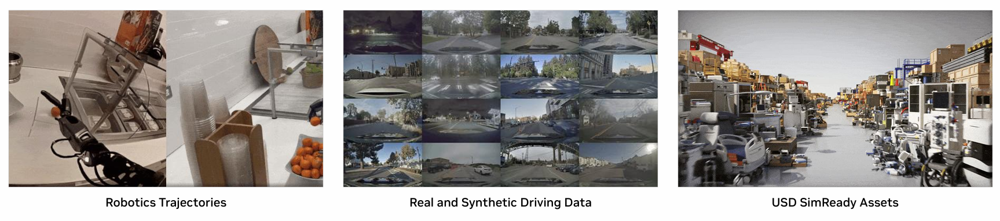

## Introduction

| Gap | What an open dataset does? |
|-----|---------------------------|
| Robot training data is scarce and costly | Gives everyone a starting set of trajectories |
| Each team collects its own driving data | Provides large, varied driving data to build on |
| Simulation needs 3D assets that behave realistically | Provides ready-made, physics-ready assets |
| Small teams and universities cannot fund their own collection | Lowers the entry barrier |

- NVIDIA's announcement of the dataset said it wanted to give researchers and developers a head start, and that the dataset would grow over time.
- This topic shows NVIDIA's open source datasets for Physical AI: **a large public dataset on Hugging Face, free for developers to download.**

## Three datasets



### 1. Robotics Trajectories

- A **trajectory** is a recorded sequence of what a robot saw and did while carrying out a task, which is what a policy learns from.

- In image first dataset shows as a robotics trajectories is **GR00T-X Embodiment Sim**, which NVIDIA describes as an open robotics dataset of simulated robot trajectories across different embodiments and tasks. 
- It was originally released as post training data for the GR00T N1 humanoid model.
- Examples from its Hugging Face card:

| Group | Size |
|-------|------|
| Cross-embodied bimanual manipulation | 9,000 trajectories |
| Robot arm kitchen manipulation | 72,000 trajectories |

### 2. Real and Synthetic Driving Data

| Dataset | What it is? |
|---------|------------|
| **PhysicalAI-Autonomous-Vehicles** | A large, geographically diverse collection of multi-sensor driving data. A mirror of its description cites a total of 1,700 hours of driving |
| **Cosmos-Drive-Dreams** and **Cosmos-Synthetic** driving sets | Synthetic driving video generated with Cosmos |
| **PhysicalAI-Autonomous-Vehicles-NuRec** | Reconstructed driving scenes for simulation |

- NVIDIA's announcement said the AV data would offer more diverse environments and longer clips than existing open resources, and Berkeley DeepDrive was named as a research center that could use it for policy and world models.

### 3. USD SimReady Assets

- **OpenUSD** (Universal Scene Description) is the 3D format used by Omniverse and Isaac Sim. 
- **SimReady** assets are 3D objects that come with physical properties, so they behave properly in a simulator.

1. NVIDIA's first release included up to 1,000 OpenUSD assets, including a SimReady collection.
2. The panel's warehouse scene matches the **SimReady Warehouse** dataset, which NVIDIA's dataset listing describes as USD assets for Isaac Sim (about 753 assets in that listing).
3. A separate dataset, **PhysicalAI-Robotics-NuRec**, holds reconstructed 3D scenes as USD and USDZ files for Isaac Sim.

## How to Get It?

- NVIDIA's dataset cards show downloading by name with the Hugging Face tools. For example, to fetch one subset:

```bash
huggingface-cli download nvidia/PhysicalAI-Robotics-GR00T-X-Embodiment-Sim \
  --repo-type dataset \
  --include "gr1_arms_only.CanSort/" \
  --local-dir $HOME/gr00t_dataset
```

- Replace the folder name to choose a different subset. Licenses differ between datasets, so read the card for each one you use.

## Summary

1. NVIDIA publishes an **open Physical AI dataset** on Hugging Face for robotics and autonomous vehicle development.
2. It covers three kinds of data: **robot trajectories, real and synthetic driving data, and SimReady USD assets**.
3. The first release was 15 TB, with more than 320,000 robot trajectories and up to 1,000 OpenUSD assets, and it has grown since.
4. GR00T-X Embodiment Sim is a widely downloaded robotics set, with NVIDIA's forum reporting over 10 million downloads.
6. This is a broader collection than the Cosmos dataset.

## References

1. [NVIDIA Blog, "NVIDIA Unveils Open Physical AI Dataset to Advance Robotics and Autonomous Vehicle Development"](https://blogs.nvidia.com/blog/open-physical-ai-dataset)
2. [Hugging Face Blog, "NVIDIA's GTC 2025 Announcement for Physical AI Developers: New Open Models and Datasets"](https://huggingface.co/blog/nvidia-physical-ai)
3. [NVIDIA Developer Forums, "Physical AI Dataset just crossed 10 million downloads on Hugging Face!"](https://forums.developer.nvidia.com/t/physical-ai-dataset-just-crossed-10-million-downloads-on-hugging-face/368486)
4. [NVIDIA dataset card, PhysicalAI-Robotics-GR00T-X-Embodiment-Sim (Hugging Face)](https://huggingface.co/datasets/nvidia/PhysicalAI-Robotics-GR00T-X-Embodiment-Sim)
5. [NVIDIA dataset card, PhysicalAI-Robotics-NuRec (Hugging Face)](https://huggingface.co/datasets/nvidia/PhysicalAI-Robotics-NuRec)
6. [NVIDIA "physical-ai-datasets" skill listing (dataset overview)](https://mcpservers.org/agent-skills/nvidia/physical-ai-datasets)
