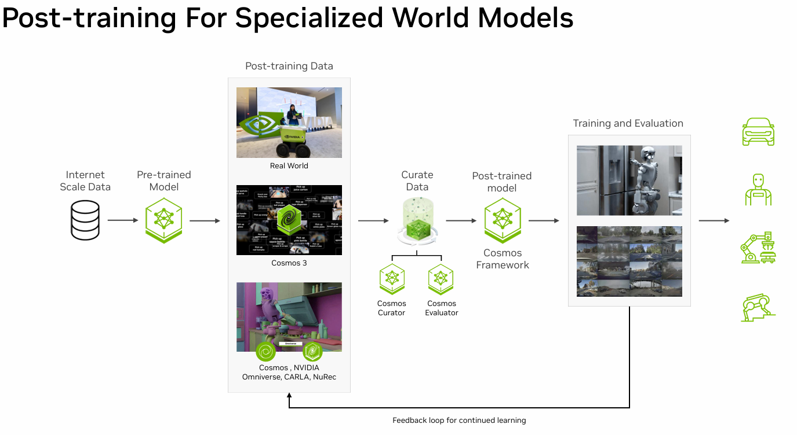

## Introduction

- A general model is broad but not deep. 
- A "specialized world model" is one that knows a particular area well, such as a certain vehicle's cameras or a certain robot's workspace.

| Question | Answer |
|----------|---------------------------|
| Where does the specialist data come from? | Real recordings, Cosmos-generated data, and simulation run through Cosmos |
| How do we avoid training on bad data? | Curate and evaluate it first |
| How do we know the result is good? | Evaluate it, then feed the failures back |
| Does it end after one round? | No. It is a loop |

- NVIDIA's technical report describes the same idea for Cosmos 3's own post training: smaller, carefully curated physical AI datasets are used to improve downstream behavior and physical consistency, while keeping the broad visual knowledge from pre training.

## Workflow

| Step | Label on diagram | What it means? |
|------|--------------------|---------------|
| 1 | **Internet Scale Data** | The huge, general data that the starting model learned from |
| 2 | **Pre-trained Model** | The general Cosmos model, such as Cosmos 3 |
| 3 | **Post-training Data** | Three sources: **Real World**, **Cosmos 3** (generated data), and **Cosmos, NVIDIA Omniverse, CARLA, NuRec** (simulation plus Cosmos) |
| 4 | **Curate Data** | Cleaning and checking the data with **Cosmos Curator** and **Cosmos Evaluator** |
| 5 | **Post-trained model** | Trained with the **Cosmos Framework** |
| 6 | **Training and Evaluation** | Testing it on tasks such as a humanoid opening a fridge and a multi-camera driving view |
| 7 | **Icons on the far right** | A car, a humanoid, and two kinds of robot arm, standing for where the specialized models end up |
| Loop | **Feedback loop for continued learning** | An arrow from evaluation back to the post-training data |

### Three data sources

| Source | What it gives you? |
|--------|-------------------|
| **Real World** | Footage from your actual robot, vehicle or site. Most accurate, but limited |
| **Cosmos 3** | Data generated by the model. Fills gaps and rare cases |
| **Cosmos, NVIDIA Omniverse, CARLA, NuRec** | Simulator output (Omniverse for robots, CARLA for driving, NuRec for reconstructed real scenes) made more realistic and varied by Cosmos Transfer |

### Three tools

| Tool | What it does? |
|------|--------------------------|
| **Cosmos Curator** | Distributed data curation: processing, annotation, filtering and deduplication of large video datasets. NVIDIA's cookbook describes it as a GPU-accelerated pipeline built on Ray |
| **Cosmos Evaluator** | An automated evaluation system for world generation and reasoning outputs. In NVIDIA's Data Factory announcement it is powered by Cosmos Reason and automatically scores, verifies and filters generated data for physical accuracy and training readiness |
| **Cosmos Framework** | Trains, optimizes and deploys physical AI models, with SFT, LoRA, distillation and RL post-training |

- NVIDIA's Cosmos repository also points to evaluation suites for checking a model, including PAIBench, Physics-IQ and VLMEvalKit.

> **Why it matters?:** the order is deliberate. Bad or duplicated data wastes training time and can teach the wrong behavior, so the model is only trained after the data has been cleaned and checked.

## Feedback Loop

- The "Training and Evaluation" back to the data is what makes this a flywheel:

1. Evaluate the specialized model on real tasks.
2. Find where it fails, such as a camera angle, an object or a weather condition.
3. Collect or generate more data for those cases.
4. Curate it, then post-train again.

- NVIDIA's Physical AI Data Factory Blueprint, covered in the deck, packages the curate, augment and evaluate parts of this loop as an open reference architecture.

## Example

1. **Training and Evaluation** : a humanoid robot at an open refrigerator, and a grid of driving camera views. They are examples of a robot task and an autonomous vehicle task.
2. A car, a humanoid and two robot arms. They show the kinds of machines the specialized models serve.

## Note

1. Reinforcement learning is part of the Cosmos Framework, but NVIDIA's cookbook describes it as applying to Cosmos Reason, so do not assume every Cosmos model can be post-trained with RL.
2. Whether a specialized model is better depends on the quality of the curated data, which is why the curate step sits in the middle of the diagram.

## Summary

1. The full post-training workflow: **pre-trained model, post-training data, curation, post-training, evaluation and a feedback loop**.
2. Post-training data comes from three places: the real world, Cosmos 3 generated data, and simulation made realistic by Cosmos.
3. **Cosmos Curator** cleans and annotates the data, **Cosmos Evaluator** scores and filters it, and the **Cosmos Framework** does the training.
4. The result is a specialized world model for vehicles, humanoids or robot arms.
5. Evaluation results feed back into the data, so improvement continues round after round.

## References

1. [NVIDIA Cosmos on GitHub (README: Cosmos Framework, Curator, Evaluator, evaluation suites)](https://github.com/nvidia/cosmos)
2. [NVIDIA Newsroom, "NVIDIA Announces Open Physical AI Data Factory Blueprint to Accelerate Robotics, Vision AI Agents and Autonomous Vehicle Development"](https://nvidianews.nvidia.com/news/nvidia-announces-open-physical-ai-data-factory-blueprint-to-accelerate-robotics-vision-ai-agents-and-autonomous-vehicle-development)
3. [NVIDIA Cosmos Cookbook](https://nvidia-cosmos.github.io/cosmos-cookbook/index.html)
4. [NVIDIA Cosmos Cookbook, "Post-Training" overview](https://nvidia-cosmos.github.io/cosmos-cookbook/core_concepts/post_training/overview.html)
5. [NVIDIA Research, "Cosmos 3: Omnimodal World Models for Physical AI" (technical report)](https://research.nvidia.com/labs/cosmos-lab/cosmos3/technical-report.pdf)
6. [NVIDIA Cosmos, Physical AI](https://www.nvidia.com/en-eu/ai/cosmos)
