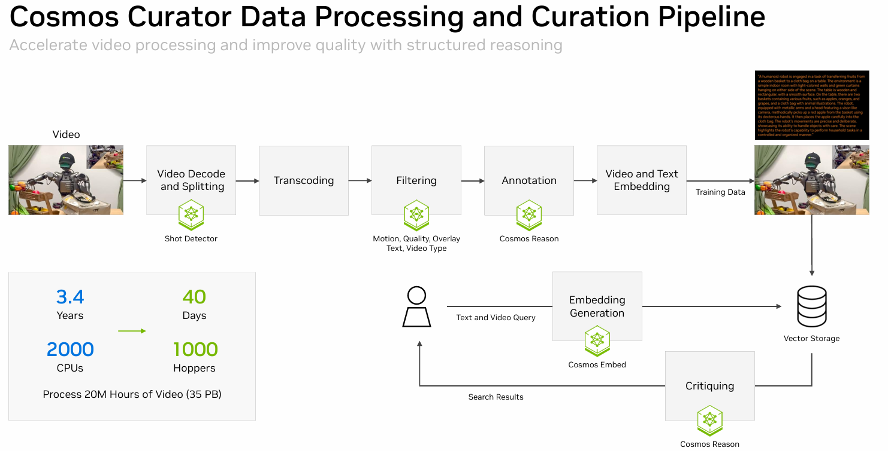

## Introduction

- NVIDIA's launch announcement for Cosmos put the problem this way: building physical AI models requires petabytes of video data and tens of thousands of compute hours to process, curate and label that data.

| Problem | Why it hurts? |
|---------|--------------|
| Raw video is huge and messy | Most of it is not useful for training |
| It must be split into clips, cleaned and described | Doing this on ordinary CPUs takes years at large scale |
| Bad clips (blurry, static, with text on screen) teach the wrong things | They waste training time |
| After curation, you still need to find the right clips | Needs search that understands meaning, not just file names |

- Last topic tells that **Cosmos Curator** as the tool that cleans data before post training. This topic opens it up and shows what is inside.
- It "Accelerate video processing and improve quality with structured reasoning."

## Processing Pipeline

| Step | What it does? |
|------|--------------|
| **Video Decode and Splitting** | Reads the video and cuts it into **shots**, meaning continuous scenes, using a shot detector. Raw cuts and transitions are kept out of clips |
| **Transcoding** | Converts the clips into a consistent format and size |
| **Filtering** | Throws away unsuitable clips. The four checks: **motion**, **quality**, **overlay text** and **video type** |
| **Annotation** | **Cosmos Reason** watches each clip and writes a detailed description |
| **Video and Text Embedding** | Turns each clip and its caption into a numeric fingerprint, so clips can be searched by meaning |
| **Training Data** | The result: clips paired with rich captions. The example shows a humanoid robot moving fruit, with a long paragraph describing the scene |

**Four filters:**

| Filter | Purpose |
|--------|----------------|
| **Motion** | Remove static clips or clips with erratic movement |
| **Quality** | Remove blurry, badly exposed or low-quality clips |
| **Overlay text** | Remove clips with subtitles or graphics on top |
| **Video type** | Keep the kinds of content that are useful, and drop the rest |

- NVIDIA's Cosmos Predict 2.5 paper describes a seven-stage version of this idea for pre training: shot-aware splitting, GPU transcoding, cropping, filtering, captioning, semantic deduplication and sharding. 
- Two points from that paper show why filtering matters:

1. **Only about 4% of the initial clips passed all the filters**, producing about 200 million trainable clips.
2. NVIDIA applies the VLM check at the very end of filtering because it is computationally the most expensive.

> **Why it matters?:** "structured reasoning" in the subtitle refers to a model that understands the video (Cosmos Reason) being used to write the labels, instead of simple rules.

## Search Loop

- The bottom half of the diagram shows how a person finds data once it is processed:

1. The user asks in words or with an example clip.
2. **Cosmos Embed** converts the query into the same kind of numeric fingerprint as the stored clips.
3. The **vector storage** finds the stored clips whose fingerprints are closest.
4. **Cosmos Reason** acts as a critic, checking whether the candidates really match the request, then the results go back to the user.

## Speed Box

- Bottom left part of the diagram shows the speed box.
- The box says **3.4 years → 40 days** and **2000 CPUs → 1000 Hoppers** for processing **20 million hours of video (35 PB)**.

What NVIDIA's pages confirm:

1. NVIDIA says 20 million hours of video can be processed in **40 days on NVIDIA Hopper GPUs**, or in as little as **14 days on NVIDIA Blackwell GPUs**, compared with about **3.4 years** on unoptimized CPU pipelines.
2. NVIDIA's blog says the CPU comparison is for a system with equivalent power consumption.
3. The pipeline was originally powered by NVIDIA NeMo Curator. NVIDIA's cookbook now describes Cosmos Curator as a GPU-accelerated video curation pipeline built on Ray, for splitting, captioning, filtering, deduplication and sampling.

- **Hopper** is the name of NVIDIA's earlier data center GPU generation (the H100 family), and **Blackwell** is the newer one.

> **Note:** Treat the speed numbers as NVIDIA's own claims for one specific large job, not a guarantee for your pipeline.

## Summary

1. **Cosmos Curator** turns raw video into curated, captioned training data.
2. The pipeline splits video into shots, transcodes it, filters out bad clips, writes captions with Cosmos Reason, and creates embeddings.
3. Filtering is strict: in NVIDIA's Predict 2.5 pipeline only about 4% of initial clips passed.
4. A second loop lets users search the data with text or video queries, using Cosmos Embed and a Cosmos Reason critic.
5. NVIDIA reports processing 20 million hours in 40 days on Hopper GPUs, against about 3.4 years on unoptimized CPUs.

## References

1. [NVIDIA Newsroom, "NVIDIA Launches Cosmos World Foundation Model Platform to Accelerate Physical AI Development"](https://nvidianews.nvidia.com/news/nvidia-launches-cosmos-world-foundation-model-platform-to-accelerate-physical-ai-development)
2. [NVIDIA Technical Blog, "Advancing Physical AI with NVIDIA Cosmos World Foundation Model Platform"](https://developer.nvidia.com/blog/advancing-physical-ai-with-nvidia-cosmos-world-foundation-model-platform/)
3. [NVIDIA Blog, "NVIDIA Makes Cosmos World Foundation Models Openly Available to Physical AI Developer Community"](https://blogs.nvidia.com/blog/cosmos-world-foundation-models/)
4. [NVIDIA Research, "World Simulation with Video Foundation Models for Physical AI" (Cosmos Predict 2.5 paper)](https://arxiv.org/pdf/2511.00062)
5. [NVIDIA Cosmos Cookbook](https://nvidia-cosmos.github.io/cosmos-cookbook/index.html)
6. [NVIDIA Cosmos on GitHub (README: Cosmos Curator)](https://github.com/nvidia/cosmos)
