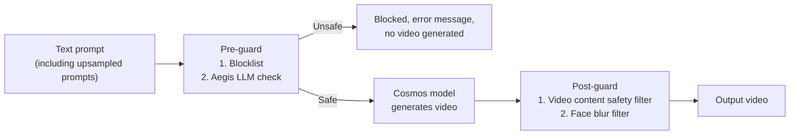

## Introduction  

- Cosmos can generate realistic video of almost anything a person describes, and it is open for anyone to use. That raises obvious risks.

| Risk | Where it shows up? |
|------|-------------------|
| Someone writes a harmful or inappropriate prompt | At the input |
| The model produces unsafe or unsuitable video, even from an innocent prompt | At the output |
| Real people's faces appear in generated or transformed video | At the output, as a privacy concern |

- NVIDIA's documentation says the guardrail system has two stages, **pre-guard** and **post-guard**, to cover both ends.
- This topic shows the **safety layer** built around Cosmos. Calls it an "open guardrail neural network ensuring safety and consistency."
- The simple idea: check what goes **in** (the prompt), and check what comes **out** (the generated video).
- It divided into three parts:
    - A speech bubble: **Pre-guard** to filter brands, NSFW content, and harmful prompts.
    - A car with a shield and check mark: **Post-guard** to remove questionable scenarios.
    - Two hands holding a person: **Guardrail** to blur human faces.

## Two Stages

### Pre-guard: checks the text going in

- NVIDIA's documentation says pre guard is applied to input prompts and also to **upsampled prompts**, meaning the longer prompts produced by the prompt upsampling step described on the world generation topic.

| Layer | What it does? |
|-------|--------------|
| **Blocklist** | A keyword checker that looks for harmful keywords. NVIDIA's system card describes it as a lemmatized, whole-word keyword search |
| **Aegis** | An LLM-based check for harmful prompts. NVIDIA describes it as a fine-tuned version of Llama Guard, trained on NVIDIA's Aegis Content Safety Dataset, and used as the second line of defense for semantically complex prompts |

- If the prompt is judged unsafe, the video is not generated and an error message is shown.

### Post-guard: checks the video coming out

| Layer | What it does? |
|-------|--------------|
| **Video content safety filter** | A classifier trained to tell safe video frames from unsafe ones. |
| **Face blur filter** | A face detection and blurring module. This is the "blur human faces" |

- NVIDIA's system card says the video content safety filter was trained on carefully curated datasets and evaluated on human-annotated data created by the **Cosmos Red Team**. 
- Expert annotators rated generated videos on a scale of 1 to 5 across multiple categories of harm in a safety taxonomy.

> **Why it matters:** safety is applied twice, to the words that go in and to the pictures that come out. A clean prompt can still produce a bad video, and the second stage is the safety net for that case.

## Is It Optional?

1. For the first Cosmos models, NVIDIA's documentation says the guardrail is integrated into the diffusion and autoregressive pipelines and **cannot be disabled**.
2. For Cosmos 3, NVIDIA's Hugging Face documentation says a safety checker runs by default. It uses a text guardrail to reject unsafe prompts and a video guardrail that blurs detected faces or rejects the output, and it says the checker is mandatory under the NVIDIA Open Model License Agreement.

## What the Guardrails Do Not Cover?

1. **Audio.** NVIDIA's Cosmos 3 documentation says the safety checker covers prompts and video frames, and that generated audio is not guardrailed. See the "Generate Worlds With Sound On" note.
2. **Perfect accuracy.** These are classifiers and keyword lists. They reduce risk but cannot catch everything, and they can also block harmless content.
3. **Training data needs.** Blurring faces protects privacy, but a project that needs faces to stay visible, such as one studying people's expressions, may need to look at how the blur affects the data.

## Summary

1. Cosmos Guardrails protect both the **input** and the **output** of the models.
2. **Pre-guard** checks text prompts with a keyword blocklist and an LLM safety check (Aegis).
3. **Post-guard** checks generated video with a safety classifier and a **face blur** filter.
4. NVIDIA says unsafe prompts stop generation, and the output filter was tested against human-annotated data from a red team.
5. The guardrail is built in and cannot be switched off in the first Cosmos models, and it is required by license for Cosmos 3.

## References

1. [NVIDIA Cosmos documentation, "Cosmos Guardrail"](https://docs.nvidia.com/cosmos/latest/guardrail.html)
2. [NVIDIA Cosmos Transfer 2.5 system card (build.nvidia.com)](https://build.nvidia.com/nvidia/cosmos-transfer2_5-2b/systemcard)
3. [Hugging Face Diffusers documentation, "Cosmos 3" (safety checker)](https://huggingface.co/docs/diffusers/main/api/pipelines/cosmos3)
4. [NVIDIA Newsroom, "NVIDIA Launches Cosmos World Foundation Model Platform to Accelerate Physical AI Development"](https://nvidianews.nvidia.com/news/nvidia-launches-cosmos-world-foundation-model-platform-to-accelerate-physical-ai-development)
