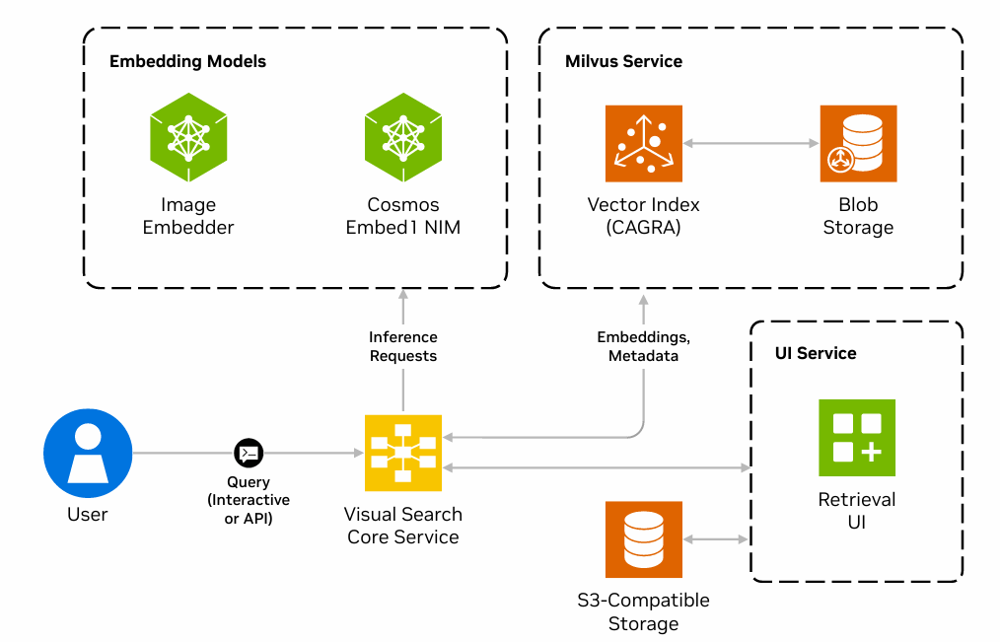

## Introduction

- A self driving or robotics team may hold millions or billions of clips. The clips that matter most are often the rarest.

| Need | Why simple search fails? |
|------|-------------------------|
| "Find every unprotected left turn in rain" | File names and basic tags rarely say that |
| "Find clips like this near-miss" | You are searching by what a clip looks like, not by a keyword |
| Build a training set for a rare case | Without search, engineers scrub through footage by hand |

- NVIDIA says Cosmos Dataset Search cuts rare scenario discovery from weeks to seconds.
- we already learn how Cosmos Curator cleans and labels video. This topic shows how you **find the exact clips you need afterwards**: **Cosmos Dataset Search (CDS)**, described as "indexing and search for large scale visual data."

## How It Works?

- The core idea is simple: turn both text and video into the same kind of **numeric fingerprint** (an embedding), so that "similar meaning" becomes "nearby numbers". Then use a fast database to find the nearest ones.

|  | What it does? |
|--------------------|--------------|
| **Visual Search Core Service** | The coordinator. NVIDIA's repository describes it as a FastAPI-based REST API that handles both ingestion and search |
| **Embedding Models** | Create the fingerprints. The image shows an **Image Embedder** and the **Cosmos Embed1 NIM** |
| **Milvus Service: Vector Index (CAGRA) and Blob Storage** | Milvus is the vector database. NVIDIA says similarity search is accelerated with NVIDIA cuVS.|
| **S3 Compatible Storage** | Holds the video files, frames and metadata. NVIDIA lists LocalStack, MinIO and AWS S3 as options |
| **UI Service: Retrieval UI** | A web interface for searching and browsing. NVIDIA describes a React-based interface |

Two steps in practice, based on NVIDIA's repository:

1. **Ingestion.** Videos are loaded, frames and metadata are extracted, embeddings are generated on the GPU, and the vectors are written to Milvus.
2. **Search.** A text or video query is embedded in the same way, the database finds the closest vectors, and the matching clips are returned through the UI, API or command line.

> **Why it matters?:** because text and video share one embedding space, you can search with words ("pedestrian crossing at night") or with an example clip ("find more like this").

## Embedding Model: Cosmos Embed1

- NVIDIA's model page describes **Cosmos-Embed1** as a joint video-text embedder tailored for physical AI.

1. It is based on a QFormer design, modified to process video.
2. It was trained on nearly 8 million paired video and text samples, covering general videos, human actions, robotic tasks and ego-centric vehicle scenarios.
3. It comes in three sizes (224p, 336p and 448p input), producing embeddings of 256 or 768 numbers, plus a 448p version fine-tuned for anomaly detection.
4. NVIDIA reports state-of-the-art results on autonomous vehicle and robotics datasets, with competitive performance in general domains.

- The NIM version in the diagram is the packaged microservice form of this model.

## Capabalities

- **Scenario Search:** Search using natural language or real-world clips as queries.
- **Support Scale:** Search over billions of clips in seconds.
- **Accelerate Data Loop:** Reduce data loop 20x compared to traditional approaches.
- **Curator:** Use as part of Cosmos Curator to accelerate loops from years to days.

> **Notes:** **Scale.** "Billions of clips in seconds" is NVIDIA's claim about the platform. Real speed depends on your hardware and index setup.

## Summary

1. **Cosmos Dataset Search** finds specific scenarios in huge video collections using natural language or example clips.
2. **Cosmos Embed1** turns text and video into shared embeddings, **Milvus** with cuVS acceleration finds the nearest matches, and a web UI shows results.
3. The architecture has five parts: a core search service, embedding models, a vector database with storage, S3-compatible storage, and a UI.
4. NVIDIA says it searches billions of clips in seconds and cuts rare scenario discovery from weeks to seconds.
5. It works with Cosmos Curator to shorten data loops from years to days.

## References

1. [NVIDIA Cosmos Dataset Search on GitHub (NVIDIA-Omniverse-blueprints)](https://github.com/NVIDIA-Omniverse-blueprints/cosmos-dataset-search/)
2. [NVIDIA Cosmos documentation, CDS Docker Compose Deployment Guide](https://docs.nvidia.com/cosmos/cds/latest/docker-compose-deployment.html)
3. [NVIDIA Developer, "AV Model Development: Open Models, Datasets & Tools"](https://developer.nvidia.com/drive/infrastructure)
4. [NVIDIA Developer, Autonomous Vehicle Developer Resources](https://developer.nvidia.com/drive)
5. [NVIDIA Research, "Cosmos-Embed1: A Joint Video-Text Embedder for Physical AI"](https://research.nvidia.com/labs/cosmos-lab/cosmos-embed1/)
6. [NVIDIA NGC Catalog, Cosmos-Embed1](https://catalog.ngc.nvidia.com/orgs/nvidia/tao/models/cosmos-embed1/-)
7. [NVIDIA on Hugging Face, "Cosmos Predict 2.5 & Transfer 2.5: Evolving the World Foundation Models for Physical AI"](https://huggingface.co/blog/nvidia/cosmos-predict-and-transfer2-5)
