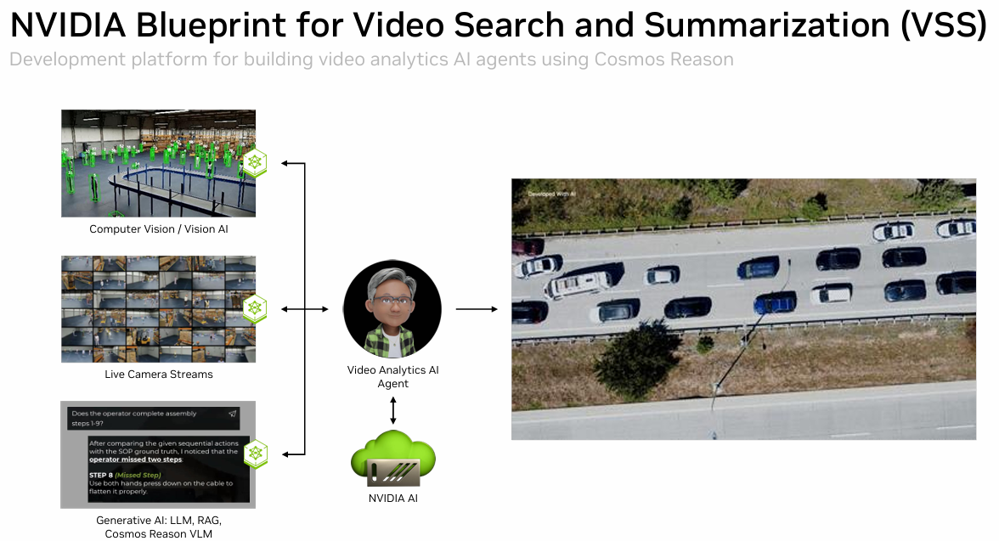
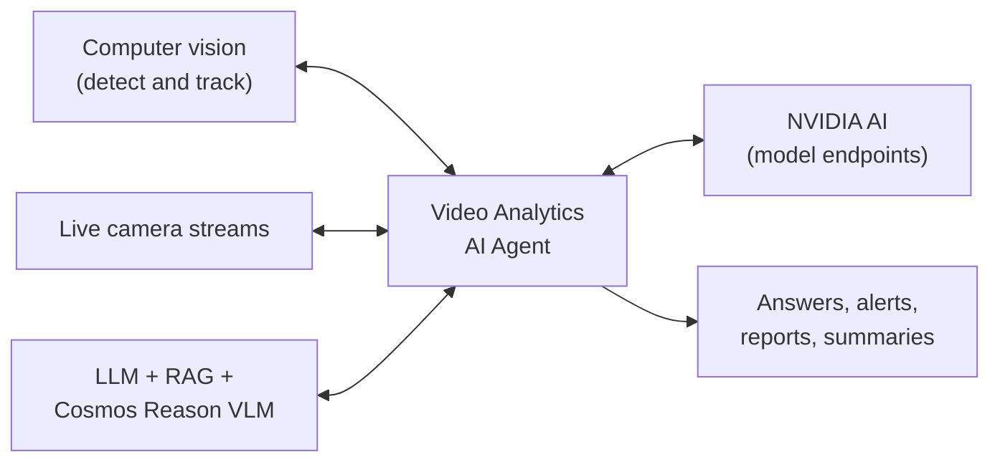

## Introduction

- Organizations have more cameras than people to watch them.

| Problem | Why it hurts? |
|---------|--------------|
| Millions of live streams and hours of recordings | No one can watch them all |
| Traditional computer vision flags fixed things (a person, a car) | It cannot answer open questions such as "did the operator skip a step?" |
| Long videos are slow to review | Finding one event can take hours |
| Alerts from simple detectors often include false alarms | People waste time checking them |

- NVIDIA describes the blueprint as turning millions of live video streams or hours of recorded footage into searchable, actionable intelligence.
- So we learn about preparing and searching video for **training**. This topic is about using video understanding at **runtime**: an AI agent that watches cameras and answers questions about them.
- This also call as "Development platform for building video analytics AI agents using Cosmos Reason."

## What the Blueprint Is?

- VSS describes as a GPU accelerated **reference architecture** for building video analytics agents with real time verified alerts, visual Q&A and automated reporting. 
- It uses vision language models such as Cosmos, large language models such as NVIDIA Nemotron, retrieval augmented generation (RAG) and NVIDIA NIM microservices.

- A **blueprint** is a starting design and code that you deploy and adapt, not a finished product.

## Blueprint for Video Search and Summarization (VSS)

- **Three inputs:** **Computer Vision / Vision AI** (a warehouse with people outlined by detection boxes), **Live Camera Streams** (a grid of camera feeds), and **Generative AI: LLM, RAG, Cosmos Reason VLM** (a chat panel) |
- **Video Analytics AI Agent**, connected by two-way arrows to all three inputs and to a cloud icon labeled **NVIDIA AI**
- An aerial view of traffic on a highway, with the label "Developed With AI"
- The chat panel is the most useful part to read. 
    - It asks, "Does the operator complete assembly steps 1-9?" 
    - The answer says the operator **missed two steps**, naming step 8 and what should have been done (pressing a cable flat with both hands). 
    - It is an example of checking a worker's actions against a standard procedure.

- NVIDIA divide this blueprint into **three layers:**

| Layer | What it does? |
|-------|--------------|
| **Real-time video intelligence** | Extracts information from stored and streamed video as it arrives. It includes a real-time embedding service (using Cosmos-Embed1) and a real-time VLM service that writes captions, detects incidents and finds anomalies |
| **Downstream analytics** | Turns raw detections into actionable insights and verified alerts |
| **Agent and offline processing** | An agent that orchestrates the tools to produce insights, reports and search from video |

- Every capability, including computer vision, VLM, embeddings, behavior analytics, alert verification and summarization, is a separate microservice. 
- Developers can deploy only the parts they need and can swap models without rebuilding services.

## What the Agent Can Do?

- NVIDIA's repository lists these main workflows:

| Workflow | Meaning |
|----------|---------------|
| **Real-time alerts** | Continuously check video streams with a VLM to detect anomalies |
| **Alert verification** | When a simple detector raises an alarm, ask a VLM to confirm it, which helps cut false alarms |
| **Visual Q&A** | Ask questions in plain language about what happened |
| **Search** | Find clips by describing them |
| **Long video summarization** | Summarize hours of footage |
| **Report generation** | Produce written reports from video |

- The blueprint diagram chat example (missed assembly steps) is a case of visual Q&A against a procedure. 
- The aerial traffic view on the right matches the traffic monitoring examples that NVIDIA's announcements describe for partners such as Linker Vision and Milestone.

## Where Cosmos Reason Fits?

- Cosmos Reason is the **eyes and judgment** of the agent: it watches the video and says what is happening.

1. NVIDIA's VSS documentation names Cosmos Reason 1 and 2, and Qwen3-VL, as examples of the VLM the real-time service can use.
2. NVIDIA's VSS 3.2.1 release notes say the default VLM was updated to **Cosmos Reason 3 Nano**, and the repository lists the Cosmos 3 Nano Reasoner and Nemotron Nano 9B v2 as the NIM models used.
3. This links back to the Cosmos 3 vision language model and to the reasoner only mode of the architecture.

## Performance and Setup Claims

- NVIDIA's VSS 3 blog says a base agent deploys in under five minutes using a docker compose profile system, with more workflows layered on top.
- NVIDIA's earlier blog on VSS 2.3 said it achieved up to **100x speedup** on video summarization tasks, with results shown per GPU configuration. That is an older version's claim for one test.

## Summary

1. **VSS** is NVIDIA's reference blueprint for building **video analytics AI agents** that watch live or recorded video.
2. It combines computer vision, live streams, and generative AI (LLM, RAG and a **Cosmos Reason** VLM) around a central agent.

3. The agent can raise and verify alerts, answer questions, search clips, summarize long video and write reports.
4. The chat example checks whether an operator completed assembly steps and finds that two were missed.
5. VSS is modular, and its default VLM is now Cosmos Reason 3 Nano in the latest release notes.

## References

1. [NVIDIA AI Blueprint for video search and summarization on GitHub (NVIDIA-AI-Blueprints)](https://github.com/NVIDIA-AI-Blueprints/video-search-and-summarization)
2. [NVIDIA VSS release notes on GitHub](https://github.com/NVIDIA-AI-Blueprints/video-search-and-summarization/releases)
3. [NVIDIA VSS documentation, Introduction](https://docs.nvidia.com/vss/latest/)
4. [NVIDIA VSS documentation, Architecture Overview (3.2.0)](https://docs.nvidia.com/vss/3.2.0/index.html)
5. [NVIDIA Technical Blog, "Transform Video Into Instantly Searchable, Actionable Intelligence with AI Agents and Skills"](https://developer.nvidia.com/blog/transform-video-into-instantly-searchable-actionable-intelligence-with-ai-agents-and-skills/)
6. [NVIDIA Technical Blog, "Advance Video Analytics AI Agents Using the NVIDIA AI Blueprint for Video Search and Summarization"](https://developer.nvidia.com/blog/advance-video-analytics-ai-agents-using-the-nvidia-ai-blueprint-for-video-search-and-summarization/)
7. [NVIDIA Blog, "Making Safer Spaces: NVIDIA and Partners Bring Physical AI to Cities and Industrial Infrastructure"](https://blogs.nvidia.com/blog/physical-ai-partners-metropolis-updates-siggraph/)
