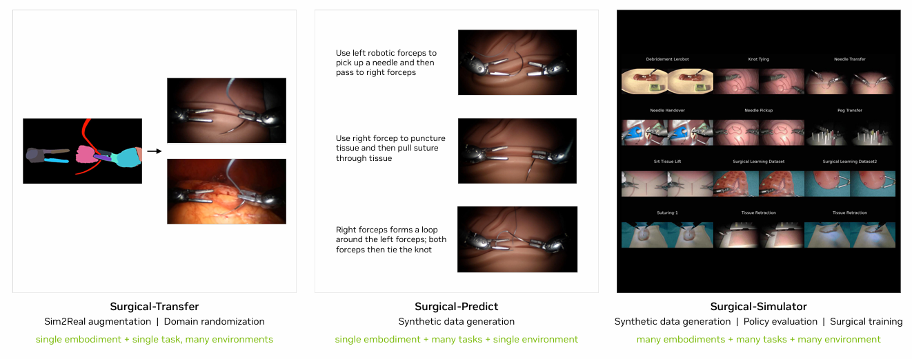
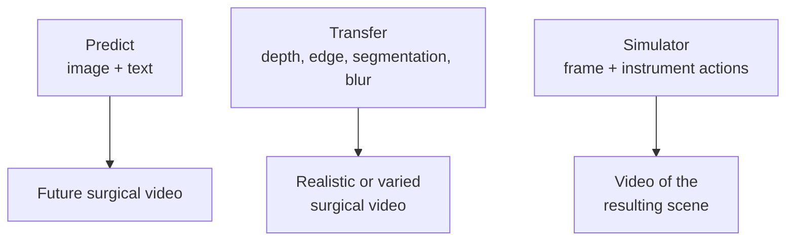

## Introduction

- Surgical robots need training data and testing, but this field is harder than most.

| Problem | Why it hurts? |
|---------|--------------|
| Real surgical data is limited and sensitive | Hard to collect at scale |
| Practicing on real patients is not an option | Need safe ways to train and test |
| Hand built simulators struggle with soft tissue, sutures and instrument contact | Realistic tissue behavior is very hard to author |
| Each surgical robot is different | A policy for one may not work on another |

- NVIDIA's blog describes the approach this way: instead of authoring tissue, sutures and instrument contact by hand, the model learns visual dynamics from paired surgical video and robot kinematics, then predicts what the camera would see next. 
- **Kinematics** here means the recorded movements of the robot's instruments.
- Until now the deck covered general physical AI. This topic introduces **Cosmos-H**, a family of Cosmos world models for **healthcare robotics**, with a focus on **surgical robots**. The "H" stands for healthcare.

## Three Models

- This diagram shows three models, each described by a short phrase and a "who and what it covers":

| Model | What it does? | Coverage |
|-------|------------------------------|----------------------------|
| **Surgical-Transfer** | Sim2Real augmentation, domain randomization | single embodiment + single task, many environments |
| **Surgical-Predict** | Synthetic data generation | single embodiment + many tasks + single environment |
| **Surgical-Simulator** | Synthetic data generation, policy evaluation, surgical training | many embodiments + many tasks + many environments |

- An **embodiment** is a particular robot body, such as one surgical robot system. 
- The three coverage lines show a growing range, from one robot doing one task in many settings up to many robots doing many tasks in many settings.

- NVIDIA's developer blog describes them as follows:

| Model | Input | Output | Use |
|-------|-------|--------|-----|
| **Cosmos-H-Surgical-Predict** | An initial image and text | Plausible future surgical video | Synthetic data generation for training policy models |
| **Cosmos-H-Surgical-Transfer** | Control signals such as depth, edges, segmentation or blur | Surgical video guided by the controls | Sim-to-real and domain transfer |
| **Cosmos-H-Surgical-Simulator** | A starting frame and a sequence of instrument kinematics | The video of what would happen | Action-conditioned simulation, policy evaluation and robot training |

### What each one model means?

1. **Surgical-Transfer** applies the same idea as Cosmos Transfer to surgical scenes. It can make simulator output look realistic, or vary the look of a scene (domain randomization).
2. **Surgical-Predict** applies the same idea as Cosmos Predict. The three example prompts are instrument actions: use the left forceps to pick up a needle and pass it to the right forceps, puncture tissue and pull the suture through, and form a loop with one forceps so both can tie a knot.
3. **Surgical-Simulator** applies the action idea. The grid on the diagram shows many surgical tasks, such as knot tying, needle transfer, peg transfer, suturing and tissue retraction, each shown as paired clips.

> **Why it matters?:** the same three jobs as general Cosmos (predict, transfer, simulate with actions) are tuned to surgery, so developers can generate data and test policies without a patient.

## More Detail on the Simulator

NVIDIA's technical material says:

1. It is built on **Cosmos Predict 2.5** (a 2B-parameter video model) and fine-tuned on the **Open-H** multi-embodiment surgical data.
2. NVIDIA's paper describes it as the first multi embodiment, kinematic action conditioned world foundation model for surgical robotics simulation. It was trained on data from nine robotic platforms and 32 datasets.
3. It takes a single video frame and a sequence of action vectors and **generates future frames in short chunks**, re-conditioning on the last generated frame each time.
4. NVIDIA says this supports in silico (in computer) policy evaluation and synthetic data generation.
5. The paper also says that quantitative evaluation of surgical world models remains an open problem, and that tissue scenes are harder to predict than non-tissue scenes because of endoscope lighting, instrument occlusion, reflections on wet tissue and deformable anatomy.

- NVIDIA's GitHub page lists how different robots are described: one robot uses a 36D action vector for four arms, and another uses only 6D (movements along three axes).

## Where This Has Gone Since?

| Update | What NVIDIA says? |
|--------|------------------|
| **March 2026 (GTC)** | Surgical-Predict and Surgical-Transfer released as part of NVIDIA MedTech open models, built on Cosmos Predict 2.5 and Transfer 2.5 (2B) |
| **July 2026** | A Cosmos-H-Surgical release built on **Cosmos 3**, with Predict and Transfer **unified in one checkpoint** |
| **Cosmos-H-Dreams** | A real-time version of the Simulator, specialized for da Vinci Research Kit tabletop suturing. NVIDIA reports about **160 frames per second** on one RTX PRO 6000, against roughly 10 frames per second for the standard model it was distilled from |

## Related Models From the Same NVIDIA Group

- NVIDIA's MedTech GitHub page also lists **GR00T-H**, a healthcare variant of the GR00T robot model, post-trained for surgical robot control across 16 platforms. 
- Think of it this way: Cosmos-H provides the world model for data and testing, and GR00T-H is a policy for controlling the robot.

## Licenses Differ by Model

- This matters if someone asks about commercial use. NVIDIA's MedTech page lists:

| Model | License listed |
|-------|----------------|
| **Cosmos-H-Surgical** (Predict and Transfer) | Non-commercial in the main listing. NVIDIA has also added OpenMDW-1.1 checkpoint editions for Predict and Transfer |
| **Cosmos-H-Surgical-Simulator** | Commercial |

- The licensing has changed over time and varies by checkpoint, so read the model card of the exact checkpoint before stating terms.

## Summary

1. **Cosmos-H** is NVIDIA's family of Cosmos world models for healthcare robotics, focused on surgery.
2. **Surgical-Transfer** handles sim-to-real and domain randomization, **Surgical-Predict** generates synthetic surgical video, and **Surgical-Simulator** predicts what instrument actions would cause.
3. The Simulator was trained on data from nine robotic platforms, so it spans many embodiments.
4. NVIDIA later added a Cosmos 3 based release and a real-time version, Cosmos-H-Dreams.
5. A companion model, GR00T-H, handles robot control.
6. Licenses differ by model and checkpoint, so verify them before quoting commercial terms.

## References

1. [NVIDIA Technical Blog, "Developing Healthcare Robotics with GPU-Native Medical Physics Simulation"](https://developer.nvidia.com/blog/developing-healthcare-robotics-with-gpu-native-medical-physics-simulation/)
2. [NVIDIA-Medtech, Cosmos-H-Surgical-Simulator on GitHub](https://github.com/NVIDIA-Medtech/Cosmos-H-Surgical-Simulator)
3. [NVIDIA-Medtech, Cosmos-H-Surgical on GitHub](https://github.com/NVIDIA-Medtech/Cosmos-H-Surgical)
4. [NVIDIA model card, Cosmos-H-Surgical (Hugging Face)](https://huggingface.co/nvidia/Cosmos-H-Surgical)
5. [NVIDIA on Hugging Face, "NVIDIA Cosmos-H-Dreams: Bringing Real-Time Generative Simulation to Surgical Robotics"](https://huggingface.co/blog/nvidia/cosmos-h-dreams)
6. [NVIDIA MedTech on GitHub](https://github.com/NVIDIA-Medtech)
7. [Open-H-Embodiment: A Large-Scale Dataset for Enabling Foundation Models in Medical Robotics (arXiv)](https://arxiv.org/pdf/2604.21017)
