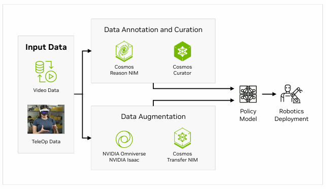
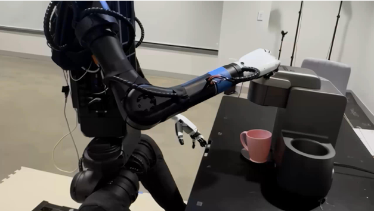

## Introduction

- NVIDIA's case study describes it clearly: robotics has struggled with data scarcity.
- Operating real robots takes minutes to produce a single high quality demonstration, yet AI systems need billions of training samples.
- Without enough data, robots cannot be deployed at scale to capture new data, which keeps robotics stuck with impressive demos and limited real world deployment.
- Skild AI answer is to use data sources that scale.
- This is the first of several **customer stories** in the deck. It shows how one company, **Skild AI**, uses Cosmos and other NVIDIA tools to build a robot brain.
- Skid AI describe their approach like: "Omni-bodied robot foundation model, Adapting to new robot embodiments and performing new skills.
- **Omni-bodied:** One model that can control many different robot bodies (humanoids, four-legged robots, arms), even without knowing the exact body in advance.
- **Robot foundation model:** A large pre-trained model that robots use as their "brain".

## What Skild AI Does?

According to NVIDIA's case study:

1. **The Skild Brain** is a robotics foundation model that is omni-bodied. It has a high-level decision-maker (for example "pick up that cup") and a low-level controller that handles the precise movements.
2. **Two scalable data sources.** Physics-based synthetic data from simulation, and human videos from the internet. NVIDIA notes simulations can be scaled by running them on more GPUs.
3. **Isaac Lab** is used to build simulation scenarios for reinforcement learning across challenging conditions, with thousands of robot instances across humanoids, quadrupeds and arms, in thousands of environments.
4. **Cosmos Transfer** augments the datasets with environmental variations. Skild AI can augment and multiply datasets using text prompts that produce varied conditions, lighting and visual features.
5. **In-context learning** is the key idea: the model notices when actions do not work as expected and adjusts. Training on many body types stops the model from memorizing solutions for one piece of hardware.

- Teleoperation data is scarce, so Skild builds most of its experience from simulation and video, and uses Cosmos to widen it.

## Workflow

- **Input Data** (**Video Data** and **TeleOp Data**) splits into two paths **Data Annotation and Curation** and **Data Augmentation**.
- **TeleOp data** is a data recorded when a human remotely controls a robot.
- **Data Annotation and Curation** uses **Cosmos Reason NIM** and **Cosmos Curator**. 
- **Data Augmentation** uses **NVIDIA Omniverse**, **NVIDIA Isaac** and **Cosmos Transfer NIM**. 
- Then **Data Annotation and Curation** and **Data Augmentation** both feed to a **Policy Model**
- **Policy model:** The part that decides what the robot does next which goes to **Robotics Deployment**

- Example: A dark robot arm reaching toward a coffee machine, with a pink mug on a table.

## Results From NVIDIA's Case Study

1. **Cost.** NVIDIA says the Skild Brain adapted to low cost, noisy hardware, with successful deployment on robots costing $4,000 to $15,000, compared with conventionally customized systems costing $250,000 or more.
2. **Recovery.** It recovered from jammed wheels within 2 to 3 seconds, and from a broken leg after several attempts.
3. **Payload.** It adapted to loads up to 1.5 times the robot's body weight.
4. **Scale of training.** NVIDIA says the multi-pronged simulation approach lets Skild gain "a millennium of experience within days".

- These are NVIDIA's reported claims about Skild's own demonstrations.

**Notes:** 

- Trade press reports in recent weeks describe Skild AI deploying its newer S1 model on dual-arm robots in an NVIDIA factory and learning tasks from a single video demonstration.
- These results are company-reported, so describe them as Skild's results with NVIDIA tools, not NVIDIA's own benchmarks.

## Summary

1. **Skild AI** builds an omni-bodied robot foundation model, the **Skild Brain**, that can adapt to new robot bodies and skills.
2. It gets around the data shortage by using **simulation** and **internet human video**, and **Cosmos Transfer** widens the data with new conditions.
3. The pipeline runs from video and teleop data, through annotation, curation and augmentation, to a policy model and deployment.
4. NVIDIA's case study confirms the full stack (Omniverse, Isaac Lab, Cosmos) and the 60% to 80% task performance within hours of data collection.

## References

1. [NVIDIA Customer Story, "Skild AI: Pioneering Omni-Bodied Intelligence Through Simulation"](https://www.nvidia.com/en-us/case-studies/skild-ai/)
2. [NVIDIA NVentures, Skild AI](https://www.nvidia.com/en-us/startups/nventures/)
3. [NVIDIA Blog, "Scaling Physical AI with Omniverse"](https://blogs.nvidia.com/blog/scaling-physical-ai-omniverse)
4. [NVIDIA Newsroom, "NVIDIA Announces Open Physical AI Data Factory Blueprint to Accelerate Robotics, Vision AI Agents and Autonomous Vehicle Development"](https://nvidianews.nvidia.com/news/nvidia-announces-open-physical-ai-data-factory-blueprint-to-accelerate-robotics-vision-ai-agents-and-autonomous-vehicle-development)
5. [NVIDIA Technical Blog, "Maximize Robotics Performance by Post-training NVIDIA Cosmos Reason"](https://developer.nvidia.com/blog/maximize-robotics-performance-by-post-training-nvidia-cosmos-reason)
