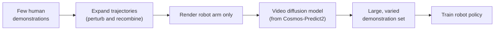

## Introduction

- This is the second customer story. It shows how **Toyota Research Institute (TRI)** builds on Cosmos for "faster robot learning for rolling out policies."
- TRI's AnchorDream paper states it: collecting large scale, diverse robot demonstrations is a major bottleneck, since real world data is costly and simulators offer limited diversity and fidelity with sim-to-real gaps.
- There are mainly **three research projects** from TRI wwhich using NVIDIA stack
    1. **Egocentric world models from internet priors**
    2. **AnchorDream: Embodiment aware robot data synthesis**.
    3. **AnyView: Synthesizing any novel view in dynamic scenes**

- The idea behind all three projects is to **reuse a pretrained video model** that has already learned how the world looks and moves, instead of training a new model from scratch.

## Three Projects

### 1. Egocentric world models from internet priors (EgoWM)

- An **egocentric** view is a first person view, as seen from a robot's or person's own camera.

1. TRI and university co-authors describe EgoWM as a simple, architecture agnostic method that turns any pretrained video diffusion model into an **action-conditioned world model**, meaning one that predicts how the view changes when given actions.
2. It injects motor commands through lightweight conditioning layers, so it needs only modest fine-tuning.
3. It works from 3-DoF mobile robots up to 25-DoF humanoids, for both navigation and manipulation.
4. The paper introduces a **Structural Consistency Score (SCS)**, which checks whether stable scene elements evolve consistently with the given actions.
5. The paper's title, "Walk through Paintings", comes from a demonstration of navigating inside paintings, which shows generalization to unseen environments.

### 2. AnchorDream: embodiment aware robot data synthesis

- **Embodiment aware** means the generated video keeps the robot's body correct.

1. Starting from a small set of human teleoperation demonstrations, new robot trajectories are created by perturbing and recombining the original motions.
2. Only the **robot arm motion** is rendered, with no objects or background. This clean video of the arm moving is the conditioning signal.
3. A video diffusion model then generates the objects, scene and interactions that fit that motion. Anchoring on the robot's motion prevents the model from inventing a robot body that cannot move that way.
4. The model is **fine-tuned from Cosmos-Predict2 2B** on the small demonstration set, using LoRA, trained on 8 NVIDIA A100 GPUs over three days.

### 3. AnyView: synthesizing any novel view in dynamic scenes

- TRI's authors describe AnyView as a diffusion-based video generation framework for **dynamic view synthesis**: showing a moving scene from a camera angle that was never recorded, with minimal geometric assumptions. 
- This is the multiview idea from the Transfer, applied to dynamic scenes.

> **Why it matters?:** Each project turns a general purpose video model into something robot specific with little extra training, which is the "post training" idea.

## Results

- **Reduced training cost**
- **Zero shot scene generation** 
- **36% relative improvement in robot policy performance** 
- **Action conditioned world models**

### Other AnchorDream results from the TRI paper:

1. On a real robot, six everyday tasks improved from 28% average success with 50 human demonstrations per task to roughly 60 to 63% when 10 times more generated demonstrations were added, described as nearly doubling performance. The paper's text and table give slightly different totals (60.0% in the text and 63% in the table), so say "nearly doubled".
2. A policy trained on the generated data alone (24.8%) slightly beat one trained on the 50 human demonstrations (22.5%).
3. The oracle upper bound from simulator-executed data was 33.3%, so AnchorDream recovered much of that gap without a simulator.

## How This Relates to NVIDIA's Own Work?

- NVIDIA's **Cosmos Policy** takes a similar approach: it post-trains Cosmos Predict 2 on robot demonstration data, so one model predicts actions, future observations and expected success. 
- NVIDIA reports state-of-the-art results on the LIBERO and RoboCasa benchmarks.
- This is separate from TRI's work, but it shows the same trend of building policies on a pretrained video world model.

## Summary

1. **TRI** builds robot learning methods on top of pretrained video models, including Cosmos.
2. **EgoWM** turns a video model into an action-conditioned first-person world model, **AnchorDream** synthesizes robot demonstrations anchored on robot motion, and **AnyView** generates new camera views of dynamic scenes.
3. AnchorDream is fine-tuned from Cosmos-Predict2 2B and raised simulator policy success by 36.4% relative, and nearly doubled real-robot success.
4. EgoWM reports up to 80% better structural consistency than prior navigation world models.
5. The sources are TRI's own papers, not NVIDIA pages.

## References

1. [TRI and USC, "Repurposing Video Diffusion for Embodiment-Aware Robot Data Synthesis" (AnchorDream, arXiv)](https://arxiv.org/html/2512.11797v1)
2. [Bagchi et al., "Walk through Paintings: Egocentric World Models from Internet Priors" (EgoWM, arXiv)](https://arxiv.org/abs/2601.15284v1)
3. [NVIDIA on Hugging Face, "Introducing NVIDIA Cosmos Policy for Advanced Robot Control"](https://huggingface.co/blog/nvidia/cosmos-policy-for-robot-control)
4. [NVIDIA press release, "NVIDIA and Global Robotics Leaders Take Physical AI to the Real World"](https://investor.nvidia.com/news/press-release-details/2026/NVIDIA-and-Global-Robotics-Leaders-Take-Physical-AI-to-the-Real-World/default.aspx)
5. [NVIDIA Cosmos-Predict2 on GitHub](https://github.com/nvidia-cosmos/cosmos-predict2)
