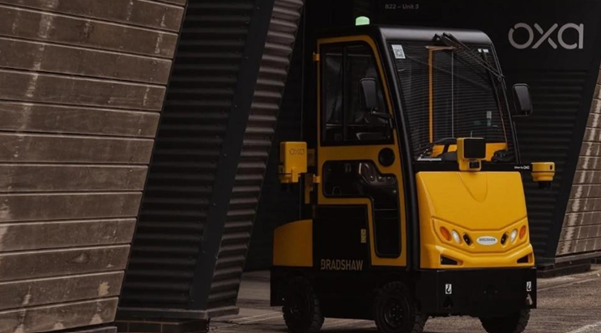
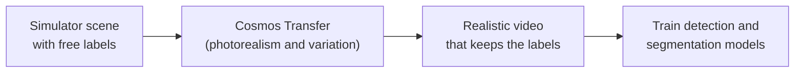

## Introduction

- This is the third customer story. It shows how **Oxa**, an autonomous vehicle software company, uses **Cosmos Transfer** to produce **labeled synthetic data**.

## Who Oxa Is?

- Oxa makes autonomous vehicle software for industrial and commercial fleets. 
- Its CEO describes customers as places such as a port, an airport or an industrial facility that want autonomous vehicles doing something useful there.
- Oxa's development toolchain is called **Oxa Foundry**.

Example: it is an industrial vehicle, not a passenger car.

## Problem That Creates the Need

- Oxa's own blog describes the challenge. The company collects large amounts of real sensor data every week, but edge cases are rare and the data volume makes them hard to find. 
- Oxa says that driving around waiting for edge cases to occur naturally is not feasible, so it generates synthetic data instead.

| Problem | Why it hurts? |
|---------|--------------|
| Each customer site looks different | New camera layouts and surroundings for every deployment |
| Rare edge cases | Too uncommon to wait for them |
| Training perception models needs **labels** | Labeling real images by hand is slow |

## What "Labeled Synthetic Data" Means?

- The key idea is **labeled**. In a simulator, the computer already knows what everything in the scene is, so labels come for free. 

- NVIDIA's Cookbook recipes describe this workflow:

1. Simulate a scene. Extract the **ground truth** from the simulation, such as depth, segmentation and 2D or 3D bounding boxes.
2. Use **Cosmos Transfer** to turn the simulated video into photorealistic video.
3. NVIDIA says this keeps the structural integrity and semantic information of the original simulator data, so the new video can keep the labels that came with the simulation.

> **Why it matters?:** the labels are the expensive part of training a perception model. If Transfer preserves the geometry, one set of labels can serve many realistic variations. 

## Oxa's reported benefits

- **Speed gains across real-to-real and sim-to-real workflows:**
    - **Sim-to-real** starts with simulator video and makes it realistic.
    - **Real-to-real** starts with real video and creates realistic variations of it (new weather, lighting, scene). Both get faster.
- **Improved detection and segmentation:** Perception models that find and outline objects perform better when trained with this data.
- **Boosts downstream task performance:** The data helps the models that use it.
- **Using Cosmos Transfer for diverse camera layouts and rare edge cases:** Generate the camera setups and unusual situations that are hard to capture.

## What NVIDIA and Oxa Say?

- Oxa has integrated Cosmos Transfer into its own development toolchain, Oxa Foundry. NVIDIA says Cosmos Transfer supports image and image-sequence transformation, customized to specific use cases.
- Oxa is also using Cosmos Predict to generate multi-camera videos with high fidelity and temporal consistency.
- Oxa combines **retrieval and generation**: it uses NVIDIA Cosmos Dataset Search to find data that exists, and Cosmos models plus its own Oxa Sensor Expansion to synthesize data that does not, such as edge cases.

- The second row ties Oxa to the **Dataset Search**, and the first and third to the **Transfer** and **data augmentation**.

> The Oxa blog describes using Cosmos Dataset Search together with Cosmos generation to turn unstructured data into structured training sets. That is the same "curate, search, augment" idea as the Data Factory blueprint.

## Summary

1. **Oxa** builds autonomous vehicle software for industrial fleets, with its toolchain called **Oxa Foundry**.
2. It uses **Cosmos Transfer** to turn simulator or real video into varied, realistic data that keeps its labels.
3. Oxa claims speed gains, better detection and segmentation, better downstream performance, and coverage of diverse camera layouts and rare edge cases.
4. NVIDIA confirms that Oxa integrated Cosmos Transfer into Oxa Foundry and uses Cosmos Predict for multi-camera video.

## References

1. [NVIDIA Technical Blog, "Simplify End-to-End Autonomous Vehicle Development with New NVIDIA Cosmos World Foundation Models"](https://developer.nvidia.com/blog/simplify-end-to-end-autonomous-vehicle-development-with-new-nvidia-cosmos-world-foundation-models/)
2. [NVIDIA Blog, "NVIDIA Releases New AI Models and Developer Tools to Advance Autonomous Vehicle Ecosystem"](https://blogs.nvidia.com/blog/autonomous-vehicle-ecosystem-ai-models-developer-tools)
3. [NVIDIA Cosmos Cookbook, "Cosmos Transfer 2.5 Sim2Real for Simulator Videos"](https://nvidia-cosmos.github.io/cosmos-cookbook/recipes/inference/transfer2_5/inference-carla-sdg-augmentation/inference.html)
4. [NVIDIA Cosmos Cookbook, "Synthetic Data Generation (SDG) for Traffic Scenarios"](https://nvidia-cosmos.github.io/cosmos-cookbook/recipes/end2end/smart_city_sdg/workflow_e2e.html)
5. [NVIDIA VSS documentation, "Sim2Real Data Transfer"](https://docs.nvidia.com/vss/latest/warehouse-docs/Sim2Real-Data-Transfer.html)
6. [Oxa blog, "Accelerating self-driving software development with multimodal search" (company page, not NVIDIA)](https://oxa.tech/news-and-insights/accelerating-self-driving-software-development-with-multimodal-search/)
