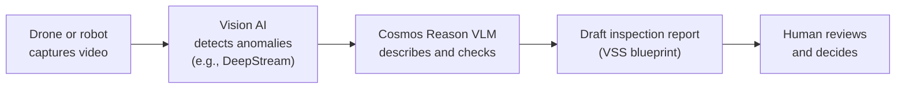

## Introduction

- This is the fourth customer story. It shows **Levatas**, a company that automates visual inspection, applied to the **power grid**.
- Utilities maintain very long networks of power lines and equipment, and inspecting them is slow and can be dangerous.
- Levatas's blog describes the review side of the problem: after footage is captured, hours go into watching video and writing time-stamped summaries.

| Problem | Why it hurts? |
|---------|--------------|
| Long networks to inspect | Takes crews a long time to cover |
| Hazardous locations | Energized lines and tall structures put workers at risk |
| Lots of footage | Someone must watch it and write the report |

- So levatas is Automated inspection of thousands of miles of power grid

## What Levatas Does?

- Levatas AI lets mobile robots, autonomous drones and unmanned submersibles understand what they see and alert people to safety, security and maintenance anomalies.
- Levatas announced integration of **NVIDIA Metropolis** vision language models, fine-tuning, and the **NVIDIA Blueprint for Video Search and Summarization (VSS).**
- With VSS, vision language models and generative AI draft detailed inspection reports from captured footage, saving hours of reviewing and writing time stamped summaries.  
- For American Electric Power (AEP), Levatas connects with the **Skydio X10 drone and dock** to examine power poles, find thermal anomalies and identify equipment wear.
- Levatas's utility product, **InFlightAI**, uses NVIDIA tools including **DeepStream** and the **Cosmos Reason VLM** for AI analysis and automated reporting.

- This is the "video analytics agent" use case. A drone captures video, a vision language model describes what it sees, and a report is drafted automatically.

## How the Pieces Fit?

- This pipeline is my summary of Levatas's descriptions, not an NVIDIA or levatas diagram. 
- Levatas's materials also mention a **human in the loop** feature, so a person confirms what the AI finds.

## Summary

1. **Levatas** automates visual inspection, here for the electric power grid, using drones and AI.
2. By its own account, it integrates NVIDIA Metropolis vision language models and the VSS blueprint, and uses Cosmos Reason for analysis and automated reporting.
3. The idea is to cut the time spent reviewing footage and writing reports, with a human confirming the AI's findings.

## References

1. [Levatas blog, "Revolutionizing Asset Inspection: Levatas AI integrates NVIDIA Metropolis platform into their Computer Vision Solutions" (company page, not NVIDIA)](https://levatas.com/blog/levatas-ai-integrates-nvidia-metropolis)
2. [Levatas website (company page, not NVIDIA)](https://levatas.com/)
3. [Levatas on LinkedIn (company page, not NVIDIA)](https://linkedin.com/company/levatas)
4. [Skydio, "Flight to Insight: Levatas and Skydio Dock for X10" (partner page, not NVIDIA)](https://skydio.com/resources/videos/flight-to-insight-levatas-skydio-dock-for-x10)
5. [NVIDIA AI Blueprint for video search and summarization on GitHub](https://github.com/NVIDIA-AI-Blueprints/video-search-and-summarization)
6. [NVIDIA Blog, "Making Safer Spaces: NVIDIA and Partners Bring Physical AI to Cities and Industrial Infrastructure"](https://blogs.nvidia.com/blog/physical-ai-partners-metropolis-updates-siggraph/)
7. [NVIDIA Customer Story, "Exelon Leads Utility Innovation With Deloitte in Autonomous Drones for Grid Asset Inspection"](https://www.nvidia.com/en-us/case-studies/exelon/)
