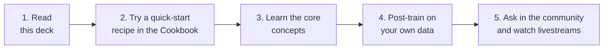

## Cosmos Cookbook

- NVIDIA describes the Cookbook as step-by-step recipes to bootstrap physical AI workflows, from data generation to evaluation, using Cosmos tools and examples [[1]](https://nvidia-cosmos.github.io/cosmos-cookbook/).
- It is the best place to start if you want to *do* something, not just read.
- What is included in the Cookbook? [[1]](https://nvidia-cosmos.github.io/cosmos-cookbook/)
    - **Quick-start inference examples**
    - **Advanced post-training workflows**
    - **Proven recipes for scalable, production-ready deployments**
    - **Deep-dive on core concepts**

### How the Cookbook is organized

1. **Getting Started** and a **Gallery**, with **Robotics** and **Autonomous Driving** sections [[1]](https://nvidia-cosmos.github.io/cosmos-cookbook/).
2. **Recipes**, grouped as Inference, Post-training, Data curation and Additional examples [[1]](https://nvidia-cosmos.github.io/cosmos-cookbook/).
3. **Core Concepts**, covering Control Modalities, Data Curation, Post-Training, Evaluation and Distillation [[1]](https://nvidia-cosmos.github.io/cosmos-cookbook/).
4. A **Glossary**, an **FAQ** and a **Contributing** page [[1]](https://nvidia-cosmos.github.io/cosmos-cookbook/).

## Getting Started and Learning Resources

### 1. Community

1. Hugging Face is where NVIDIA publishes Cosmos models and datasets [[8]](https://huggingface.co/nvidia).
2. NVIDIA's developer page also points to a **Cosmos Discord**, where people can ask questions, share projects and get support from NVIDIA experts and the community [[3]](https://www.nvidia.com/en-us/lp/ai/physical-ai-open-world-foundation-models/).
3. NVIDIA's developer forums have a **Cosmos** tag with announcements and Q&A [[4]](https://forums.developer.nvidia.com/tag/cosmos).

### 2. Developer Blogs and Documentation

1. NVIDIA's **technical blog** [[9]](https://developer.nvidia.com/blog).
2. NVIDIA's **Cosmos documentation** [[10]](https://docs.nvidia.com/cosmos/latest/) covers the individual models.

### 3. Livestreams

1. NVIDIA's developer page lists livestreams including **Intro to NVIDIA Cosmos** with its creator, **Build Reasoning Agents for Physical AI**, and **Physical AI in Action** with Milestone Systems, PlusAI and Telit Cinterion [[3]](https://www.nvidia.com/en-us/lp/ai/physical-ai-open-world-foundation-models/).
2. NVIDIA's forums also list a **Getting Started with NVIDIA Cosmos 3** livestream [[6]](https://forums.developer.nvidia.com/t/livestream-getting-started-with-nvidia-cosmos-3-for-robotics-and-physical-ai-cosmos-labs/372325), and "Ask Me Anything" sessions that ran alongside the **Cosmos Cookoff**, a physical AI challenge held in early 2026 [[5]](https://forums.developer.nvidia.com/t/the-nvidia-cosmos-cookoff-is-here/358995).

## Simple Learning Path

| If you want to... | Start here |
|-------------------|------------|
| Run a model | Cookbook quick start inference [[1]](https://nvidia-cosmos.github.io/cosmos-cookbook/) |
| Customize a model | Cookbook post training recipes [[1]](https://nvidia-cosmos.github.io/cosmos-cookbook/) |
| Build a video agent | VSS documentation [[7]](https://docs.nvidia.com/vss/latest/) |
| Get the code | NVIDIA Cosmos on GitHub [[2]](https://github.com/nvidia-cosmos) |
| Get help | Cosmos Discord [[3]](https://www.nvidia.com/en-us/lp/ai/physical-ai-open-world-foundation-models/) and the developer forums [[4]](https://forums.developer.nvidia.com/tag/cosmos) |
| Learn from experts | Livestreams [[3]](https://www.nvidia.com/en-us/lp/ai/physical-ai-open-world-foundation-models/) [[6]](https://forums.developer.nvidia.com/t/livestream-getting-started-with-nvidia-cosmos-3-for-robotics-and-physical-ai-cosmos-labs/372325) and Q&A sessions [[5]](https://forums.developer.nvidia.com/t/the-nvidia-cosmos-cookoff-is-here/358995) |

## References

1. [NVIDIA Cosmos Cookbook](https://nvidia-cosmos.github.io/cosmos-cookbook/)
2. [NVIDIA Cosmos on GitHub (nvidia-cosmos organization)](https://github.com/nvidia-cosmos)
3. [NVIDIA, "Advance Your Physical AI Development With Open World Foundation Models" (developer resources page)](https://www.nvidia.com/en-us/lp/ai/physical-ai-open-world-foundation-models/)
4. [NVIDIA Developer Forums, Cosmos tag](https://forums.developer.nvidia.com/tag/cosmos)
5. [NVIDIA Developer Forums, "The NVIDIA Cosmos Cookoff is Here!"](https://forums.developer.nvidia.com/t/the-nvidia-cosmos-cookoff-is-here/358995)
6. [NVIDIA Developer Forums, "[Livestream] Getting Started with NVIDIA Cosmos 3 for Robotics and Physical AI"](https://forums.developer.nvidia.com/t/livestream-getting-started-with-nvidia-cosmos-3-for-robotics-and-physical-ai-cosmos-labs/372325)
7. [NVIDIA VSS documentation](https://docs.nvidia.com/vss/latest/)
8. [NVIDIA on Hugging Face (Cosmos models and datasets)](https://huggingface.co/nvidia)
9. [NVIDIA Technical Blog](https://developer.nvidia.com/blog)
10. [NVIDIA Cosmos documentation](https://docs.nvidia.com/cosmos/latest/)